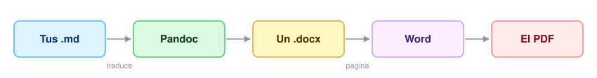
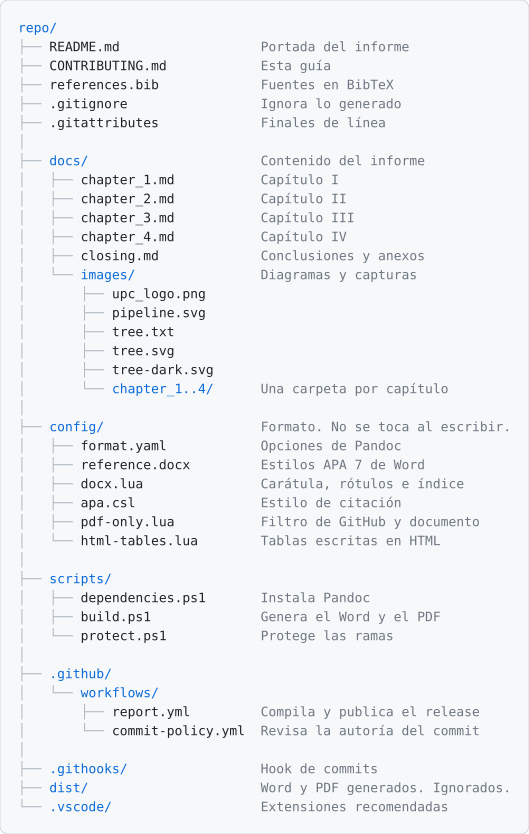

# Guía para contribuir al informe

El informe se escribe en Markdown y se exporta a Word y a PDF con formato APA 7.
Dos herramientas hacen ese trabajo:



Pandoc traduce el Markdown a un documento de Word, resuelve las citas y aplica los
estilos APA 7 de una plantilla. No sabe nada de páginas: eso lo calcula Word, que
es quien decide dónde corta cada línea y cada página, llena el índice con sus
números de página y exporta el PDF. El build abre Word por su cuenta, así que tú
corres un comando y no dos.

## Dependencias

| Herramienta | Uso |
| --- | --- |
| Pandoc | Convierte el Markdown a un documento de Word |
| Microsoft Word | Llena el índice y exporta el PDF |

Abre PowerShell en la raíz de la carpeta del proyecto y corre esto antes de
compilar por primera vez:

```powershell
.\scripts\dependencies.ps1
```

Comprueba las dos, instala Pandoc si falta, previa confirmación, y no hace nada si
ya está. Word no lo instala: viene con Microsoft 365. Sin Word el build igual
genera el `.docx`, pero el índice queda vacío y no sale el PDF. Puedes correrlo las
veces que quieras.

> [!NOTE]
> Después de una instalación hay que abrir una terminal nueva. Windows no refresca
> el PATH en las ventanas que ya estaban abiertas.

## Compilación

Desde la raíz del proyecto:

```powershell
.\scripts\build.ps1 <av1|tb1|av2|tb2>
```

El parámetro es obligatorio. Decide qué capítulos entran y cómo se llaman los
archivos que salen:

```
dist/upc-pre-<periodo>-1acc0238-<nrc>-<startup>-report-<entrega>.docx
dist/upc-pre-<periodo>-1acc0238-<nrc>-<startup>-report-<entrega>.pdf
```

El build tarda uno o dos minutos, casi todo en Word, que abre el documento,
actualiza el índice y lo exporta. El PDF es el que se entrega; el `.docx` sirve
para revisar o para un último retoque a mano, pero ese retoque se pierde en el
siguiente build: lo que tenga que quedar se corrige en el Markdown.

Los estilos APA 7 (Times New Roman 12, interlineado 1.5, sangría de 0.5 in en la
primera línea, alineación a la izquierda, márgenes de 1 in, los cinco niveles de
título, número de página arriba a la derecha, sangría francesa en las referencias
y control de viudas y huérfanas) vienen de `config/reference.docx`. Lo que un
estilo no puede hacer solo (la carátula, el índice, los rótulos "Tabla N" y
"Figura N", los títulos de cuarto y quinto nivel en línea con su párrafo, el
tamaño de las figuras) lo hace `config/docx.lua`.

`config/reference.docx` no se edita a mano: se regenera con
`python scripts/reference-docx.py`, que es donde está escrita cada regla.

> [!NOTE]
> Word no hace flotar las figuras: una imagen alta que no cabe en lo que queda de
> la página pasa a la siguiente y deja un hueco. Antes de entregar, recorre el PDF
> y revisa que no queden huecos grandes ni títulos solos al pie.

## Estructura

<picture>
  <source media="(prefers-color-scheme: dark)" srcset="docs/images/tree-dark.svg">
  
</picture>

## Flujo de trabajo

| Rama | Para qué sirve |
| --- | --- |
| `main` | Solo estados entregables. De aquí salen las entregas. |
| `develop` | Donde se integra el trabajo del equipo. |
| `feature/*` | Una por sección del informe. Vive uno o dos días. |

### Escribir una sección

Sales de `develop` actualizada y abres tu rama:

```powershell
git switch develop
git pull
git switch -c feature/2-3-needfinding
```

El nombre lleva el número de la sección y una palabra que la identifique. Así el
historial dice quién escribió qué, que es parte de lo que se califica.

Escribes, haces tus commits y cuando la sección esté lista la subes:

```powershell
git push -u origin feature/2-3-needfinding
```

Abres la Pull Request hacia `develop`, un compañero la revisa, y al mergear se borra
la rama:

```powershell
gh pr merge --merge --delete-branch
```

Ese `--delete-branch` no es cosmético. En un ciclo se acumulan decenas de ramas y sin
borrarlas nadie distingue las vivas de las terminadas.

> [!TIP]
> Cierra tus ramas rápido. Una rama abierta una semana acumula divergencia con
> `develop` y termina en conflictos de cosas que ni tocaste. Si una sección te va a
> llevar más de dos días, pártela.

Como cada capítulo es un solo archivo, dos personas escribiendo a la vez en
secciones distintas del mismo capítulo van a chocar al mergear la segunda rama. El
conflicto se resuelve en un minuto, porque los dos bloques se conservan, pero
conviene repartirse los capítulos para no toparse.

### Entregar

Cuando el informe está listo para AV1, TB1, AV2 o TB2, una Pull Request de `develop`
a `main`. Es la única forma en que `main` cambia.

Con eso mergeado, el tag dispara la compilación y publica el release con el
documento de Word:

```powershell
git tag av1
git push origin av1
```

Los servidores de GitHub no tienen Word, así que el PDF no sale de ahí. Se genera
en una máquina del equipo desde `main` con `.\scripts\build.ps1 av1`, se revisa y
se adjunta al release:

```powershell
gh release upload av1 dist/upc-pre-202620-1acc0238-13980-Kerolabs-report-av1.pdf
```

### Protección de ramas

`main` y `develop` rechazan los pushes directos. Todo entra por Pull Request y con
el check `commit-policy` en verde, incluidos los administradores.

> [!WARNING]
> Esa configuración vive en los ajustes del repositorio, no en sus archivos, así que
> no se copia al crear un repositorio nuevo a partir de este. Para replicarla:
>
> ```powershell
> .\scripts\protect.ps1 <owner/repo>
> ```
>
> Las dos ramas tienen que existir en el remoto y el workflow tiene que haber
> corrido al menos una vez, para que GitHub conozca el check.

## Commits

Los mensajes van **en inglés** y siguen [Conventional Commits](https://www.conventionalcommits.org):
un tipo, dos puntos y qué hace el cambio.

```
feat: add user personas to chapter 2
fix: correct the sprint 1 backlog table
docs: update the version log
```

`feat` para contenido nuevo, `fix` para correcciones, `docs` para la documentación
del repositorio y `chore` para configuración.

> [!IMPORTANT]
> El enunciado exige GitFlow y Conventional Commits, y los evalúa mirando el
> historial y los analíticos de colaboración. No es una preferencia del equipo: es
> parte de la nota, igual que el contenido del informe.

El formato se comprueba en dos sitios, uno en tu máquina y otro en el servidor:

| Control | Dónde actúa | Se salta con |
| --- | --- | --- |
| `.githooks/commit-msg` | Al hacer commit, en tu equipo | `git commit --no-verify` |
| `commit-policy.yml` | En cada push y cada Pull Request | Nada |

Los dos aplican las mismas reglas: la primera línea sigue Conventional Commits
(`tipo: descripción`, con los tipos `feat`, `fix`, `docs`, `style`, `refactor`,
`perf`, `test`, `build`, `ci`, `chore` y `revert`), y el commit se atribuye a un
integrante del equipo, así que los pies que algunas herramientas añaden solos al
mensaje (`Co-authored-by`, `Generated with`) se quitan antes de subir. Los commits
de merge y de revert que generan git y GitHub quedan exentos.

El hook lo activa `dependencies.ps1`. Si un commit ya salió mal y todavía no lo
subiste, `git commit --amend` lo arregla.

## Convenciones de escritura

> [!IMPORTANT]
> Varias de estas reglas no producen ningún error al compilar. El PDF se genera
> igual, pero con el contenido mal formado, y te enteras al abrirlo.

### Encabezados

La numeración se escribe a mano, dentro del título. El build no numera nada, para
que el documento diga exactamente lo que pide el enunciado.

```markdown
# Capítulo I: Presentación
## 1.1. Startup Profile
### 1.1.1. Descripción de la Startup
#### 1.1.1.1. Subnivel
```

Cada `#` de primer nivel abre página nueva. El índice llega hasta el tercer nivel;
los más profundos salen en el documento pero no se listan. Para forzar un salto,
`\newpage` en una línea propia.

### Separadores y emojis

Usa `***` para una línea separadora, con una línea en blanco antes y después.

> [!CAUTION]
> No uses `---`. Esa secuencia también significa "cabecera de tabla" y "bloque de
> metadatos" en Markdown, y según lo que tenga alrededor convierte tu texto en una
> tabla o lo hace desaparecer del PDF sin avisar.

El build desactiva la interpretación como metadatos con
`--from=markdown-yaml_metadata_block`, que era la que borraba contenido en silencio.
La ambigüedad con las tablas sigue ahí.

No uses emojis. Times New Roman no tiene glifos para ✕, ⊘ o 🔗: Word los dibuja
con otra fuente y desentonan con el texto. Si necesitas marcar estados en una
tabla, escríbelos con palabras.

### Tablas

Las tablas del informe se escriben en HTML. Markdown solo sabe de cuadrículas
regulares, y varios cuadros del enunciado necesitan celdas que abarquen varias
columnas o filas: el de cada User Story, el Competitive Analysis Landscape, el Sprint
Backlog. HTML lo expresa con `colspan` y `rowspan`, y una sola forma de escribir
tablas evita mezclar dos sintaxis en el mismo capítulo.

```html
<table>
  <thead>
    <tr>
      <th>Story ID</th>
      <th>User</th>
      <th>Priority</th>
      <th>Epic</th>
    </tr>
  </thead>
  <tbody>
    <tr>
      <td>US01</td>
      <td>Cabeza de junta</td>
      <td>Alta</td>
      <td>EP01</td>
    </tr>
    <tr>
      <td><b>Title</b></td>
      <td colspan="3">Crear cuenta</td>
    </tr>
    <tr>
      <td><b>Description</b></td>
      <td colspan="3">Como cabeza de junta deseo crear mi cuenta para administrar mis juntas desde la aplicación.</td>
    </tr>
    <tr>
      <td><b>Acceptance Criteria</b></td>
      <td colspan="3"><b>Escenario 1:</b> registro correcto<br>Given que el visitante no tiene cuenta<br>When registra sus datos<br>Then el sistema crea la cuenta</td>
    </tr>
  </tbody>
</table>
```

Una etiqueta por línea, sangría de dos espacios por nivel y el contenido de cada
celda en la misma línea que su `<td>`. Así una fila se lee de un vistazo y el diff de
una Pull Request muestra exactamente qué celda cambió. No sangres el contenido en
una línea aparte con cuatro espacios o más: Markdown lo tomaría por un bloque de
código.

`config/html-tables.lua` convierte la tabla antes de exportar, con las celdas
combinadas, el ancho
de cada columna repartido según su contenido. Reglas para que salga bien en GitHub
y en Word a la vez:

- Línea en blanco antes de `<table>` y después de `</table>`.
- Cabecera dentro de `<thead>` y con celdas `<th>`; se imprime una sola vez,
  aunque la tabla siga en la página siguiente.
- Negrita y cursiva con `<b>` y `<i>`, no con `**` ni `*`. GitHub no interpreta
  Markdown dentro de una tabla HTML, así que los asteriscos se verían tal cual en
  el repositorio, aunque en Word salgan bien. Lo mismo con imágenes y enlaces:
  `` y `<a href="url">texto</a>`.
- Salto de línea dentro de una celda con `<br>`.
- Columna centrada con `align="center"` en cada una de sus celdas.
- Las citas `[@clave]` sí funcionan dentro de las celdas.
- Si el reparto automático de anchos no convence, fíjalos a mano con
  `<colgroup><col width="20%"><col width="80%"></colgroup>` justo después de
  `<table>`. Al ver un `<col>`, el filtro respeta esos anchos y no calcula nada.
- Una celda con `rowspan` no se puede partir entre dos páginas. Si la tabla es
  larga, úsalo solo en filas cortas.
- Un identificador largo sin espacios (`RegisterContributionCommand`,
  `/api/v1/periods/{id}`) se corta solo en los límites CamelCase y después de
  `/`, `.` o `_`. Lo hace `config/docx.lua` únicamente dentro de tablas; no hace
  falta partirlo a mano. En las celdas, y solo ahí, Word además parte las
  palabras con guion cuando la columna es angosta.

Todas las tablas salen con la cuadrícula completa: borde, una línea entre filas y
una entre columnas, a espacio simple. Lo define el estilo de tabla de
`config/reference.docx`. APA 7 pide solo tres líneas horizontales; el equipo
prefirió la cuadrícula porque en cuadros con celdas combinadas y texto largo se
lee mejor.

> [!CAUTION]
> `<div align="center">` y cualquier otra etiqueta HTML que no sea `<table>` y lo
> que va dentro de ella se descarta al exportar, sin ningún mensaje de error: queda
> el texto, se pierde el formato.

#### Saltos de línea dentro de una celda

**Usa `<br>`.** El contenido de una celda va en una sola línea del archivo; `<br>` es
la forma de bajar de línea sin salir de ella.

```html
<tr>
  <td>Comunica oralmente</td>
  <td><b>Apellido, Nombre</b><br><i>AV1:</i> Lo que hizo.<br><i>TB1:</i> Lo que hizo.<br><br><b>Otro Apellido, Nombre</b><br><i>AV1:</i> Lo que hizo.</td>
</tr>
```

Dos `<br>` seguidos dejan una línea en blanco, que es lo que separa a un integrante
del siguiente. Sin esto, una celda como las del Student Outcome sale en Word como
un párrafo corrido donde el nombre de una persona aparece en mitad de la frase de
otra, y no se distingue quién hizo qué.

Fuera de una tabla, `<br>` es la única etiqueta HTML que sobrevive a la
exportación, y solo porque `config/pdf-only.lua` la traduce a un salto de línea de
verdad.

### Diagramas

Los diagramas de arquitectura se escriben como texto en `docs/architecture/` y se
regeneran con Docker; las imágenes resultantes se copian a `docs/images/chapter_2/`.

| Fuente | Herramienta | Salida |
| --- | --- | --- |
| `workspace.dsl` | Structurizr (C4: contexto, contenedores, componentes, despliegue) | `c4_*.png` |
| `uml/*.puml` | PlantUML (diagramas de clases) | `uml_*.png` |
| `db/*.puml` y `db/*.sql` | PlantUML (entidad-relación) y el DDL de cada esquema | `db_*.png` |

```powershell
docker run --rm -e PLANTUML_LIMIT_SIZE=16384 -v "${PWD}/docs/architecture:/data" plantuml/plantuml -tpng -o out "/data/uml/*.puml" "/data/db/*.puml"
```

```powershell
docker run -d --name structurizr -p 8080:8080 -v "${PWD}/docs/architecture:/usr/local/structurizr" structurizr/structurizr local
```

Structurizr renderiza en el navegador: abre `http://localhost:8080`, entra a cada
vista y usa su botón de exportar a PNG. Las carpetas `out/` no se versionan.

### Imágenes

La ruta se escribe relativa al archivo `.md` que la referencia, y así funciona tanto
en GitHub como en Word.

```markdown
{width=85%}
```

Cada imagen va en la carpeta de su capítulo. El logo y las fotos del equipo, en la
raíz de `docs/images/`.

Ancho máximo: **1600 píxeles**. Una imagen ocupa como mucho 6,5 pulgadas de ancho,
así que 1600 px ya son 245 puntos por pulgada; más resolución no se distingue,
pero engorda el `.docx` y el PDF y alarga el build. Reduce la captura antes de
subirla, con cualquier editor o con este comando:

```powershell
python -c "from PIL import Image; im=Image.open('captura.png'); r=1600/im.width; im.resize((1600, round(im.height*r)), Image.LANCZOS).save('captura.png', optimize=True)"
```

Una imagen más alta que la página se reduce sola a 7 pulgadas de alto, para que
quepa junto con su título y su nota; lo hace `config/docx.lua`.

### Contenido distinto en GitHub y en el documento

El `README.md` necesita las dos cosas: una tabla de contenidos con enlaces para
navegar los `.md` en GitHub, y el índice con números de página en el documento.
Los marcadores en comentarios HTML lo resuelven, porque GitHub los ignora y Pandoc
los lee. Conservan el nombre `pdf` de cuando el informe se compilaba con LaTeX.

```markdown
<!-- pdf:omit-start -->
Esto se ve en GitHub y no sale en el documento.
<!-- pdf:omit-end -->

<!-- pdf:only
\tableofcontents
-->
```

Lo que va dentro de `pdf:only` se interpreta como Markdown, así que acepta bloques
de Pandoc (`::: {#refs}`) y tres comandos que `config/docx.lua` traduce a Word:
`\tableofcontents` (el índice), `\newpage` y `\clearpage` (un salto de página).
Como está dentro de un comentario, en GitHub no se ve nada.

De eso se encarga `config/pdf-only.lua`, que el build pasa con `--lua-filter`.

> [!NOTE]
> La tabla de contenidos con enlaces del README se mantiene a mano. Si agregas o
> renombras un encabezado, actualiza también el enlace. El índice del documento sí
> se genera solo.

### Citas y bibliografía

La lista de referencias se genera sola. No se escribe a mano.

**Uno.** Agrega la fuente a `references.bib`. En Google Scholar la sacas del botón
de comillas, opción BibTeX. La primera palabra de la entrada es la clave con la que
la vas a citar.

```bibtex
@book{evans2003ddd,
  author    = {Evans, Eric},
  title     = {Domain-Driven Design},
  publisher = {Addison-Wesley},
  year      = {2003}
}
```

Para herramientas de software usa `@software` en lugar de `@book`. APA añade sola la
etiqueta `[Computer software]` y el número de versión.

**Dos.** Cítala en el texto.

| Sintaxis | Resultado |
| --- | --- |
| `[@evans2003ddd]` | (Evans, 2003) |
| `[-@evans2003ddd]` | (2003), para citas narrativas |
| `[@evans2003ddd, p. 45]` | (Evans, 2003, p. 45) |
| `[@clave1; @clave2]` | (Autor A, 2020; Autor B, 2021) |

**Tres.** Ya está. La entrada aparece en la bibliografía, ordenada alfabéticamente y
con sangría francesa.

Una fuente que no cites no aparece, y así debe ser: APA solo lista lo que se cita.

> [!CAUTION]
> En `docs/closing.md` hay un bloque que parece vacío y que no se debe borrar:
>
> ```markdown
> # Bibliografía
>
> <!-- pdf:only
> ::: {#refs}
> :::
> -->
> ```
>
> Marca el punto donde se inserta la lista de referencias. Sin él, Pandoc la pega al
> final de todo el documento, o sea después de los anexos.
