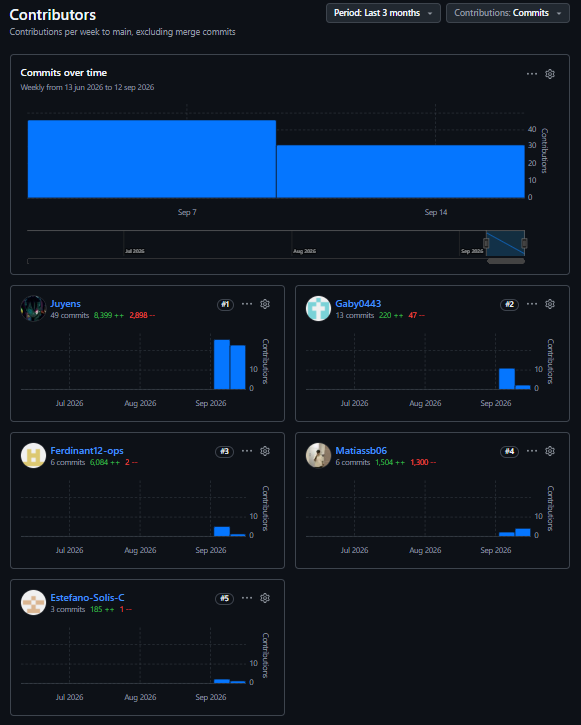
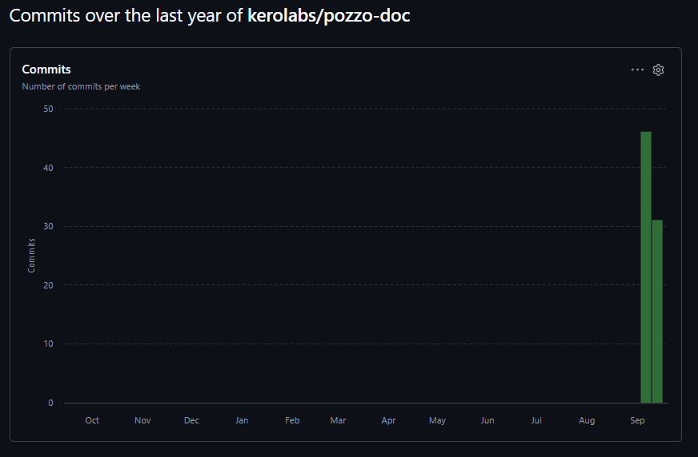
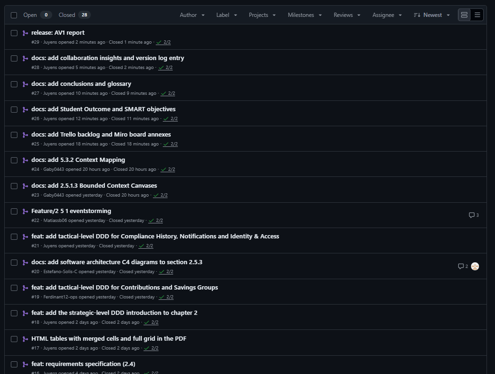
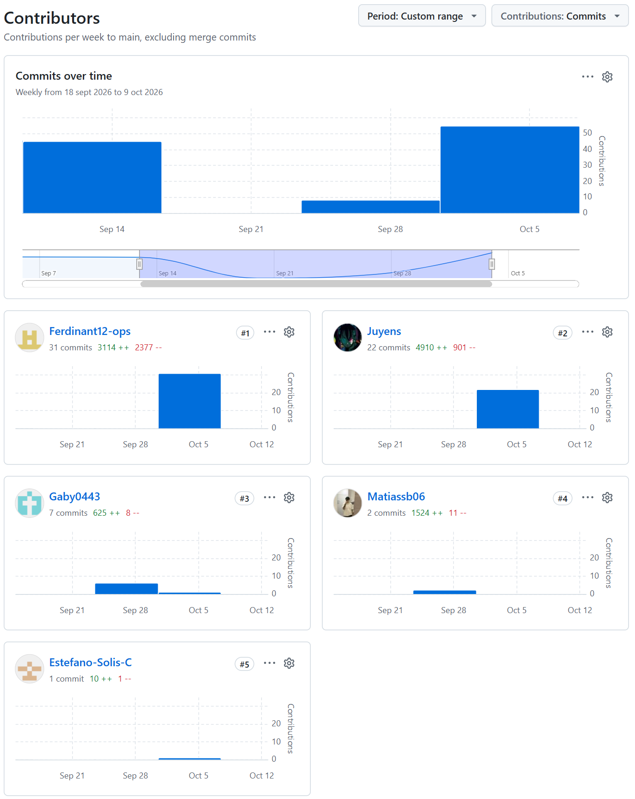
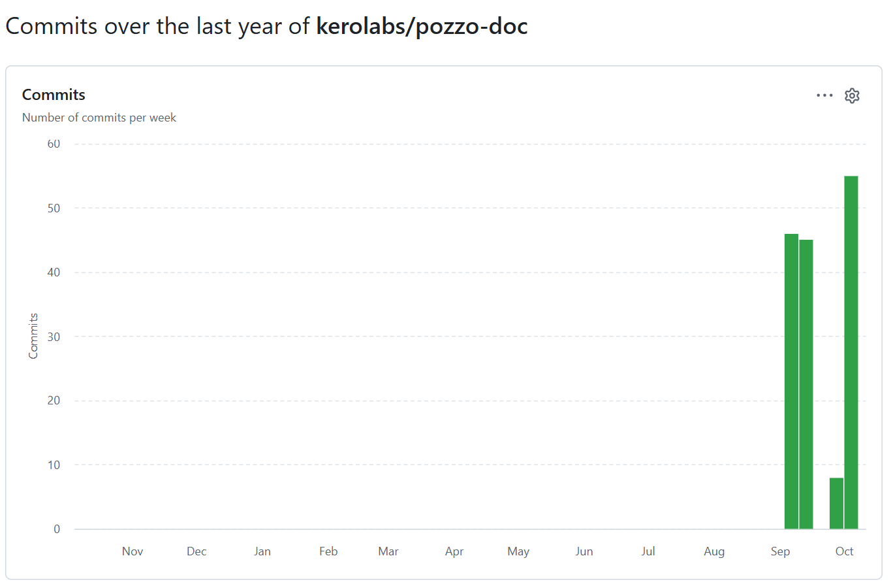
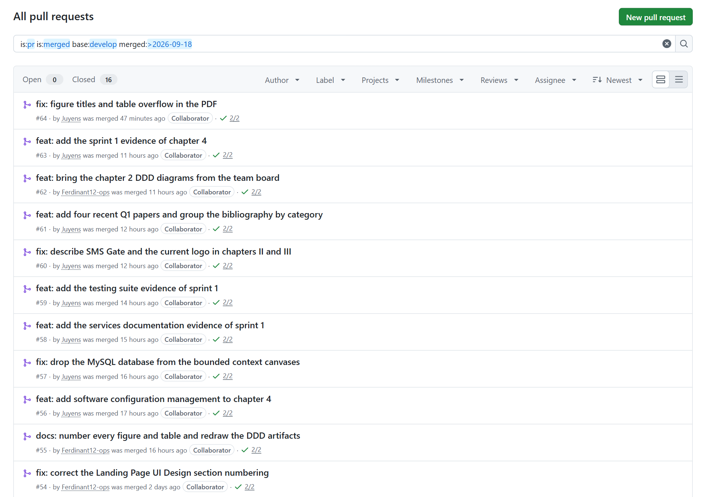
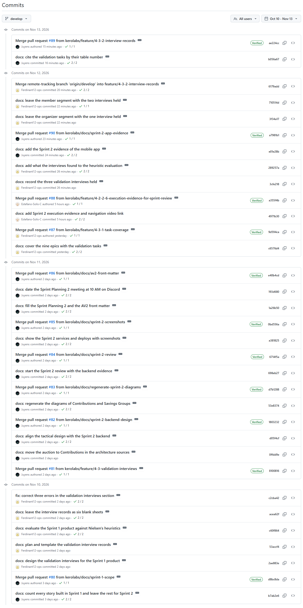

# Registro de Versiones del Informe

La Tabla 1 presenta el registro de versiones del informe.

<table>
  <caption>Registro de versiones del informe</caption>
  <thead>
    <tr>
      <th align="center">Versión</th>
      <th align="center">Fecha</th>
      <th align="center">Autor</th>
      <th align="center">Descripción de modificación</th>
    </tr>
  </thead>
  <tbody>
    <tr>
      <td align="center">1.0</td>
      <td align="center">02/09/2026</td>
      <td align="center">Todo el equipo</td>
      <td align="center">Primera versión: estructura del informe y capítulos I y II</td>
    </tr>
    <tr>
      <td align="center">1.1</td>
      <td align="center">18/09/2026</td>
      <td align="center">Todo el equipo</td>
      <td align="center">Versión para AV1: Product Backlog en Trello, anexos, Student Outcome, Objetivos SMART, Conclusiones, Glosario y Collaboration Insights; remisiones internas por nombre de sección</td>
    </tr>
    <tr>
      <td align="center">1.2</td>
      <td align="center">02/10/2026</td>
      <td align="center">Sanchez Benavente, Leonardo Matias</td>
      <td align="center">Borrador del Capítulo III para TB1: guía de estilo, arquitectura de información, diseño del landing page y de la aplicación móvil (wireframes, wireflows, mock-ups, user flows y prototipo)</td>
    </tr>
    <tr>
      <td align="center">2.0</td>
      <td align="center">09/10/2026</td>
      <td align="center">Todo el equipo</td>
      <td align="center">Versión para TB1: Capítulo III (Solution UI/UX Design) y Capítulo IV con el Sprint 1; Capítulo II alineado con los servicios desplegados y con los diagramas DDD del tablero del equipo; numeración APA de tablas y figuras; cuatro papers Q1 recientes en la bibliografía; Collaboration Insights, Student Outcome y Conclusiones actualizados</td>
    </tr>
    <tr>
      <td align="center">2.1</td>
      <td align="center">09/11/2026</td>
      <td align="center">Camargo Briceño, Joseph Julius</td>
      <td align="center">Corrección del Sprint 1: el Sprint Planning 1, el Sprint Backlog 1 y el Product Backlog incluyen todas las historias implementadas en el Sprint (141 Story Points), y el Sprint 2 reúne las 58 restantes</td>
    </tr>
    <tr>
      <td align="center">2.2</td>
      <td align="center">10/11/2026</td>
      <td align="center">Camargo Briceño, Joseph Julius</td>
      <td align="center">Capítulo II alineado con el backend del Sprint 2: rutas de TS04, diseño táctico de Contributions y Savings Groups con la subasta en Contributions, y DDL, diagramas de clases, de base de datos y de componentes con las nuevas columnas y tablas</td>
    </tr>
    <tr>
      <td align="center">2.3</td>
      <td align="center">10/11/2026</td>
      <td align="center">Camargo Briceño, Joseph Julius</td>
      <td align="center">Capítulo IV con el Sprint 2: planificación, Sprint Backlog y evidencias de desarrollo, pruebas, documentación y despliegue de los servicios RESTful completos; diagramas de clases, de base de datos y de componentes de Contributions y Savings Groups regenerados; Student Outcome de la AV2</td>
    </tr>
    <tr>
      <td align="center">2.4</td>
      <td align="center">12/11/2026</td>
      <td align="center">Flores Pinchi, Jose Fernando</td>
      <td align="center">Validation Interviews: diseño de las entrevistas con tareas que cubren las nueve épicas y evaluación heurística del producto</td>
    </tr>
    <tr>
      <td align="center">2.5</td>
      <td align="center">12/11/2026</td>
      <td align="center">Solis Campos, Estefano Sebastian</td>
      <td align="center">Execution Evidence del Sprint 2 con el video de la navegación de la aplicación móvil</td>
    </tr>
    <tr>
      <td align="center">2.6</td>
      <td align="center">12/11/2026</td>
      <td align="center">Camargo Briceño, Joseph Julius</td>
      <td align="center">Capítulo IV con la aplicación móvil del Sprint 2: tareas del Sprint Backlog, commits, pantallas, APK e insights del equipo; servicios RESTful actualizados a <code>v0.2.2</code>; corrección de la numeración de las figuras</td>
    </tr>
    <tr>
      <td align="center">2.7</td>
      <td align="center">12/11/2026</td>
      <td align="center">Flores Pinchi, Jose Fernando</td>
      <td align="center">Registro de las tres entrevistas de validación realizadas y sus hallazgos en la evaluación heurística</td>
    </tr>
    <tr>
      <td align="center">3.0</td>
      <td align="center">12/11/2026</td>
      <td align="center">Todo el equipo</td>
      <td align="center">Versión para AV2: Capítulo IV con el Sprint 2 completo y las entrevistas de validación; Collaboration Insights, Student Outcome e índice actualizados</td>
    </tr>
    <tr>
      <td align="center">3.1</td>
      <td align="center">13/11/2026</td>
      <td align="center">Flores Pinchi, Jose Fernando</td>
      <td align="center">Video About-the-Product, armado con las escenas de las entrevistas de validación</td>
    </tr>
    <tr>
      <td align="center">3.2</td>
      <td align="center">13/11/2026</td>
      <td align="center">Sanchez Benavente, Leonardo Matias</td>
      <td align="center">Video About-the-Team, con la presentación del equipo y el testimonio de cada integrante</td>
    </tr>
  </tbody>
</table>

# Project Report Collaboration Insights

El informe se elabora en el repositorio `pozzo-doc` de la organización Kerolabs en GitHub: <https://github.com/kerolabs/pozzo-doc>. El informe está escrito en Markdown, con un archivo por capítulo, y el documento de cada entrega se genera desde el repositorio con Pandoc, sobre una plantilla de Word con las normas APA 7, y se exporta a PDF desde Microsoft Word, de modo que el documento entregado es siempre el estado exacto de la rama `main`.

## AV1

**Organización del trabajo.** El equipo repartió las secciones de los capítulos I y II entre los cinco integrantes y aplicó GitFlow: `main` guarda solo los estados entregados, `develop` integra el trabajo del equipo y cada sección se escribe en una rama `feature/*` nombrada con el número de la sección (por ejemplo `feature/2-3-needfinding` o `feature/2-5-2-Context-Mapping`). Cada rama se sube como Pull Request hacia `develop`, otro integrante la revisa y, al mergear, la rama se elimina. Los mensajes de commit siguen Conventional Commits en inglés, y un workflow de GitHub Actions, requerido para mergear en `develop` y en `main`, verifica el formato de cada commit de la Pull Request; un hook local aplica la misma regla antes de crear el commit. Las reglas de escritura del informe (tablas en HTML, rutas de imágenes, citas con `references.bib`) están documentadas en el archivo `CONTRIBUTING.md` del repositorio, que todos los integrantes siguieron.

**Coordinación.** El equipo trabajó con sesiones síncronas para las actividades colaborativas (entrevistas, EventStorming, Candidate Context Discovery, Bounded Context Canvases y Context Mapping, en Miro) y de forma asíncrona para la redacción de cada sección. Las revisiones se hicieron en las Pull Requests, donde se corrigieron errores de formato, terminología y coherencia entre secciones antes de integrar.

**Aportes por integrante.** Entre el 7 y el 17 de septiembre de 2026 se integraron 26 Pull Requests y 76 commits en `develop`. El cuadro resume las secciones que cada integrante redactó y su actividad en el repositorio (ver Tabla 2).

<table>
  <caption>Participación de cada integrante en la entrega AV1</caption>
  <colgroup><col width="26%"><col width="50%"><col width="12%"><col width="12%"></colgroup>
  <thead>
    <tr>
      <th>Integrante</th>
      <th>Secciones redactadas en AV1</th>
      <th align="center">Pull Requests</th>
      <th align="center">Commits</th>
    </tr>
  </thead>
  <tbody>
    <tr>
      <td>Camargo Briceño, Joseph Julius</td>
      <td>Requirements specification (User Stories, Impact Mapping, Product Backlog); Tactical-Level DDD de Compliance History, Notifications e Identity & Access; introducción del Strategic-Level DDD; ajustes del Lean UX Process a las plantillas del enunciado; anexos; Student Outcome, Objetivos SMART, Conclusiones y Glosario; configuración de la exportación a PDF y de las tablas HTML del informe.</td>
      <td align="center">13</td>
      <td align="center">48</td>
    </tr>
    <tr>
      <td>Flores Pinchi, Jose Fernando</td>
      <td>Inicialización del repositorio desde la plantilla; Lean UX Process (Problem Statement, Assumptions, Hypothesis Statements, Lean UX Canvas); Entrevistas (diseño, registro y análisis); Tactical-Level DDD de Contributions y Savings Groups.</td>
      <td align="center">3</td>
      <td align="center">6</td>
    </tr>
    <tr>
      <td>Sanchez Benavente, Leonardo Matias</td>
      <td>Solution Profile (antecedentes y problemática); User Personas, User Task Matrix y Ubiquitous Language; EventStorming de nivel de diseño, Candidate Context Discovery y Domain Message Flows Modeling.</td>
      <td align="center">3</td>
      <td align="center">6</td>
    </tr>
    <tr>
      <td>Solis Campos, Estefano Sebastian</td>
      <td>Segmentos objetivo; Competidores (análisis competitivo, estrategias y tácticas); Software Architecture con el C4 Model (contexto, contenedores y despliegue).</td>
      <td align="center">3</td>
      <td align="center">3</td>
    </tr>
    <tr>
      <td>Tirado Carrera, Gabriela Luciana</td>
      <td>Startup Profile (descripción y perfiles); User Journey Mapping, Empathy Mapping y Big Picture EventStorming; Bounded Context Canvases y Context Mapping.</td>
      <td align="center">4</td>
      <td align="center">13</td>
    </tr>
  </tbody>
</table>

**Evidencia.** Las siguientes capturas corresponden a la pestaña Insights del repositorio al cierre de la entrega (ver Figuras 1 a 3).

## TB1

**Organización del trabajo.** El equipo mantuvo el mismo flujo de la AV1: GitFlow con una rama por sección, Pull Requests hacia `develop` y el check de Conventional Commits requerido para integrar. En esta entrega el informe sumó el Capítulo III, que redactaron Sanchez y Tirado, y el Capítulo IV con el Sprint 1, que redactó Camargo a partir de los repositorios de código. Flores numeró y referenció todas las tablas y figuras según APA 7 y rehízo los diagramas del diseño estratégico y táctico del Capítulo II desde el tablero del equipo. Varias Pull Requests corrigieron el Capítulo II para que describa lo que se implementó: la base de datos de los Bounded Context Canvases, el proveedor de SMS y el logo actual.

**Coordinación.** La reunión de Sprint Planning del 1 de octubre de 2026, por Discord y con los cinco integrantes, fijó el alcance del Sprint 1 y quién lideraba cada parte del informe y de los productos. La redacción siguió siendo asíncrona, y las revisiones se hicieron en las Pull Requests.

**Aportes por integrante.** Entre el 18 de septiembre y el 9 de octubre de 2026 se integraron 19 Pull Requests y 63 commits en `develop`. El cuadro resume las secciones que cada integrante redactó o corrigió y su actividad en el repositorio del informe (ver Tabla 3).

<table>
  <caption>Participación de cada integrante en la entrega TB1</caption>
  <colgroup><col width="26%"><col width="50%"><col width="12%"><col width="12%"></colgroup>
  <thead>
    <tr>
      <th>Integrante</th>
      <th>Secciones redactadas o corregidas en TB1</th>
      <th align="center">Pull Requests</th>
      <th align="center">Commits</th>
    </tr>
  </thead>
  <tbody>
    <tr>
      <td>Camargo Briceño, Joseph Julius</td>
      <td>Capítulo IV: Software Configuration Management y Sprint 1 (planificación, backlog, evidencias de desarrollo, pruebas, ejecución, documentación de servicios, despliegue e insights del equipo); alineación del Capítulo II con los servicios desplegados; papers Q1 y bibliografía por categorías; ajustes del PDF; Collaboration Insights, Student Outcome y Conclusiones de esta entrega; figura del video del Sprint 1.</td>
      <td align="center">11</td>
      <td align="center">22</td>
    </tr>
    <tr>
      <td>Flores Pinchi, Jose Fernando</td>
      <td>Numeración y referencia APA de todas las tablas y figuras del informe; diagramas del diseño estratégico y táctico del Capítulo II traídos del tablero del equipo; corrección de la numeración de Landing Page UI Design.</td>
      <td align="center">3</td>
      <td align="center">31</td>
    </tr>
    <tr>
      <td>Sanchez Benavente, Leonardo Matias</td>
      <td>Capítulo III: Style Guidelines y Mobile Applications UX/UI Design (wireframes, wireflows, mock-ups, user flows y prototipo).</td>
      <td align="center">1</td>
      <td align="center">2</td>
    </tr>
    <tr>
      <td>Solis Campos, Estefano Sebastian</td>
      <td>Video de la navegación de la aplicación en Execution Evidence for Sprint Review. El resto de su aporte se concentró en la documentación de los repositorios de código, que se detalla en el capítulo de implementación, en la sección Team Collaboration Insights during Sprint.</td>
      <td align="center">1</td>
      <td align="center">1</td>
    </tr>
    <tr>
      <td>Tirado Carrera, Gabriela Luciana</td>
      <td>Capítulo III: Information Architecture (sistemas de organización, etiquetado, SEO, búsqueda y navegación) y Landing Page UI Design (wireframe y mock-up); enlace al prototipo.</td>
      <td align="center">3</td>
      <td align="center">7</td>
    </tr>
  </tbody>
</table>

**Evidencia.** Las siguientes capturas corresponden a la pestaña Insights del repositorio al integrar la entrega en `main`: las contribuciones por integrante entre el 18 de septiembre y el 9 de octubre, la actividad de commits y las Pull Requests integradas en `develop` (ver Figuras 4 a 6).

## AV2

**Organización del trabajo.** El equipo mantuvo el flujo de las entregas anteriores: GitFlow con una rama por sección, Pull Requests hacia `develop` y el check de Conventional Commits requerido para integrar. En esta entrega Camargo alineó el Capítulo II con los servicios del Sprint 2 y redactó la evidencia del Sprint 2 en el Capítulo IV; Flores diseñó y registró las entrevistas de validación y sumó sus hallazgos a la evaluación heurística; y Solis llevó al informe la evidencia de ejecución con el video de la aplicación. Sanchez y Tirado concentraron su aporte en la aplicación móvil, que se detalla en el capítulo de implementación, en la sección Team Collaboration Insights during Sprint del Sprint 2.

**Coordinación.** La reunión de Sprint Planning del 3 de noviembre de 2026, por Discord y con los cinco integrantes, fijó el alcance del Sprint 2 y quién lideraba cada parte del informe y de los productos. La redacción siguió siendo asíncrona, y las revisiones se hicieron en las Pull Requests.

**Aportes por integrante.** Entre el 10 de octubre y el 12 de noviembre de 2026, sin contar esta actualización del registro, se integraron 11 Pull Requests y 21 commits en `develop`. El cuadro resume las secciones que cada integrante redactó o corrigió y su actividad en el repositorio del informe (ver Tabla 4).

<table>
  <caption>Participación de cada integrante en la entrega AV2</caption>
  <colgroup><col width="26%"><col width="50%"><col width="12%"><col width="12%"></colgroup>
  <thead>
    <tr>
      <th>Integrante</th>
      <th>Secciones redactadas o corregidas en AV2</th>
      <th align="center">Pull Requests</th>
      <th align="center">Commits</th>
    </tr>
  </thead>
  <tbody>
    <tr>
      <td>Camargo Briceño, Joseph Julius</td>
      <td>Corrección del alcance del Sprint 1; Capítulo II alineado con los servicios del Sprint 2, con sus diagramas regenerados; Capítulo IV con el Sprint 2 (planificación, backlog, evidencias de desarrollo, pruebas, ejecución, documentación de servicios, despliegue e insights del equipo); Registro de Versiones, Collaboration Insights y Student Outcome de esta entrega.</td>
      <td align="center">7</td>
      <td align="center">10</td>
    </tr>
    <tr>
      <td>Flores Pinchi, Jose Fernando</td>
      <td>Validation Interviews: diseño de las entrevistas con tareas que cubren las nueve épicas, registro de las tres entrevistas realizadas y evaluación heurística del producto con los hallazgos de las entrevistas; Video About-the-Product.</td>
      <td align="center">3</td>
      <td align="center">10</td>
    </tr>
    <tr>
      <td>Sanchez Benavente, Leonardo Matias</td>
      <td>Video About-the-Team, integrado el 13 de noviembre, después del corte de este cuadro. Su aporte de código se concentró en la aplicación móvil, que se detalla en el capítulo de implementación, en la sección Team Collaboration Insights during Sprint.</td>
      <td align="center">0</td>
      <td align="center">0</td>
    </tr>
    <tr>
      <td>Solis Campos, Estefano Sebastian</td>
      <td>Execution Evidence for Sprint Review del Sprint 2, con el video de la navegación de la aplicación.</td>
      <td align="center">1</td>
      <td align="center">1</td>
    </tr>
    <tr>
      <td>Tirado Carrera, Gabriela Luciana</td>
      <td>Sin aportes al repositorio del informe en esta entrega. Su aporte se concentró en la aplicación móvil, que se detalla en el capítulo de implementación, en la sección Team Collaboration Insights during Sprint.</td>
      <td align="center">0</td>
      <td align="center">0</td>
    </tr>
  </tbody>
</table>

**Evidencia.** La siguiente captura muestra los commits de la rama `develop` del repositorio entre el 10 de octubre y el 12 de noviembre, con su autor y los merges de cada Pull Request (ver Figura 7).

{width=55%}

<!-- pdf:omit-start -->

# Contenido

### [Registro de Versiones del Informe](#registro-de-versiones-del-informe)

### [Project Report Collaboration Insights](#project-report-collaboration-insights)

### [Student Outcome](#student-outcome)

### [Objetivos SMART](#objetivos-smart)

### [Capítulo I: Presentación](docs/chapter_1.md#capítulo-i-presentación)
- [1.1. Startup Profile](docs/chapter_1.md#11-startup-profile)
  - [1.1.1. Descripción de la Startup](docs/chapter_1.md#111-descripción-de-la-startup)
  - [1.1.2. Perfiles de integrantes del equipo](docs/chapter_1.md#112-perfiles-de-integrantes-del-equipo)
- [1.2. Solution Profile](docs/chapter_1.md#12-solution-profile)
  - [1.2.1. Antecedentes y problemática](docs/chapter_1.md#121-antecedentes-y-problemática)
  - [1.2.2. Lean UX Process](docs/chapter_1.md#122-lean-ux-process)
- [1.3. Segmentos objetivo](docs/chapter_1.md#13-segmentos-objetivo)

### [Capítulo II: Requirements Development and Software Solution Design](docs/chapter_2.md#capítulo-ii-requirements-development-and-software-solution-design)
- [2.1. Competidores](docs/chapter_2.md#21-competidores)
  - [2.1.1. Análisis competitivo](docs/chapter_2.md#211-análisis-competitivo)
  - [2.1.2. Estrategias y tácticas frente a competidores](docs/chapter_2.md#212-estrategias-y-tácticas-frente-a-competidores)
- [2.2. Entrevistas](docs/chapter_2.md#22-entrevistas)
  - [2.2.1. Diseño de entrevistas](docs/chapter_2.md#221-diseño-de-entrevistas)
  - [2.2.2. Registro de entrevistas](docs/chapter_2.md#222-registro-de-entrevistas)
  - [2.2.3. Análisis de entrevistas](docs/chapter_2.md#223-análisis-de-entrevistas)
- [2.3. Needfinding](docs/chapter_2.md#23-needfinding)
  - [2.3.1. User Personas](docs/chapter_2.md#231-user-personas)
  - [2.3.2. User Task Matrix](docs/chapter_2.md#232-user-task-matrix)
  - [2.3.3. User Journey Mapping](docs/chapter_2.md#233-user-journey-mapping)
  - [2.3.4. Empathy Mapping](docs/chapter_2.md#234-empathy-mapping)
  - [2.3.5. Big Picture EventStorming](docs/chapter_2.md#235-big-picture-eventstorming)
  - [2.3.6. Ubiquitous Language](docs/chapter_2.md#236-ubiquitous-language)
- [2.4. Requirements specification](docs/chapter_2.md#24-requirements-specification)
  - [2.4.1. User Stories](docs/chapter_2.md#241-user-stories)
  - [2.4.2. Impact Mapping](docs/chapter_2.md#242-impact-mapping)
  - [2.4.3. Product Backlog](docs/chapter_2.md#243-product-backlog)
- [2.5. Strategic-Level Domain-Driven Design](docs/chapter_2.md#25-strategic-level-domain-driven-design)
  - [2.5.1. EventStorming](docs/chapter_2.md#251-eventstorming)
  - [2.5.2. Context Mapping](docs/chapter_2.md#252-context-mapping)
  - [2.5.3. Software Architecture](docs/chapter_2.md#253-software-architecture)
- [2.6. Tactical-Level Domain-Driven Design](docs/chapter_2.md#26-tactical-level-domain-driven-design)
  - [2.6.1. Bounded Context: Contributions](docs/chapter_2.md#261-bounded-context-contributions)
  - [2.6.2. Bounded Context: Savings Groups](docs/chapter_2.md#262-bounded-context-savings-groups)
  - [2.6.3. Bounded Context: Compliance History](docs/chapter_2.md#263-bounded-context-compliance-history)
  - [2.6.4. Bounded Context: Notifications](docs/chapter_2.md#264-bounded-context-notifications)
  - [2.6.5. Bounded Context: Identity & Access](docs/chapter_2.md#265-bounded-context-identity--access)

### [Capítulo III: Solution UI/UX Design](docs/chapter_3.md#capítulo-iii-solution-uiux-design)
- [3.1. Product design](docs/chapter_3.md#31-product-design)
  - [3.1.1. Style Guidelines](docs/chapter_3.md#311-style-guidelines)
  - [3.1.2. Information Architecture](docs/chapter_3.md#312-information-architecture)
  - [3.1.3. Landing Page UI Design](docs/chapter_3.md#313-landing-page-ui-design)
  - [3.1.4. Mobile Applications UX/UI Design](docs/chapter_3.md#314-mobile-applications-uxui-design)

### [Capítulo IV: Product Implementation & Validation](docs/chapter_4.md#capítulo-iv-product-implementation--validation)
- [4.1. Software Configuration Management](docs/chapter_4.md#41-software-configuration-management)
  - [4.1.1. Software Development Environment Configuration](docs/chapter_4.md#411-software-development-environment-configuration)
  - [4.1.2. Source Code Management](docs/chapter_4.md#412-source-code-management)
  - [4.1.3. Source Code Style Guide & Conventions](docs/chapter_4.md#413-source-code-style-guide--conventions)
  - [4.1.4. Software Deployment Configuration](docs/chapter_4.md#414-software-deployment-configuration)
- [4.2. Landing Page & Mobile Application Implementation](docs/chapter_4.md#42-landing-page--mobile-application-implementation)
  - [4.2.1. Sprint 1](docs/chapter_4.md#421-sprint-1)
  - [4.2.2. Sprint 2](docs/chapter_4.md#422-sprint-2)
- [4.3. Validation Interviews](docs/chapter_4.md#43-validation-interviews)
  - [4.3.1. Diseño de Entrevistas](docs/chapter_4.md#431-diseño-de-entrevistas)
  - [4.3.2. Registro de Entrevistas](docs/chapter_4.md#432-registro-de-entrevistas)
  - [4.3.3. Evaluaciones según heurísticas](docs/chapter_4.md#433-evaluaciones-según-heurísticas)
- [4.4. Video About-the-Product](docs/chapter_4.md#44-video-about-the-product)
- [4.5. Video About-the-Team](docs/chapter_4.md#45-video-about-the-team)

### [Conclusiones](docs/closing.md#conclusiones)
- [Conclusiones y recomendaciones](docs/closing.md#conclusiones-y-recomendaciones)

### [Glosario](docs/closing.md#glosario)

### [Bibliografía](docs/closing.md#bibliografía)

### [Anexos](docs/closing.md#anexos)
- [Anexo A. Product Backlog en Trello](docs/closing.md#anexo-a-product-backlog-en-trello)
- [Anexo B. Tablero de Miro del diseño estratégico](docs/closing.md#anexo-b-tablero-de-miro-del-diseño-estratégico)
- [Anexo C. Fuentes de los diagramas de arquitectura](docs/closing.md#anexo-c-fuentes-de-los-diagramas-de-arquitectura)

<!-- pdf:omit-end -->

<!-- pdf:only
\tableofcontents
-->

# Student Outcome

El curso contribuye al cumplimiento del Student Outcome ABET:\
ABET - EAC - Student Outcome 7\
Criterio: La capacidad de adquirir y aplicar nuevos conocimientos según sea necesario, utilizando estrategias de aprendizaje apropiadas.

En el siguiente cuadro se describe las acciones realizadas y enunciados de conclusiones por parte del grupo, que permiten sustentar el haber alcanzado el logro del ABET – EAC - Student Outcome 7 (ver Tabla 5).

<table>
  <caption>Student Outcome: criterios, acciones y conclusiones</caption>
  <colgroup><col width="16%"><col width="46%"><col width="38%"></colgroup>
  <thead>
    <tr>
      <th>Criterio específico</th>
      <th>Acciones realizadas</th>
      <th>Conclusiones</th>
    </tr>
  </thead>
  <tbody>
    <tr>
      <td>Actualiza conceptos y conocimientos necesarios para su desarrollo profesional y en especial para su proyecto en soluciones de software.</td>
      <td><b>Camargo Briceño, Joseph Julius</b> <i>AV1:</i> Especificó las 46 User Stories, las 8 Technical Stories y las 3 Spike Stories con criterios de aceptación en Gherkin, elaboró el Impact Map en UXPressia y el Product Backlog en Trello, y diseñó el nivel táctico de los Bounded Contexts Compliance History, Notifications e Identity & Access con sus diagramas de clases y de base de datos. Configuró la exportación del informe a PDF con Pandoc y XeLaTeX bajo las normas APA 7.</td>
      <td><i>AV1:</i> El equipo actualizó conceptos de Lean UX, Domain-Driven Design estratégico y táctico, EventStorming y C4 Model, y los aplicó sobre un dominio real, las juntas de ahorro, hasta obtener una especificación de requisitos y un diseño de solución coherentes entre sí: cada Bounded Context nace de un evento pivotal del EventStorming, cada User Story de un hallazgo de las entrevistas y cada objetivo de negocio de una hipótesis del Lean UX Process.</td>
    </tr>
    <tr>
      <td></td>
      <td><b>Camargo Briceño, Joseph Julius</b> <i>TB1:</i> Implementó los servicios RESTful en Spring Boot con los cinco Bounded Contexts del diseño táctico, sobre PostgreSQL, con 54 endpoints documentados en OpenAPI y 170 pruebas automatizadas entre unitarias, de integración y de aceptación en Gherkin; los desplegó en Oracle Cloud con despliegue continuo desde GitHub Actions; construyó la aplicación Android nativa en Kotlin y Jetpack Compose con el flujo completo de una junta; y redactó el capítulo de implementación con la evidencia del Sprint 1.</td>
      <td><i>TB1:</i> El equipo pasó del diseño a la implementación y comprobó que el diseño de la AV1 se sostiene: los cinco Bounded Contexts se convirtieron en módulos de los servicios y los ajustes que pidió el código se llevaron de vuelta al Capítulo II. El Capítulo III aplicó Material Design 3 y arquitectura de información sobre las mismas User Stories, de modo que el diseño de las pantallas y el de los servicios parten de la misma especificación.</td>
    </tr>
    <tr>
      <td></td>
      <td><b>Camargo Briceño, Joseph Julius</b> <i>AV2:</i> Completó los servicios RESTful con las historias del Sprint 2: la subasta de turnos con el reparto del descuento, la deserción y el reemplazo de un integrante, el vínculo de quien no tenía la aplicación al registrarse, el intercambio de turnos, el comprobante de la entrega del pozo, el aporte compartido con un enlace verificable, los recordatorios por atraso y el nuevo ciclo. Sumó 12 endpoints documentados en OpenAPI, para un total de 66, y llevó la suite a 221 pruebas; trabajó cada historia en su propia rama y pull request, y desplegó hasta la versión <code>v0.2.2</code> con las correcciones que aparecieron al probar la aplicación contra los servicios desplegados. Repartió las historias de la aplicación entre los integrantes, probó la integración en el emulador y generó el APK firmado para las entrevistas de validación. Alineó el diseño táctico del Capítulo II con lo implementado, regeneró sus diagramas y redactó la evidencia del Sprint 2.</td>
      <td><i>AV2:</i> El Sprint 2 completó los servicios RESTful y llevó a la aplicación los casos en que la junta cambia en el camino: la subasta de turnos, la deserción, el reemplazo y el nuevo ciclo. Probar la aplicación contra los servicios desplegados encontró tres fallas que las pruebas automatizadas no cubrían, y cada corrección volvió con su prueba. Las entrevistas de validación contrastaron el producto con cabezas de junta y participantes, y sus hallazgos se sumaron a la evaluación heurística.</td>
    </tr>
    <tr>
      <td></td>
      <td><b>Flores Pinchi, Jose Fernando</b> <i>AV1:</i> Aplicó el Lean UX Process para redactar el Problem Statement, los cinco tipos de Assumptions, los Hypothesis Statements y el Lean UX Canvas; diseñó, registró y analizó las entrevistas a cabezas de junta y participantes con sustento estadístico; y diseñó el nivel táctico de los Bounded Contexts Contributions y Savings Groups en sus cuatro capas.</td>
      <td></td>
    </tr>
    <tr>
      <td></td>
      <td><b>Flores Pinchi, Jose Fernando</b> <i>TB1:</i> Aplicó las normas APA 7 a la numeración y la referencia de todas las tablas y figuras del informe, trajo al Capítulo II los diagramas del diseño estratégico y táctico desde el tablero del equipo, y documentó en los servicios RESTful los repositorios y el contrato de puntuación de Compliance History.</td>
      <td></td>
    </tr>
    <tr>
      <td></td>
      <td><b>Flores Pinchi, Jose Fernando</b> <i>AV2:</i> Diseñó las entrevistas de validación con tareas que recorren las nueve épicas del producto, registró las tres entrevistas realizadas a cabezas de junta y participantes, y sumó sus hallazgos a la evaluación heurística. En la aplicación móvil integró a <code>develop</code> la entrega del pozo con su transferencia, los períodos anteriores y el nuevo ciclo.</td>
      <td></td>
    </tr>
    <tr>
      <td></td>
      <td><b>Sanchez Benavente, Leonardo Matias</b> <i>AV1:</i> Redactó los antecedentes y la problemática con la técnica 5W2H, elaboró los User Personas y el User Task Matrix, consolidó el Ubiquitous Language y condujo en Miro el EventStorming de nivel de diseño, el Candidate Context Discovery y el Domain Storytelling que identificaron los cinco Bounded Contexts.</td>
      <td></td>
    </tr>
    <tr>
      <td></td>
      <td><b>Sanchez Benavente, Leonardo Matias</b> <i>TB1:</i> Elaboró la guía de estilo sobre Material Design 3 (principios, color, tipografía, espaciado, componentes y modos claro y oscuro) y el diseño UX/UI de la aplicación móvil en wireframes, wireflows, mock-ups, user flows y un prototipo navegable en Figma; además construyó la primera versión del landing page.</td>
      <td></td>
    </tr>
    <tr>
      <td></td>
      <td><b>Sanchez Benavente, Leonardo Matias</b> <i>AV2:</i> Integró a <code>develop</code> de la aplicación móvil la configuración de la subasta de turnos y las ofertas de los integrantes, con lo que cada uno debe después del descuento.</td>
      <td></td>
    </tr>
    <tr>
      <td></td>
      <td><b>Solis Campos, Estefano Sebastian</b> <i>AV1:</i> Describió los segmentos objetivo con sustento estadístico, realizó el análisis competitivo con el landscape, el SWOT de cada competidor y las estrategias frente a ellos, y modeló la arquitectura de software con el C4 Model en Structurizr en sus niveles de contexto, contenedores y despliegue.</td>
      <td></td>
    </tr>
    <tr>
      <td></td>
      <td><b>Solis Campos, Estefano Sebastian</b> <i>TB1:</i> Documentó el código de los tres productos: guías de contribución con el flujo de Pull Requests, Javadoc de los controladores, servicios y configuración de los servicios RESTful, KDoc de la navegación, las pantallas, los view models y los repositorios de la aplicación, y comentarios y README del landing page. Además llevó al informe el video de la navegación de la aplicación del Sprint 1.</td>
      <td></td>
    </tr>
    <tr>
      <td></td>
      <td><b>Solis Campos, Estefano Sebastian</b> <i>AV2:</i> Integró a <code>develop</code> de la aplicación móvil el cierre de la subasta, el intercambio de turnos y el calendario con los turnos por subastar, y llevó al informe la evidencia de ejecución del Sprint 2 con el video de la navegación de la aplicación.</td>
      <td></td>
    </tr>
    <tr>
      <td></td>
      <td><b>Tirado Carrera, Gabriela Luciana</b> <i>AV1:</i> Redactó la descripción de la startup y los perfiles del equipo, elaboró los User Journey Maps y los Empathy Maps en UXPressia, facilitó el Big Picture EventStorming y diseñó los cinco Bounded Context Canvases y el Context Mapping con los patrones de relación entre contextos.</td>
      <td></td>
    </tr>
    <tr>
      <td></td>
      <td><b>Tirado Carrera, Gabriela Luciana</b> <i>TB1:</i> Diseñó la arquitectura de información del landing page y de la aplicación (sistemas de organización, etiquetado, búsqueda, navegación, SEO y meta tags) y el wireframe y el mock-up del landing page; escribió su contenido y la política de privacidad, y mejoró la accesibilidad de la aplicación para lectores de pantalla.</td>
      <td></td>
    </tr>
    <tr>
      <td></td>
      <td><b>Tirado Carrera, Gabriela Luciana</b> <i>AV2:</i> Integró a <code>develop</code> de la aplicación móvil el retiro de un integrante con la opción de deshacerlo, el registro de la deserción y la asignación de su reemplazo.</td>
      <td></td>
    </tr>
    <tr>
      <td>Reconoce la necesidad del aprendizaje permanente para el desempeño profesional y el desarrollo de proyectos en soluciones de software.</td>
      <td><b>Camargo Briceño, Joseph Julius</b> <i>AV1:</i> Estudió por su cuenta el diseño táctico de Domain-Driven Design (agregados, value objects, command handlers y repositorios) y el formato Gherkin para redactar criterios comprobables; aprendió Pandoc, filtros Lua y XeLaTeX para automatizar el PDF del informe, y la API de Trello para cargar el backlog desde la especificación.</td>
      <td><i>AV1:</i> Ninguna de las técnicas del proyecto se dominaba al inicio del ciclo. Cada integrante tuvo que estudiar por su cuenta libros, documentación y herramientas para producir su sección, y el equipo comprobó que ese aprendizaje se transfiere: lo que uno aprendió se revisó en Pull Requests y quedó disponible para los demás. El equipo reconoce que las entregas siguientes exigirán lo mismo con Kotlin, Jetpack Compose, ML Kit y Spring Boot.</td>
    </tr>
    <tr>
      <td></td>
      <td><b>Camargo Briceño, Joseph Julius</b> <i>TB1:</i> Aprendió durante el Sprint lo que la AV1 había anticipado: Spring Boot con Spring Security y JWT, Testcontainers y Cucumber para las pruebas, Jetpack Compose y ML Kit para leer comprobantes en el dispositivo, y la administración de un servidor Linux con systemd y Caddy al que se despliega por SSH desde GitHub Actions.</td>
      <td><i>TB1:</i> Kotlin, Jetpack Compose, ML Kit y Spring Boot, que la AV1 señalaba como el aprendizaje pendiente, se aprendieron en este Sprint, pero ese aprendizaje se concentró en un integrante. El equipo reconoce que para la AV2 cada integrante debe implementar las historias de un Bounded Context, en la aplicación y en los servicios, para que el conocimiento técnico se reparta como se repartió el de diseño.</td>
    </tr>
    <tr>
      <td></td>
      <td><b>Camargo Briceño, Joseph Julius</b> <i>AV2:</i> Profundizó en la consistencia entre Bounded Contexts con eventos de integración: qué cambios deben guardarse en la misma transacción, como el intercambio de turnos o el reemplazo de un integrante, y cuáles corren después de confirmada, como el vínculo de una cuenta nueva o los avisos. Aprendió a regenerar los diagramas de PlantUML y Structurizr sin Docker, con sus distribuciones de Java y el Graphviz que trae PlantUML, y a revisar las ramas integradas en busca de pruebas que compilan sin ejecutarse.</td>
      <td><i>AV2:</i> La propuesta de la TB1 se cumplió en parte: en la aplicación cada integrante llevó las historias de una parte del dominio, con su rama y su Pull Request, pero los servicios siguieron a cargo de un integrante. El equipo reconoce que para la TB2 el aprendizaje debe llegar también a los servicios y a la distribución con Firebase App Distribution, con cada integrante implementando y probando las historias que lleve.</td>
    </tr>
    <tr>
      <td></td>
      <td><b>Flores Pinchi, Jose Fernando</b> <i>AV1:</i> Revisó el libro Lean UX de Gothelf y Seiden para distinguir los cinco tipos de assumptions y formular hipótesis comprobables, investigó buenas prácticas de diseño de entrevistas para construir arquetipos, y se familiarizó con el modelo por capas de Domain-Driven Design para diseñar el contexto core de la solución.</td>
      <td></td>
    </tr>
    <tr>
      <td></td>
      <td><b>Flores Pinchi, Jose Fernando</b> <i>TB1:</i> Profundizó en las reglas de APA 7 para tablas y figuras, en la numeración automática que exige un informe que cambia en cada entrega, y en la documentación de código con Javadoc y KDoc.</td>
      <td></td>
    </tr>
    <tr>
      <td></td>
      <td><b>Flores Pinchi, Jose Fernando</b> <i>AV2:</i> Estudió la evaluación heurística de Nielsen y su escala de severidad, y el diseño de entrevistas de validación con tareas observables, para medir si cada participante completa la tarea, con o sin ayuda, y en qué pantalla se detiene.</td>
      <td></td>
    </tr>
    <tr>
      <td></td>
      <td><b>Sanchez Benavente, Leonardo Matias</b> <i>AV1:</i> Estudió EventStorming de Brandolini y Domain Storytelling de Hofer y Schwentner para modelar el dominio y sus flujos de mensajes, aprendió a construir arquetipos en UXPressia y a documentar un Ubiquitous Language libre de términos técnicos.</td>
      <td></td>
    </tr>
    <tr>
      <td></td>
      <td><b>Sanchez Benavente, Leonardo Matias</b> <i>TB1:</i> Estudió Material Design 3 y su sistema de roles de color, el diseño de wireflows y user flows, y el prototipado navegable en Figma para traducir las User Stories en pantallas.</td>
      <td></td>
    </tr>
    <tr>
      <td></td>
      <td><b>Sanchez Benavente, Leonardo Matias</b> <i>AV2:</i> Se familiarizó con la organización por capas de la aplicación en Kotlin (dominio, casos de uso, infraestructura con Retrofit y presentación con Jetpack Compose) y con el flujo de ramas y Pull Requests de su repositorio.</td>
      <td></td>
    </tr>
    <tr>
      <td></td>
      <td><b>Solis Campos, Estefano Sebastian</b> <i>AV1:</i> Aprendió el C4 Model y el DSL de Structurizr para describir la arquitectura como código versionable, e investigó las fuentes estadísticas del INEI y la SBS y la oferta de los competidores para sustentar los segmentos y el análisis competitivo.</td>
      <td></td>
    </tr>
    <tr>
      <td></td>
      <td><b>Solis Campos, Estefano Sebastian</b> <i>TB1:</i> Aprendió las convenciones de Javadoc y KDoc y a documentar proyectos Spring Boot y Android para que otro integrante pueda construirlos y contribuir sin ayuda.</td>
      <td></td>
    </tr>
    <tr>
      <td></td>
      <td><b>Solis Campos, Estefano Sebastian</b> <i>AV2:</i> Pasó de documentar la aplicación a trabajar sobre sus pantallas en Jetpack Compose y sus view models, y aprendió a integrar una rama que parte de la de otro integrante.</td>
      <td></td>
    </tr>
    <tr>
      <td></td>
      <td><b>Tirado Carrera, Gabriela Luciana</b> <i>AV1:</i> Investigó el proceso iterativo del Bounded Context Canvas y los patrones de Context Mapping (Customer/Supplier, Conformist, Anti-corruption Layer y Shared Kernel), y aprendió a facilitar sesiones de EventStorming y a elaborar Empathy Maps y Journey Maps en UXPressia.</td>
      <td></td>
    </tr>
    <tr>
      <td></td>
      <td><b>Tirado Carrera, Gabriela Luciana</b> <i>TB1:</i> Estudió arquitectura de información, posicionamiento en buscadores con meta tags y hreflang, y las pautas de accesibilidad de Android para que los lectores de pantalla anuncien etiquetas y estados.</td>
      <td></td>
    </tr>
    <tr>
      <td></td>
      <td><b>Tirado Carrera, Gabriela Luciana</b> <i>AV2:</i> Se familiarizó con la organización por capas de la aplicación en Kotlin y con los mensajes que se pueden deshacer en Jetpack Compose, que llevan a la aplicación la regla de los cinco segundos para retirar a un integrante.</td>
      <td></td>
    </tr>
  </tbody>
</table>

# Objetivos SMART

Cada integrante formula dos objetivos para su desarrollo profesional una vez finalizada la carrera. Cada objetivo es específico, medible, alcanzable, relevante y con plazo definido (ver Tabla 6).

<table>
  <caption>Objetivos SMART del proyecto</caption>
  <colgroup><col width="4%"><col width="30%"><col width="22%"><col width="24%"><col width="20%"></colgroup>
  <thead>
    <tr>
      <th>#</th>
      <th>Objetivo</th>
      <th>Medible</th>
      <th>Alcanzable y relevante</th>
      <th>Plazo</th>
    </tr>
  </thead>
  <tbody>
    <tr>
      <td colspan="5"><b>Camargo Briceño, Joseph Julius</b></td>
    </tr>
    <tr>
      <td align="center">1</td>
      <td>Obtener la certificación Oracle Certified Professional: Java SE 21 Developer.</td>
      <td>Aprobar el examen oficial; antes, superar el 80 % en tres simulacros consecutivos.</td>
      <td>Cinco horas semanales de estudio sobre la base de Java y Spring Boot ya aplicada en el proyecto; consolida el perfil backend al que se orienta.</td>
      <td>Dentro de los 12 meses posteriores a la graduación.</td>
    </tr>
    <tr>
      <td align="center">2</td>
      <td>Diseñar y poner en producción un sistema con arquitectura de microservicios en Spring Boot.</td>
      <td>Al menos tres servicios desplegados en un entorno real, con monitoreo y despliegue automatizado.</td>
      <td>Extiende el monolito modular por Bounded Context diseñado para Pozzo; es la práctica que piden los puestos de backend a los que aspira.</td>
      <td>Dentro de los 18 meses posteriores a la graduación.</td>
    </tr>
    <tr>
      <td colspan="5"><b>Flores Pinchi, Jose Fernando</b></td>
    </tr>
    <tr>
      <td align="center">1</td>
      <td>Obtener la certificación CompTIA Security+.</td>
      <td>Aprobar el examen oficial; antes, superar el 85 % en un examen de práctica mensual durante tres meses seguidos.</td>
      <td>Seis horas semanales de estudio; es la certificación de entrada del perfil de ciberseguridad hacia el que orienta su carrera.</td>
      <td>Dentro de los 12 meses posteriores a la graduación.</td>
    </tr>
    <tr>
      <td align="center">2</td>
      <td>Construir un portafolio verificable en seguridad participando en competencias Capture The Flag.</td>
      <td>Seis competencias completadas y un informe técnico publicado por cada una.</td>
      <td>Una competencia cada tres meses, compatible con un empleo a tiempo completo; demuestra habilidad práctica que las certificaciones no acreditan.</td>
      <td>Dentro de los 18 meses posteriores a la graduación.</td>
    </tr>
    <tr>
      <td colspan="5"><b>Sanchez Benavente, Leonardo Matias</b></td>
    </tr>
    <tr>
      <td align="center">1</td>
      <td>Obtener la certificación AWS Certified Developer Associate.</td>
      <td>Aprobar el examen oficial; antes, desplegar en AWS una API REST con base de datos y CI/CD como proyecto de práctica.</td>
      <td>Cinco horas semanales; complementa su base full-stack con Angular y Spring Boot con la nube que usan los empleadores del sector.</td>
      <td>Dentro de los 12 meses posteriores a la graduación.</td>
    </tr>
    <tr>
      <td align="center">2</td>
      <td>Contribuir a proyectos de código abierto del ecosistema Angular o Spring.</td>
      <td>Diez Pull Requests aceptadas en repositorios públicos con más de 500 estrellas.</td>
      <td>Una contribución cada seis semanas, empezando por documentación y errores etiquetados como aptos para principiantes; construye reputación técnica verificable.</td>
      <td>Dentro de los 18 meses posteriores a la graduación.</td>
    </tr>
    <tr>
      <td colspan="5"><b>Solis Campos, Estefano Sebastian</b></td>
    </tr>
    <tr>
      <td align="center">1</td>
      <td>Obtener la certificación Professional Scrum Master I (PSM I).</td>
      <td>Aprobar el examen oficial con al menos 85 %; antes, superar el 90 % en el Scrum Open Assessment tres veces seguidas.</td>
      <td>Cuatro horas semanales de estudio de la Guía Scrum y práctica con el marco ya aplicado en los sprints del proyecto; abre el camino hacia roles de coordinación de equipos.</td>
      <td>Dentro de los 6 meses posteriores a la graduación.</td>
    </tr>
    <tr>
      <td align="center">2</td>
      <td>Lanzar un producto digital propio y validarlo con usuarios reales.</td>
      <td>Cien usuarios activos mensuales y un ciclo completo de validación con entrevistas documentadas.</td>
      <td>Reutiliza el proceso de Lean UX y validación aplicado en Pozzo sobre una idea propia; responde a su interés por la innovación tecnológica.</td>
      <td>Dentro de los 24 meses posteriores a la graduación.</td>
    </tr>
    <tr>
      <td colspan="5"><b>Tirado Carrera, Gabriela Luciana</b></td>
    </tr>
    <tr>
      <td align="center">1</td>
      <td>Completar el Google UX Design Professional Certificate.</td>
      <td>Los siete cursos aprobados y el proyecto final publicado en un portafolio en línea.</td>
      <td>Seis horas semanales; formaliza la habilidad en desarrollo de interfaces que ya aporta al equipo y la extiende a la investigación con usuarios.</td>
      <td>Dentro de los 9 meses posteriores a la graduación.</td>
    </tr>
    <tr>
      <td align="center">2</td>
      <td>Obtener un puesto de desarrolladora front-end en una empresa de producto.</td>
      <td>Contrato firmado; en el camino, un portafolio con cinco proyectos que cumplan WCAG 2.1 nivel AA y al menos tres postulaciones al mes.</td>
      <td>Se apoya en su experiencia con Angular y Vue y en el trabajo de interfaz de Pozzo; es el rol al que apunta su perfil.</td>
      <td>Dentro de los 12 meses posteriores a la graduación.</td>
    </tr>
  </tbody>
</table>
