# Capítulo IV: Product Implementation & Validation

## 4.1. Software Configuration Management

En esta sección se fijan las decisiones que mantienen consistentes los productos de Pozzo durante todo el ciclo de vida: con qué herramientas trabaja el equipo, cómo se organiza y protege el código fuente, qué convenciones siguen el código y los mensajes de commit, y cómo se despliega cada producto a partir de su repositorio. Pozzo se compone de cinco productos, cada uno con su repositorio en la organización `kerolabs` de GitHub: el landing page, los servicios RESTful, la aplicación móvil, las páginas públicas de los enlaces que comparte la aplicación y este informe.

### 4.1.1. Software Development Environment Configuration

El equipo trabaja con las herramientas de la Tabla 135, agrupadas por la actividad del ciclo de vida en la que se usan. Las que funcionan como servicio en la nube se indican con su ruta de referencia; las que se instalan en el computador de cada integrante, con su ruta de descarga. Todas respetan las restricciones de tecnología del curso: UXPressia para personas, journeys, empathy e impact maps; Figma para wireframes, mock-ups y prototipos; Structurizr para el C4 Model; Kotlin nativo para Android; Spring Boot para los servicios; OpenAPI con Swagger para su documentación, y Trello para la gestión del backlog.

<table>
  <caption>Herramientas del entorno de desarrollo por actividad del ciclo de vida</caption>
  <colgroup><col width="17%"><col width="18%"><col width="40%"><col width="25%"></colgroup>
  <thead>
    <tr>
      <th>Actividad</th>
      <th>Producto</th>
      <th>Propósito en Pozzo</th>
      <th>Ruta</th>
    </tr>
  </thead>
  <tbody>
    <tr>
      <td rowspan="2">Project Management</td>
      <td>Trello</td>
      <td>Tablero del Product Backlog y de cada Sprint Backlog, con el estado de cada User Story y de sus tareas.</td>
      <td><a href="https://trello.com/b/fRocSVZA/pozzo-product-backlog">trello.com/b/fRocSVZA</a></td>
    </tr>
    <tr>
      <td>GitHub</td>
      <td>Organización <code>kerolabs</code>: repositorios, Pull Requests, revisión de código y analíticos de colaboración.</td>
      <td><a href="https://github.com/kerolabs">github.com/kerolabs</a></td>
    </tr>
    <tr>
      <td rowspan="3">Requirements Management</td>
      <td>Miro</td>
      <td>Big Picture EventStorming, descubrimiento de bounded contexts, flujos de mensajes y Bounded Context Canvases.</td>
      <td><a href="https://miro.com/app/board/uXjVHm8In_g=/">miro.com</a></td>
    </tr>
    <tr>
      <td>UXPressia</td>
      <td>User Personas, Empathy Maps, User Journey Maps e Impact Maps.</td>
      <td><a href="https://uxpressia.com">uxpressia.com</a></td>
    </tr>
    <tr>
      <td>Trello</td>
      <td>Registro de las User Stories, Technical Stories y Spike Stories priorizadas del Product Backlog.</td>
      <td><a href="https://trello.com/b/fRocSVZA/pozzo-product-backlog">trello.com/b/fRocSVZA</a></td>
    </tr>
    <tr>
      <td>Product UX/UI Design</td>
      <td>Figma</td>
      <td>Guía de estilo, wireframes y mock-ups del landing page y de la aplicación, wireflows, user flows y prototipo navegable, en un solo archivo.</td>
      <td><a href="https://www.figma.com/design/8KoGtoEQuWzHgtOih3hTgF/">figma.com</a></td>
    </tr>
    <tr>
      <td rowspan="6">Software Development</td>
      <td>Git</td>
      <td>Control de versiones local de todos los repositorios.</td>
      <td><a href="https://git-scm.com/downloads">git-scm.com/downloads</a></td>
    </tr>
    <tr>
      <td>Android Studio</td>
      <td>Desarrollo de la aplicación móvil en Kotlin con Jetpack Compose, emulador de pruebas y generación del APK firmado.</td>
      <td><a href="https://developer.android.com/studio">developer.android.com/studio</a></td>
    </tr>
    <tr>
      <td>IntelliJ IDEA</td>
      <td>Desarrollo de los servicios RESTful en Java 21 con Spring Boot 4.1 y Maven.</td>
      <td><a href="https://www.jetbrains.com/idea/download">jetbrains.com/idea/download</a></td>
    </tr>
    <tr>
      <td>Eclipse Temurin JDK 21</td>
      <td>Compilación y ejecución local de los servicios; la misma versión que usa el servidor.</td>
      <td><a href="https://adoptium.net">adoptium.net</a></td>
    </tr>
    <tr>
      <td>Visual Studio Code</td>
      <td>Edición del landing page (HTML5, CSS3 y JavaScript), de las páginas públicas de enlaces y de este informe en Markdown.</td>
      <td><a href="https://code.visualstudio.com/download">code.visualstudio.com/download</a></td>
    </tr>
    <tr>
      <td>Supabase</td>
      <td>PostgreSQL de los cinco bounded contexts, con un esquema por contexto, y almacenamiento de fotos de perfil y de imágenes de comprobantes.</td>
      <td><a href="https://supabase.com/dashboard">supabase.com/dashboard</a></td>
    </tr>
    <tr>
      <td rowspan="4">Software Testing</td>
      <td>JUnit 6 y Spring Boot Test</td>
      <td>Pruebas unitarias del dominio y pruebas de integración de los servicios.</td>
      <td><a href="https://junit.org">junit.org</a></td>
    </tr>
    <tr>
      <td>Testcontainers</td>
      <td>Levanta PostgreSQL en un contenedor de Docker para las pruebas de integración y de aceptación, con el mismo motor de producción.</td>
      <td><a href="https://testcontainers.com">testcontainers.com</a></td>
    </tr>
    <tr>
      <td>Cucumber</td>
      <td>Pruebas de aceptación escritas en Gherkin a partir de los criterios de aceptación de las Technical Stories.</td>
      <td><a href="https://cucumber.io/docs/installation/java">cucumber.io</a></td>
    </tr>
    <tr>
      <td>Swagger UI</td>
      <td>Prueba manual de cada endpoint contra el servidor desplegado, con datos de muestra.</td>
      <td><a href="https://api-kerolabs.duckdns.org/swagger-ui.html">api-kerolabs.duckdns.org/swagger-ui.html</a></td>
    </tr>
    <tr>
      <td rowspan="5">Software Deployment</td>
      <td>GitHub Actions</td>
      <td>Comprueba los mensajes de commit en cada push y Pull Request, despliega los servicios en cada merge a <code>main</code> y compila este informe a PDF en cada entrega.</td>
      <td><a href="https://github.com/features/actions">github.com/features/actions</a></td>
    </tr>
    <tr>
      <td>Oracle Cloud Infrastructure</td>
      <td>Instancia Always Free con Ubuntu 24.04 donde corren los servicios RESTful, detrás de Caddy.</td>
      <td><a href="https://cloud.oracle.com">cloud.oracle.com</a></td>
    </tr>
    <tr>
      <td>DuckDNS</td>
      <td>Nombre de dominio <code>api-kerolabs.duckdns.org</code> que apunta a la instancia.</td>
      <td><a href="https://www.duckdns.org">duckdns.org</a></td>
    </tr>
    <tr>
      <td>GitHub Pages</td>
      <td>Publicación del landing page y de las páginas públicas de los enlaces de invitación e historial.</td>
      <td><a href="https://pages.github.com">pages.github.com</a></td>
    </tr>
    <tr>
      <td>Firebase</td>
      <td>Cloud Messaging para las notificaciones push y App Distribution para entregar la aplicación a quienes la prueban.</td>
      <td><a href="https://console.firebase.google.com">console.firebase.google.com</a></td>
    </tr>
    <tr>
      <td rowspan="4">Software Documentation</td>
      <td>springdoc-openapi</td>
      <td>Genera la especificación OpenAPI de los servicios a partir del código y la publica con Swagger UI.</td>
      <td><a href="https://springdoc.org">springdoc.org</a></td>
    </tr>
    <tr>
      <td>Structurizr</td>
      <td>Diagramas del C4 Model escritos como código en <code>docs/architecture/workspace.dsl</code>.</td>
      <td><a href="https://structurizr.com">structurizr.com</a></td>
    </tr>
    <tr>
      <td>PlantUML</td>
      <td>Diagramas de clases del dominio y de base de datos de cada bounded context.</td>
      <td><a href="https://plantuml.com">plantuml.com</a></td>
    </tr>
    <tr>
      <td>Pandoc y XeLaTeX</td>
      <td>Convierten este informe de Markdown a PDF con formato APA 7.</td>
      <td><a href="https://pandoc.org/installing.html">pandoc.org/installing.html</a></td>
    </tr>
  </tbody>
</table>

### 4.1.2. Source Code Management

El código de Pozzo se versiona con Git y se aloja en GitHub, en la organización `kerolabs`. Cada producto tiene su propio repositorio, de modo que se versiona, se revisa y se despliega por separado. El repositorio de los servicios RESTful incluye, junto al proyecto, sus pruebas unitarias, de integración y de aceptación (ver Tabla 136).

<table>
  <caption>Repositorios de los productos de Pozzo en la organización kerolabs</caption>
  <colgroup><col width="28%"><col width="32%"><col width="40%"></colgroup>
  <thead>
    <tr>
      <th>Producto</th>
      <th>Repositorio</th>
      <th>Contenido</th>
    </tr>
  </thead>
  <tbody>
    <tr>
      <td>Landing Page</td>
      <td><a href="https://github.com/kerolabs/pozzo-landing-page">kerolabs/pozzo-landing-page</a></td>
      <td>Sitio estático en HTML5, CSS3 y JavaScript, en inglés y español.</td>
    </tr>
    <tr>
      <td>Web Services</td>
      <td><a href="https://github.com/kerolabs/pozzo-backend">kerolabs/pozzo-backend</a></td>
      <td>Servicios RESTful en Spring Boot con sus pruebas, el workflow de despliegue y la configuración del servidor.</td>
    </tr>
    <tr>
      <td>Mobile Application</td>
      <td><a href="https://github.com/kerolabs/pozzo-mobile">kerolabs/pozzo-mobile</a></td>
      <td>Aplicación Android en Kotlin con Jetpack Compose.</td>
    </tr>
    <tr>
      <td>Páginas públicas de enlaces</td>
      <td><a href="https://github.com/kerolabs/kerolabs.github.io">kerolabs/kerolabs.github.io</a></td>
      <td>Páginas que abren los enlaces de invitación a una junta y de historial compartido.</td>
    </tr>
    <tr>
      <td>Informe</td>
      <td><a href="https://github.com/kerolabs/pozzo-doc">kerolabs/pozzo-doc</a></td>
      <td>Este documento en Markdown, los diagramas como código y la configuración que lo compila a PDF.</td>
    </tr>
  </tbody>
</table>

El flujo de trabajo sigue GitFlow [@driessen2010gitflow]. Además de la rama principal, cada repositorio tiene una rama de integración y ramas de vida corta para cada cambio (ver Tabla 137):

<table>
  <caption>Ramas de GitFlow en los repositorios de Pozzo</caption>
  <colgroup><col width="20%"><col width="18%"><col width="62%"></colgroup>
  <thead>
    <tr>
      <th>Rama</th>
      <th>Sale de</th>
      <th>Uso y convención de nombre</th>
    </tr>
  </thead>
  <tbody>
    <tr>
      <td><code>main</code></td>
      <td>(permanente)</td>
      <td>Solo estados entregables. En los servicios RESTful, cada merge a <code>main</code> se despliega en el servidor; en el landing page y en las páginas de enlaces, lo publica GitHub Pages.</td>
    </tr>
    <tr>
      <td><code>develop</code></td>
      <td>(permanente)</td>
      <td>Integra el trabajo terminado del equipo. Es la base de todas las ramas de trabajo.</td>
    </tr>
    <tr>
      <td><code>feature/&lt;nombre&gt;</code></td>
      <td><code>develop</code></td>
      <td>Una por funcionalidad, con el nombre en inglés y en kebab-case según lo que agrega: <code>feature/receipts-and-group-notices</code>, <code>feature/group-management</code>. En el informe llevan además el número de la sección: <code>feature/4-1-configuration-management</code>. Vuelven a <code>develop</code> por Pull Request.</td>
    </tr>
    <tr>
      <td><code>fix/</code>, <code>chore/</code>, <code>ci/&lt;nombre&gt;</code></td>
      <td><code>develop</code></td>
      <td>Correcciones que no son urgentes, cambios de configuración y cambios de los workflows, con la misma convención: <code>fix/device-registration-race</code>, <code>chore/oracle-backend</code>, <code>ci/deploy-oracle</code>.</td>
    </tr>
    <tr>
      <td><code>release/&lt;versión&gt;</code></td>
      <td><code>develop</code></td>
      <td>Prepara una entrega: solo admite el número de versión y correcciones de último momento. Se mergea a <code>main</code>, se etiqueta con su versión y se mergea de vuelta a <code>develop</code>. Ejemplo: <code>release/0.1.0</code>.</td>
    </tr>
    <tr>
      <td><code>hotfix/&lt;versión&gt;</code></td>
      <td><code>main</code></td>
      <td>Corrige un error en producción sin esperar la siguiente entrega. Sube el número de parche, se mergea a <code>main</code> y a <code>develop</code> y se etiqueta. Ejemplo: <code>hotfix/0.1.1</code>.</td>
    </tr>
  </tbody>
</table>

Los releases se nombran con Semantic Versioning 2.0.0 [@preston2013semver]: `MAJOR.MINOR.PATCH`, con la etiqueta `v` delante (`v0.1.0`). Mientras el producto se construye la versión mayor es 0, y cada entrega con un Sprint terminado sube la versión menor: `v0.1.0` en la TB1 (Sprint 1) y `v0.2.0` en la AV2 (Sprint 2). La TB2, que es el Release Review, publica la `v1.0.0`. Las correcciones urgentes entre entregas suben solo el parche. El informe usa como etiqueta el nombre de la entrega (`av1`, `tb1`), porque cada una dispara la compilación de su PDF.

Los mensajes de commit siguen Conventional Commits [@conventionalcommits2019]: un tipo, dos puntos y qué hace el cambio, en inglés. Los tipos admitidos son `feat`, `fix`, `docs`, `style`, `refactor`, `perf`, `test`, `build`, `ci`, `chore` y `revert`, con un ámbito opcional entre paréntesis.

```
feat: keep receipt images in a private bucket and show them through signed links
fix: retry a device registration that collided with a simultaneous one
ci: deploy main to the Oracle Cloud instance through a restricted SSH key
```

Tres mecanismos hacen que estas reglas se cumplan y no dependan de la memoria de cada integrante:

- **Workflow `commit-policy`.** Corre en GitHub Actions con cada push y cada Pull Request de todos los repositorios, y rechaza los commits que no siguen el formato. También rechaza los pies que algunas herramientas añaden solas al mensaje, porque cada commit debe atribuirse a un integrante del equipo.
- **Hook `commit-msg`.** Aplica las mismas reglas en el computador del integrante, al momento de hacer el commit, para que el error se corrija antes de subirlo.
- **Protección de ramas.** `main` y `develop` rechazan los pushes directos en todos los repositorios, también los de los administradores. Todo cambio entra por Pull Request y solo se puede mergear con el check `commit-policy` en verde. Al terminar, la rama de trabajo se borra.

### 4.1.3. Source Code Style Guide & Conventions

Todo el código de Pozzo se escribe en inglés: nombres de clases, funciones, variables, archivos, rutas de la API, comentarios y mensajes de commit. El español queda para los textos que ve el usuario (pantallas, notificaciones, mensajes de error de la API) y para este informe. Sobre esa base, cada lenguaje sigue una guía de referencia (ver Tabla 138):

<table>
  <caption>Guías de estilo de referencia por lenguaje</caption>
  <colgroup><col width="17%"><col width="27%"><col width="56%"></colgroup>
  <thead>
    <tr>
      <th>Lenguaje</th>
      <th>Guía de referencia</th>
      <th>Convenciones que aplica Pozzo</th>
    </tr>
  </thead>
  <tbody>
    <tr>
      <td>Kotlin (aplicación móvil)</td>
      <td>Kotlin Coding Conventions [@kotlin2026conventions] y Android Kotlin Style Guide [@android2026kotlinstyle]</td>
      <td>Clases y composables en PascalCase; funciones y propiedades en camelCase; constantes en UPPER_SNAKE_CASE. Un paquete por bounded context dentro de <code>features</code>, con las capas <code>domain</code>, <code>application</code>, <code>infrastructure</code> y <code>presentation</code>. Las pantallas terminan en <code>Screen</code>, sus view models en <code>ViewModel</code> y los casos de uso en <code>UseCase</code>.</td>
    </tr>
    <tr>
      <td>Java (servicios RESTful)</td>
      <td>Google Java Style Guide [@google2026javastyle] y Spring Boot Reference Documentation [@spring2026boot]</td>
      <td>Nomenclatura de la guía de Google, con sangría de cuatro espacios como el código de Spring. Un paquete por bounded context con las capas <code>domain</code>, <code>application</code>, <code>infrastructure</code> e <code>interfaces</code>. Commands, queries, events y resources son records y terminan en <code>Command</code>, <code>Query</code>, <code>Event</code> y <code>Resource</code>. Las rutas de la API van en plural y en kebab-case bajo <code>/api/v1</code>, por ejemplo <code>/api/v1/groups/{groupId}/members</code>.</td>
    </tr>
    <tr>
      <td>HTML, CSS y JavaScript (landing page y páginas de enlaces)</td>
      <td>Google HTML/CSS Style Guide [@google2026htmlcss]</td>
      <td>Elementos semánticos (<code>header</code>, <code>main</code>, <code>section</code>, <code>footer</code>), etiquetas y atributos en minúsculas y sangría de dos espacios. Clases con la convención Block Element Modifier (<code>brand__logo</code>, <code>brand__logo--dark</code>). Colores, espaciados y tipografía como variables CSS; JavaScript sin dependencias, con <code>const</code> y <code>let</code>.</td>
    </tr>
    <tr>
      <td>Gherkin (pruebas de aceptación)</td>
      <td>Gherkin Reference [@cucumber2026gherkin]</td>
      <td>Un archivo <code>.feature</code> por User Story, con su identificador en el nombre (<code>us23-register-contribution.feature</code>). Palabras clave y pasos en inglés; cada escenario sigue la estructura Given, When, Then de los criterios de aceptación de su User Story.</td>
    </tr>
    <tr>
      <td>Markdown (informe)</td>
      <td>Guía para contribuir del repositorio <code>pozzo-doc</code></td>
      <td>Numeración de títulos escrita a mano, tablas en HTML, imágenes con ruta relativa y citas desde <code>references.bib</code>, para que el mismo archivo se lea en GitHub y se compile a PDF.</td>
    </tr>
  </tbody>
</table>

Los comentarios explican por qué el código hace algo y no qué hace, que ya se lee en el código. Las clases públicas llevan un comentario de documentación (Javadoc o KDoc) que dice qué representan en el dominio, usando los términos del Ubiquitous Language (sección Ubiquitous Language).

### 4.1.4. Software Deployment Configuration

Cada producto se despliega a partir de la rama `main` de su repositorio. Para los servicios RESTful y las páginas web el despliegue es automático: basta con mergear la Pull Request de la entrega. La aplicación móvil se compila y firma en el computador de un integrante y se distribuye como APK.

**Landing Page.** GitHub Pages publica el contenido de la rama `main` de `pozzo-landing-page` en <https://kerolabs.github.io/pozzo-landing-page/>. El sitio no tiene compilación: al mergear a `main`, el workflow `pages-build-deployment` de GitHub publica los archivos tal como están, en uno o dos minutos.

**Páginas públicas de enlaces.** El repositorio `kerolabs.github.io` se publica igual, en la raíz del dominio <https://kerolabs.github.io>. Sirve dos páginas: `unirme`, que muestra el código de una invitación y cómo unirse desde la aplicación, e `historial`, que lee de los servicios el resumen de cumplimiento que un integrante compartió. El archivo `.nojekyll` evita que GitHub Pages ignore las carpetas que empiezan con punto, donde irán los archivos de verificación de Android App Links.

**Web Services.** Los servicios RESTful corren en una instancia Always Free de Oracle Cloud Infrastructure (1 GB de memoria y Ubuntu 24.04), que a diferencia de los planes gratuitos de otras plataformas no se suspende cuando no recibe tráfico. La instancia se preparó una sola vez con el script `deploy/oracle-setup.sh` del repositorio, que deja:

- Java 21, una memoria de intercambio de 2 GB y los puertos 80 y 443 abiertos, tanto en el firewall del sistema como en la Security List de la red de Oracle.
- Caddy como proxy inverso, que obtiene y renueva solo el certificado HTTPS de Let's Encrypt para <https://api-kerolabs.duckdns.org>, el nombre que DuckDNS resuelve a la dirección de la instancia.
- El servicio `pozzo` de systemd, que ejecuta el jar con un usuario sin acceso a consola, escucha solo en `127.0.0.1:8080` detrás de Caddy y se reinicia solo si falla.
- La configuración en `/etc/pozzo/pozzo.env`, que solo leen el servicio y el administrador: conexión a la base de datos, clave de firma de las sesiones y credenciales de SMS Gate (códigos por SMS), Brevo (correos de recuperación), Firebase Cloud Messaging (notificaciones push) y Supabase Storage (imágenes).

Con la instancia preparada, el workflow `deploy.yml` despliega cada merge a `main`:

1. Compila el jar con Java 21 en un runner de GitHub. La instancia no compila nada.
2. Se conecta por SSH con una llave dedicada al usuario `deploy`. Esa llave solo puede ejecutar el script que recibe el jar: no abre consola ni túneles, y el workflow verifica la huella del servidor antes de conectarse.
3. El servidor instala la nueva versión, reinicia el servicio y espera hasta cinco minutos a que `/actuator/health` responda `UP`, mientras envía al workflow el log del arranque. Si la versión nueva no arranca, vuelve a la anterior y el workflow falla.

El estado de los despliegues, los recursos de la instancia y el log en vivo de los servicios se consultan en <https://api-kerolabs.duckdns.org/status>, una página protegida con usuario y contraseña. La documentación OpenAPI se publica en <https://api-kerolabs.duckdns.org/swagger-ui.html>.

**Base de datos y almacenamiento.** PostgreSQL corre en Supabase, con un esquema por bounded context, y los servicios se conectan por el session pooler. Supabase Storage guarda las fotos de perfil en un bucket público y las imágenes de los comprobantes en uno privado, que solo se leen con enlaces firmados que vencen a los quince minutos.

**Mobile Application.** La aplicación tiene dos variantes. `cloud`, la predeterminada, apunta a los servicios desplegados; `local` apunta a los servicios corriendo en el computador del integrante y se instala aparte, para que las dos convivan en el mismo celular. El APK de entrega se genera en Android Studio con la variante `cloudRelease`, firmado con la llave de la aplicación, que se guarda fuera del repositorio. El proyecto de Firebase `kerolabs-pozzo` provee las notificaciones push y, para la entrega final, la distribución de la aplicación a quienes la prueban mediante Firebase App Distribution.

El diagrama de despliegue del C4 Model resume dónde corre cada contenedor de la solución (ver Figura 142):

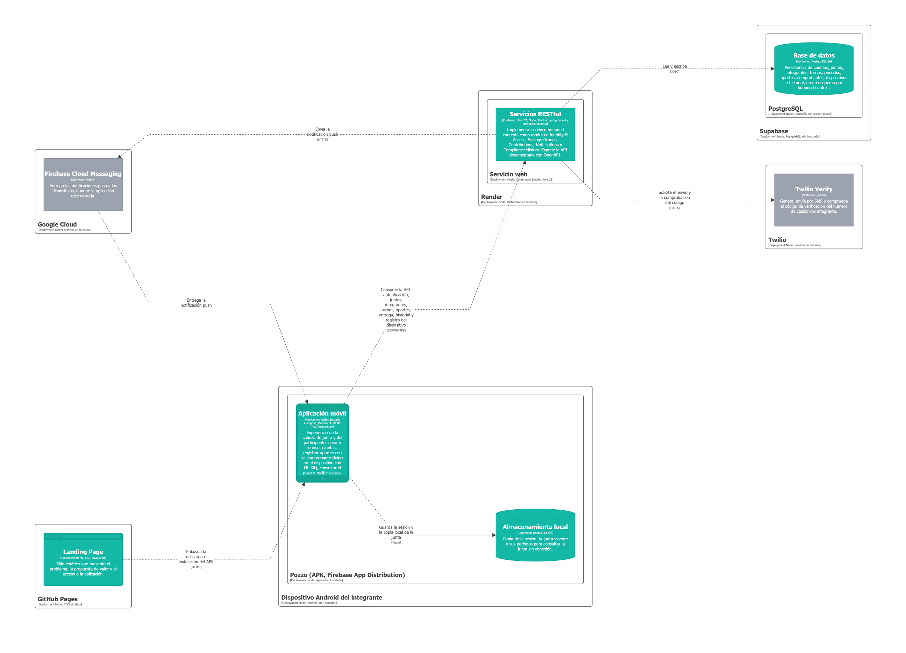{width=85%}

## 4.2. Landing Page & Mobile Application Implementation

### 4.2.1. Sprint 1

#### 4.2.1.1. Sprint Planning 1

El Sprint 1 cubre la entrega TB1. Reúne las historias que se implementaron en él: las del landing page, de la creación de la junta, de las invitaciones, de los turnos y del estado del pozo, junto con las del acceso con el código SMS, el registro y la validación de aportes, los recordatorios y avisos, y el historial de cumplimiento, además de las Spike Stories de lectura de comprobantes y de notificaciones push. La reunión de Sprint Planning se realizó el 1 de octubre de 2026 por Discord con los cinco integrantes: el equipo acordó el Sprint Goal, redactado con la plantilla de Scrum.org que recomienda el enunciado, y repartió el liderazgo de cada aspecto del Sprint. La Tabla 139 resume la planificación.

<table>
  <caption>Resumen del Sprint Planning 1</caption>
  <colgroup><col width="32%"><col width="68%"></colgroup>
  <thead>
    <tr>
      <th>Sprint #</th>
      <th>Sprint 1</th>
    </tr>
  </thead>
  <tbody>
    <tr>
      <td><b>Sprint Planning Background</b></td>
      <td></td>
    </tr>
    <tr>
      <td>Date</td>
      <td>2026-10-01</td>
    </tr>
    <tr>
      <td>Time</td>
      <td>05:00 PM</td>
    </tr>
    <tr>
      <td>Location</td>
      <td>Reunión virtual por Discord. El alcance se tomó del tablero "Pozzo - Product Backlog" en Trello: <a href="https://trello.com/b/fRocSVZA/pozzo-product-backlog">https://trello.com/b/fRocSVZA/pozzo-product-backlog</a></td>
    </tr>
    <tr>
      <td>Prepared By</td>
      <td>Camargo Briceño, Joseph Julius</td>
    </tr>
    <tr>
      <td>Attendees (to planning meeting)</td>
      <td>Camargo Briceño, Joseph Julius / Flores Pinchi, Jose Fernando / Sanchez Benavente, Leonardo Matias / Solis Campos, Estefano Sebastian / Tirado Carrera, Gabriela Luciana</td>
    </tr>
    <tr>
      <td>Sprint 0 Review Summary</td>
      <td>No aplica: es el primer Sprint. Parte de la AV1, que entregó los capítulos I y II con el Product Backlog de 46 User Stories, 8 Technical Stories y 3 Spike Stories priorizado y estimado en Story Points.</td>
    </tr>
    <tr>
      <td>Sprint 0 Retrospective Summary</td>
      <td>No aplica: es el primer Sprint.</td>
    </tr>
    <tr>
      <td><b>Sprint Goal &amp; User Stories</b></td>
      <td></td>
    </tr>
    <tr>
      <td>Sprint 1 Goal</td>
      <td><b>Our focus is on</b> que la cabeza de junta cree su junta en Pozzo, invite a los integrantes con un código o un enlace, asigne los turnos e inicie la junta, y que todos vean el mismo estado del pozo, junto con un landing page que explique Pozzo a quien no lo conoce. <b>We believe it delivers</b> un registro único y compartido de quién está en la junta y cuándo cobra cada uno <b>to</b> las cabezas de junta y los participantes. <b>This will be confirmed when</b> una cabeza de junta cree una junta desde la aplicación, al menos tres integrantes se unan con la invitación y todos vean el mismo calendario de turnos y el mismo estado del pozo.</td>
    </tr>
    <tr>
      <td>Sprint 1 Velocity</td>
      <td>141 Story Points, los de las historias completadas en el Sprint 1.</td>
    </tr>
    <tr>
      <td>Sum of Story Points</td>
      <td>141 Story Points: 34 User Stories, 6 Technical Stories y las Spike Stories SP01 y SP02.</td>
    </tr>
  </tbody>
</table>

#### 4.2.1.2. Aspect Leaders and Collaborators

Los aspectos del Sprint 1 son los productos que entrega la TB1 y el informe que los documenta: el landing page, el diseño de la interfaz del Capítulo III, la aplicación móvil, los servicios RESTful con su despliegue, y el informe con su formato APA. Cada aspecto tiene un líder, que responde por su avance y su calidad, y colaboradores que trabajan en él. La matriz se acordó en la reunión de Sprint Planning (ver Tabla 140).

<table>
  <caption>Leadership-and-Collaboration Matrix del Sprint 1</caption>
  <colgroup><col width="24%"><col width="16%"><col width="12%"><col width="12%"><col width="12%"><col width="12%"><col width="12%"></colgroup>
  <thead>
    <tr>
      <th>Team Member (Last Name, First Name)</th>
      <th>GitHub Username</th>
      <th>Landing Page Leader (L) / Collaborator (C)</th>
      <th>Diseño UI/UX (Capítulo III) Leader (L) / Collaborator (C)</th>
      <th>Aplicación móvil Leader (L) / Collaborator (C)</th>
      <th>Servicios RESTful y despliegue Leader (L) / Collaborator (C)</th>
      <th>Informe y formato APA Leader (L) / Collaborator (C)</th>
    </tr>
  </thead>
  <tbody>
    <tr>
      <td>Camargo Briceño, Joseph Julius</td>
      <td>Juyens</td>
      <td>C</td>
      <td></td>
      <td><b>L</b></td>
      <td><b>L</b></td>
      <td>C</td>
    </tr>
    <tr>
      <td>Flores Pinchi, Jose Fernando</td>
      <td>Ferdinant12-ops</td>
      <td>C</td>
      <td>C</td>
      <td>C</td>
      <td>C</td>
      <td><b>L</b></td>
    </tr>
    <tr>
      <td>Sanchez Benavente, Leonardo Matias</td>
      <td>Matiassb06</td>
      <td><b>L</b></td>
      <td>C</td>
      <td></td>
      <td>C</td>
      <td>C</td>
    </tr>
    <tr>
      <td>Solis Campos, Estefano Sebastian</td>
      <td>Estefano-Solis-C</td>
      <td>C</td>
      <td></td>
      <td>C</td>
      <td>C</td>
      <td></td>
    </tr>
    <tr>
      <td>Tirado Carrera, Gabriela Luciana</td>
      <td>Gaby0443</td>
      <td>C</td>
      <td><b>L</b></td>
      <td>C</td>
      <td>C</td>
      <td>C</td>
    </tr>
  </tbody>
</table>

#### 4.2.1.3. Sprint Backlog 1

El objetivo del Sprint 1 es que una cabeza de junta pueda crear su junta, invitar a los integrantes, asignar los turnos, iniciarla y ver el estado del pozo, con un landing page que presente Pozzo. La Figura 143 muestra el tablero del Sprint en Trello, con la lista "Sprint 1 (TB1)" y sus 141 Story Points. Enlace público del tablero: <https://trello.com/b/fRocSVZA/pozzo-product-backlog>.

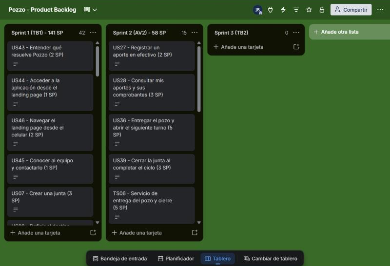{width=90%}

La Tabla 141 relaciona cada historia del Sprint con las tareas en que se descompuso, su responsable y su estado. Las tareas se obtuvieron de los commits y pull requests de cada repositorio. El equipo no estimó horas por tarea; su estimación está en los Story Points de cada historia.

<table>
  <caption>Sprint Backlog del Sprint 1</caption>
  <colgroup><col width="7%"><col width="12%"><col width="6%"><col width="13%"><col width="27%"><col width="10%"><col width="16%"><col width="9%"></colgroup>
  <thead>
    <tr>
      <th>User Story Id</th>
      <th>User Story Title</th>
      <th>Task Id</th>
      <th>Task Title</th>
      <th>Description</th>
      <th>Estimation (Hours)</th>
      <th>Assigned To</th>
      <th>Status</th>
    </tr>
  </thead>
  <tbody>
    <tr>
      <td>US43</td>
      <td>Entender qué resuelve Pozzo</td>
      <td>T01</td>
      <td>Contenido del landing</td>
      <td>Hero con el problema, la solución y la aclaración de que Pozzo no maneja el dinero, y las secciones de cómo funciona y funcionalidades.</td>
      <td>Sin estimar</td>
      <td>Tirado Carrera, Gabriela Luciana</td>
      <td>Done</td>
    </tr>
    <tr>
      <td></td>
      <td></td>
      <td>T02</td>
      <td>Ajuste del hero</td>
      <td>Retirar la insignia de círculos de ahorro para dejar el mensaje principal.</td>
      <td>Sin estimar</td>
      <td>Flores Pinchi, Jose Fernando</td>
      <td>Done</td>
    </tr>
    <tr>
      <td>US44</td>
      <td>Acceder a la aplicación desde el landing page</td>
      <td>T03</td>
      <td>Llamadas a la acción</td>
      <td>Botones a la lista de espera y a la sección de cómo funciona, y el formulario de la lista de espera.</td>
      <td>Sin estimar</td>
      <td>Tirado Carrera, Gabriela Luciana</td>
      <td>Done</td>
    </tr>
    <tr>
      <td>US46</td>
      <td>Navegar el landing page desde el celular</td>
      <td>T04</td>
      <td>Estilos y comportamiento</td>
      <td>Hoja de estilos responsiva, menú móvil, tema claro y oscuro, e idioma inglés y español.</td>
      <td>Sin estimar</td>
      <td>Sanchez Benavente, Leonardo Matias</td>
      <td>Done</td>
    </tr>
    <tr>
      <td>US45</td>
      <td>Conocer al equipo y contactarlo</td>
      <td>T05</td>
      <td>Equipo, contacto y privacidad</td>
      <td>Sección del equipo, contacto y Política de Privacidad.</td>
      <td>Sin estimar</td>
      <td>Tirado Carrera, Gabriela Luciana</td>
      <td>Done</td>
    </tr>
    <tr>
      <td></td>
      <td></td>
      <td>T06</td>
      <td>Términos y Condiciones</td>
      <td>Página de Términos y Condiciones enlazada desde el pie del landing.</td>
      <td>Sin estimar</td>
      <td>Sanchez Benavente, Leonardo Matias</td>
      <td>Done</td>
    </tr>
    <tr>
      <td>US07</td>
      <td>Crear una junta</td>
      <td>T07</td>
      <td>Creación de la junta en la aplicación</td>
      <td>Formulario de tres pasos con nombre, aporte, periodicidad, cupos y fecha del primer aporte.</td>
      <td>Sin estimar</td>
      <td>Camargo Briceño, Joseph Julius</td>
      <td>Done</td>
    </tr>
    <tr>
      <td>US08</td>
      <td>Definir el destino de los aportes</td>
      <td>T08</td>
      <td>Destino de los aportes</td>
      <td>Yape o Plin y el celular de destino, al crear la junta o antes de iniciarla.</td>
      <td>Sin estimar</td>
      <td>Camargo Briceño, Joseph Julius</td>
      <td>Done</td>
    </tr>
    <tr>
      <td>TS02</td>
      <td>Servicio de juntas</td>
      <td>T09</td>
      <td>Dominio y endpoints de Savings Groups</td>
      <td>Agregado SavingsGroup, persistencia y endpoints para crear, consultar, ajustar reglas e iniciar.</td>
      <td>Sin estimar</td>
      <td>Camargo Briceño, Joseph Julius</td>
      <td>Done</td>
    </tr>
    <tr>
      <td></td>
      <td></td>
      <td>T10</td>
      <td>Pruebas del servicio</td>
      <td>Pruebas unitarias del agregado y escenarios de aceptación de TS02.</td>
      <td>Sin estimar</td>
      <td>Camargo Briceño, Joseph Julius</td>
      <td>Done</td>
    </tr>
    <tr>
      <td>US11</td>
      <td>Invitar integrantes con código y enlace</td>
      <td>T11</td>
      <td>Invitación por código y enlace</td>
      <td>Código de seis caracteres, enlace para compartir y página pública que abre la aplicación.</td>
      <td>Sin estimar</td>
      <td>Camargo Briceño, Joseph Julius</td>
      <td>Done</td>
    </tr>
    <tr>
      <td>US12</td>
      <td>Unirme a una junta con código o enlace</td>
      <td>T12</td>
      <td>Unirse con la invitación</td>
      <td>Pantalla para escribir el código o abrir el enlace y unirse.</td>
      <td>Sin estimar</td>
      <td>Camargo Briceño, Joseph Julius</td>
      <td>Done</td>
    </tr>
    <tr>
      <td>US13</td>
      <td>Revisar la junta antes de unirme</td>
      <td>T13</td>
      <td>Vista previa de la junta</td>
      <td>Nombre, reglas y cupos libres antes de confirmar la unión.</td>
      <td>Sin estimar</td>
      <td>Camargo Briceño, Joseph Julius</td>
      <td>Done</td>
    </tr>
    <tr>
      <td>TS03</td>
      <td>Servicio de integrantes e invitaciones</td>
      <td>T14</td>
      <td>Endpoints de invitaciones e integrantes</td>
      <td>Generar y resolver invitaciones, unirse, registrar integrantes sin la aplicación y retirarlos.</td>
      <td>Sin estimar</td>
      <td>Camargo Briceño, Joseph Julius</td>
      <td>Done</td>
    </tr>
    <tr>
      <td></td>
      <td></td>
      <td>T15</td>
      <td>Pruebas del servicio</td>
      <td>Escenarios de aceptación de TS03.</td>
      <td>Sin estimar</td>
      <td>Camargo Briceño, Joseph Julius</td>
      <td>Done</td>
    </tr>
    <tr>
      <td>US16</td>
      <td>Ver la lista de integrantes</td>
      <td>T16</td>
      <td>Detalle de la junta</td>
      <td>Lista de integrantes con su tipo, su turno y su foto.</td>
      <td>Sin estimar</td>
      <td>Camargo Briceño, Joseph Julius</td>
      <td>Done</td>
    </tr>
    <tr>
      <td>US17</td>
      <td>Asignar turnos por sorteo</td>
      <td>T17</td>
      <td>Sorteo reproducible</td>
      <td>Sorteo con semilla publicada en el servicio y en la aplicación.</td>
      <td>Sin estimar</td>
      <td>Camargo Briceño, Joseph Julius</td>
      <td>Done</td>
    </tr>
    <tr>
      <td>US18</td>
      <td>Asignar turnos por orden acordado</td>
      <td>T18</td>
      <td>Orden acordado</td>
      <td>Pantalla para ordenar a los integrantes y endpoint del orden acordado.</td>
      <td>Sin estimar</td>
      <td>Camargo Briceño, Joseph Julius</td>
      <td>Done</td>
    </tr>
    <tr>
      <td>US10</td>
      <td>Iniciar la junta</td>
      <td>T19</td>
      <td>Inicio de la junta</td>
      <td>Validación de cupos, turnos y destino, inicio del ciclo y aviso a los integrantes.</td>
      <td>Sin estimar</td>
      <td>Camargo Briceño, Joseph Julius</td>
      <td>Done</td>
    </tr>
    <tr>
      <td>US22</td>
      <td>Consultar el calendario de turnos</td>
      <td>T20</td>
      <td>Calendario de turnos</td>
      <td>Turno, fecha de corte e integrante que cobra en cada período.</td>
      <td>Sin estimar</td>
      <td>Camargo Briceño, Joseph Julius</td>
      <td>Done</td>
    </tr>
    <tr>
      <td>US29</td>
      <td>Ver el estado del pozo del período vigente</td>
      <td>T21</td>
      <td>Estado del pozo</td>
      <td>Endpoint del período vigente y pantalla con lo reunido, lo que falta y el estado de cada integrante.</td>
      <td>Sin estimar</td>
      <td>Camargo Briceño, Joseph Julius</td>
      <td>Done</td>
    </tr>
    <tr>
      <td>SP01</td>
      <td>Investigar la lectura automática de comprobantes de Yape y Plin</td>
      <td>T22</td>
      <td>Lectura en el dispositivo</td>
      <td>Prueba de ML Kit Text Recognition sobre capturas de Yape y Plin y extracción de monto, fecha, destinatario y número de operación.</td>
      <td>Sin estimar</td>
      <td>Camargo Briceño, Joseph Julius</td>
      <td>Done</td>
    </tr>
    <tr>
      <td>US01</td>
      <td>Ingresar con el número de celular</td>
      <td>T23</td>
      <td>Solicitud del código SMS</td>
      <td>Pantalla del número de celular con validación de nueve dígitos y endpoint que emite el código, con una espera de 30 segundos para el reenvío.</td>
      <td>Sin estimar</td>
      <td>Camargo Briceño, Joseph Julius</td>
      <td>Done</td>
    </tr>
    <tr>
      <td>US02</td>
      <td>Verificar el código SMS</td>
      <td>T24</td>
      <td>Verificación del código</td>
      <td>Ingreso del código de seis dígitos con vigencia de 10 minutos y tres intentos, y paso al registro cuando el número es nuevo.</td>
      <td>Sin estimar</td>
      <td>Camargo Briceño, Joseph Julius</td>
      <td>Done</td>
    </tr>
    <tr>
      <td>US03</td>
      <td>Completar el registro</td>
      <td>T25</td>
      <td>Registro con términos</td>
      <td>Formulario de nombre y apellido con la aceptación de los Términos y Condiciones y de la Política de Privacidad.</td>
      <td>Sin estimar</td>
      <td>Camargo Briceño, Joseph Julius</td>
      <td>Done</td>
    </tr>
    <tr>
      <td>TS01</td>
      <td>Servicio de autenticación por SMS</td>
      <td>T26</td>
      <td>Endpoints de autenticación</td>
      <td>Agregados de Identity &amp; Access y endpoints para solicitar y verificar el código, registrar la cuenta y cerrar la sesión, con el envío por SMS Gate.</td>
      <td>Sin estimar</td>
      <td>Camargo Briceño, Joseph Julius</td>
      <td>Done</td>
    </tr>
    <tr>
      <td></td>
      <td></td>
      <td>T27</td>
      <td>Pruebas del servicio</td>
      <td>Escenarios de aceptación de TS01.</td>
      <td>Sin estimar</td>
      <td>Camargo Briceño, Joseph Julius</td>
      <td>Done</td>
    </tr>
    <tr>
      <td>US04</td>
      <td>Mantener la sesión en el dispositivo</td>
      <td>T28</td>
      <td>Sesión persistente</td>
      <td>Token de sesión de 30 días guardado en el dispositivo y cierre de sesión que lo revoca.</td>
      <td>Sin estimar</td>
      <td>Camargo Briceño, Joseph Julius</td>
      <td>Done</td>
    </tr>
    <tr>
      <td>US23</td>
      <td>Registrar mi aporte con el comprobante</td>
      <td>T29</td>
      <td>Registro del aporte</td>
      <td>Captura del comprobante desde la cámara o la galería y envío del aporte con su imagen.</td>
      <td>Sin estimar</td>
      <td>Camargo Briceño, Joseph Julius</td>
      <td>Done</td>
    </tr>
    <tr>
      <td>US24</td>
      <td>Revisar los datos leídos del comprobante</td>
      <td>T30</td>
      <td>Lectura y corrección de datos</td>
      <td>Lectura con ML Kit en el dispositivo, comparación de cada dato con lo esperado e ingreso manual cuando la imagen es ilegible.</td>
      <td>Sin estimar</td>
      <td>Camargo Briceño, Joseph Julius</td>
      <td>Done</td>
    </tr>
    <tr>
      <td>US25</td>
      <td>Validación automática del aporte</td>
      <td>T31</td>
      <td>Validación en el servicio</td>
      <td>Comparación del monto, el destinatario, la fecha y el número de operación con lo esperado, y rechazo de los comprobantes repetidos.</td>
      <td>Sin estimar</td>
      <td>Camargo Briceño, Joseph Julius</td>
      <td>Done</td>
    </tr>
    <tr>
      <td>TS05</td>
      <td>Servicio de aportes y comprobantes</td>
      <td>T32</td>
      <td>Dominio y endpoints de Contributions</td>
      <td>Ciclos, períodos y aportes, con endpoints para registrar, revisar y consultar los aportes y sus comprobantes.</td>
      <td>Sin estimar</td>
      <td>Camargo Briceño, Joseph Julius</td>
      <td>Done</td>
    </tr>
    <tr>
      <td></td>
      <td></td>
      <td>T33</td>
      <td>Pruebas del servicio</td>
      <td>Escenarios de aceptación de TS05.</td>
      <td>Sin estimar</td>
      <td>Camargo Briceño, Joseph Julius</td>
      <td>Done</td>
    </tr>
    <tr>
      <td>US26</td>
      <td>Revisar un aporte con inconsistencia</td>
      <td>T34</td>
      <td>Revisión de inconsistencias</td>
      <td>Lista de aportes en revisión para la cabeza, detalle campo por campo, y aprobación o rechazo.</td>
      <td>Sin estimar</td>
      <td>Camargo Briceño, Joseph Julius</td>
      <td>Done</td>
    </tr>
    <tr>
      <td>US30</td>
      <td>Saber si mi pozo estará completo</td>
      <td>T35</td>
      <td>Indicador para quien cobra</td>
      <td>Aviso destacado para quien cobra con el monto que recibe, lo que falta reunir y el pozo completo.</td>
      <td>Sin estimar</td>
      <td>Camargo Briceño, Joseph Julius</td>
      <td>Done</td>
    </tr>
    <tr>
      <td>SP02</td>
      <td>Investigar las notificaciones push y la programación de recordatorios</td>
      <td>T36</td>
      <td>Notificaciones push</td>
      <td>Integración de Firebase Cloud Messaging en la aplicación y de un programador de recordatorios en el servicio.</td>
      <td>Sin estimar</td>
      <td>Camargo Briceño, Joseph Julius</td>
      <td>Done</td>
    </tr>
    <tr>
      <td>US35</td>
      <td>Recibir avisos de los hechos de la junta</td>
      <td>T37</td>
      <td>Avisos de la junta</td>
      <td>Avisos por los hechos de la junta y centro de avisos ordenado del más reciente al más antiguo.</td>
      <td>Sin estimar</td>
      <td>Camargo Briceño, Joseph Julius</td>
      <td>Done</td>
    </tr>
    <tr>
      <td>US34</td>
      <td>Configurar los recordatorios de la junta</td>
      <td>T38</td>
      <td>Configuración de recordatorios</td>
      <td>Consulta de la cadencia y desactivación de los recordatorios de la junta.</td>
      <td>Sin estimar</td>
      <td>Camargo Briceño, Joseph Julius</td>
      <td>Done</td>
    </tr>
    <tr>
      <td>TS07</td>
      <td>Servicio de recordatorios y notificaciones</td>
      <td>T39</td>
      <td>Dominio y endpoints de Notifications</td>
      <td>Registro de dispositivos, planes de recordatorio, programador de envíos y avisos por evento.</td>
      <td>Sin estimar</td>
      <td>Camargo Briceño, Joseph Julius</td>
      <td>Done</td>
    </tr>
    <tr>
      <td></td>
      <td></td>
      <td>T40</td>
      <td>Pruebas del servicio</td>
      <td>Escenarios de aceptación de TS07.</td>
      <td>Sin estimar</td>
      <td>Camargo Briceño, Joseph Julius</td>
      <td>Done</td>
    </tr>
    <tr>
      <td>US09</td>
      <td>Consultar y ajustar las reglas de la junta</td>
      <td>T41</td>
      <td>Ajuste de reglas</td>
      <td>Edición de las reglas antes de iniciar la junta y vista de solo lectura para los participantes.</td>
      <td>Sin estimar</td>
      <td>Camargo Briceño, Joseph Julius</td>
      <td>Done</td>
    </tr>
    <tr>
      <td>US05</td>
      <td>Administrar mi perfil</td>
      <td>T42</td>
      <td>Perfil del integrante</td>
      <td>Número de Yape o Plin, correo de respaldo, foto de perfil, recuperación de la cuenta por correo y cambio de número.</td>
      <td>Sin estimar</td>
      <td>Camargo Briceño, Joseph Julius</td>
      <td>Done</td>
    </tr>
    <tr>
      <td>US31</td>
      <td>Consultar la junta sin conexión</td>
      <td>T43</td>
      <td>Consulta sin conexión</td>
      <td>Copia local de las juntas y de los aportes con Room, y aviso de cuándo se actualizó por última vez.</td>
      <td>Sin estimar</td>
      <td>Camargo Briceño, Joseph Julius</td>
      <td>Done</td>
    </tr>
    <tr>
      <td>US40</td>
      <td>Consultar mi historial de cumplimiento</td>
      <td>T44</td>
      <td>Historial de cumplimiento</td>
      <td>Resumen y detalle por junta del historial del integrante.</td>
      <td>Sin estimar</td>
      <td>Camargo Briceño, Joseph Julius</td>
      <td>Done</td>
    </tr>
    <tr>
      <td>US42</td>
      <td>Ver el historial de quien se une a mi junta</td>
      <td>T45</td>
      <td>Historial en el perfil del integrante</td>
      <td>Resumen del historial de cada integrante, visible para la cabeza desde la lista de integrantes.</td>
      <td>Sin estimar</td>
      <td>Camargo Briceño, Joseph Julius</td>
      <td>Done</td>
    </tr>
    <tr>
      <td>TS08</td>
      <td>Servicio de historial de cumplimiento</td>
      <td>T46</td>
      <td>Dominio y endpoints de Compliance History</td>
      <td>Registro de cumplimiento por integrante, consultas del historial y enlaces compartidos.</td>
      <td>Sin estimar</td>
      <td>Camargo Briceño, Joseph Julius</td>
      <td>Done</td>
    </tr>
    <tr>
      <td></td>
      <td></td>
      <td>T47</td>
      <td>Pruebas del servicio</td>
      <td>Escenarios de aceptación de TS08.</td>
      <td>Sin estimar</td>
      <td>Camargo Briceño, Joseph Julius</td>
      <td>Done</td>
    </tr>
    <tr>
      <td>US37</td>
      <td>Registrar la cobertura de un aporte</td>
      <td>T48</td>
      <td>Cobertura de un aporte</td>
      <td>Registro de quién cubre un aporte atrasado y por cuánto, con su efecto en el historial.</td>
      <td>Sin estimar</td>
      <td>Camargo Briceño, Joseph Julius</td>
      <td>Done</td>
    </tr>
    <tr>
      <td>US41</td>
      <td>Compartir mi historial</td>
      <td>T49</td>
      <td>Historial compartido</td>
      <td>Enlace verificable y página pública en kerolabs.github.io con el resumen del historial sin montos.</td>
      <td>Sin estimar</td>
      <td>Camargo Briceño, Joseph Julius</td>
      <td>Done</td>
    </tr>
    <tr>
      <td>US06</td>
      <td>Elegir el tema visual</td>
      <td>T50</td>
      <td>Tema visual</td>
      <td>Elección entre el tema del sistema, claro u oscuro, guardada en el dispositivo.</td>
      <td>Sin estimar</td>
      <td>Camargo Briceño, Joseph Julius</td>
      <td>Done</td>
    </tr>
  </tbody>
</table>

#### 4.2.1.4. Development Evidence for Sprint Review

En el Sprint 1 se implementaron los cuatro productos de la entrega: el landing page, las páginas públicas que abren los enlaces de invitación y de historial compartido, los servicios RESTful y la aplicación móvil. El landing page quedó publicado en GitHub Pages; los servicios RESTful, con sus cinco bounded contexts, quedaron desplegados en Oracle Cloud con su documentación OpenAPI; y la aplicación móvil cubre las historias del Sprint. Las tablas siguientes relacionan, por repositorio, los commits de implementación integrados en `develop`. Los commits de pruebas se presentan en la sección de Testing Suite Evidence.

**Landing Page.** La Tabla 142 lista los 14 commits de `kerolabs/pozzo-landing-page`.

<table>
  <caption>Commits de implementación de pozzo-landing-page</caption>
  <colgroup><col width="13%"><col width="17%"><col width="11%"><col width="23%"><col width="21%"><col width="15%"></colgroup>
  <thead>
    <tr>
      <th>Repository</th>
      <th>Branch</th>
      <th>Commit Id</th>
      <th>Commit Message</th>
      <th>Commit Message Body</th>
      <th>Committed on (Date)</th>
    </tr>
  </thead>
  <tbody>
    <tr>
      <td>kerolabs/pozzo-landing-page</td>
      <td>develop</td>
      <td><a href="https://github.com/kerolabs/pozzo-landing-page/commit/1e7ae4a">1e7ae4a</a></td>
      <td>feat: add Pozzo landing page</td>
      <td>Sin cuerpo</td>
      <td>02/10/2026</td>
    </tr>
    <tr>
      <td>kerolabs/pozzo-landing-page</td>
      <td>develop</td>
      <td><a href="https://github.com/kerolabs/pozzo-landing-page/commit/0e5eef4">0e5eef4</a></td>
      <td>add Readme</td>
      <td>Added README.md with project details and instructions.</td>
      <td>02/10/2026</td>
    </tr>
    <tr>
      <td>kerolabs/pozzo-landing-page</td>
      <td>develop</td>
      <td><a href="https://github.com/kerolabs/pozzo-landing-page/commit/c1127d4">c1127d4</a></td>
      <td>feat: include idex context and privacy content</td>
      <td>Sin cuerpo</td>
      <td>02/10/2026</td>
    </tr>
    <tr>
      <td>kerolabs/pozzo-landing-page</td>
      <td>develop</td>
      <td><a href="https://github.com/kerolabs/pozzo-landing-page/commit/40947e6">40947e6</a></td>
      <td>ci: check the commit messages of every push and pull request</td>
      <td>Sin cuerpo</td>
      <td>08/10/2026</td>
    </tr>
    <tr>
      <td>kerolabs/pozzo-landing-page</td>
      <td>feature/new-logo</td>
      <td><a href="https://github.com/kerolabs/pozzo-landing-page/commit/000c3e5">000c3e5</a></td>
      <td>feat: use the terracotta Pozzo logo of the app</td>
      <td>Sin cuerpo</td>
      <td>08/10/2026</td>
    </tr>
    <tr>
      <td>kerolabs/pozzo-landing-page</td>
      <td>feature/hero-cleanup</td>
      <td><a href="https://github.com/kerolabs/pozzo-landing-page/commit/816374d">816374d</a></td>
      <td>feat: remove the savings circles badge from the hero</td>
      <td>Sin cuerpo</td>
      <td>08/10/2026</td>
    </tr>
    <tr>
      <td>kerolabs/pozzo-landing-page</td>
      <td>feature/hero-cleanup</td>
      <td><a href="https://github.com/kerolabs/pozzo-landing-page/commit/66ab48c">66ab48c</a></td>
      <td>docs: comment the main sections of the landing script</td>
      <td>Sin cuerpo</td>
      <td>08/10/2026</td>
    </tr>
    <tr>
      <td>kerolabs/pozzo-landing-page</td>
      <td>docs/code-comments-and-guidelines</td>
      <td><a href="https://github.com/kerolabs/pozzo-landing-page/commit/cfa448d">cfa448d</a></td>
      <td>docs: add CONTRIBUTING.md guide with pull request workflow</td>
      <td>Sin cuerpo</td>
      <td>08/10/2026</td>
    </tr>
    <tr>
      <td>kerolabs/pozzo-landing-page</td>
      <td>docs/code-comments-and-guidelines</td>
      <td><a href="https://github.com/kerolabs/pozzo-landing-page/commit/c62468b">c62468b</a></td>
      <td>docs: add section structural comments in index.html</td>
      <td>Sin cuerpo</td>
      <td>08/10/2026</td>
    </tr>
    <tr>
      <td>kerolabs/pozzo-landing-page</td>
      <td>docs/code-comments-and-guidelines</td>
      <td><a href="https://github.com/kerolabs/pozzo-landing-page/commit/11fe05b">11fe05b</a></td>
      <td>docs: add functional documentation comments to main.js</td>
      <td>Sin cuerpo</td>
      <td>08/10/2026</td>
    </tr>
    <tr>
      <td>kerolabs/pozzo-landing-page</td>
      <td>docs/code-comments-and-guidelines</td>
      <td><a href="https://github.com/kerolabs/pozzo-landing-page/commit/025cfa9">025cfa9</a></td>
      <td>docs: add comments to legal pages structure</td>
      <td>Sin cuerpo</td>
      <td>08/10/2026</td>
    </tr>
    <tr>
      <td>kerolabs/pozzo-landing-page</td>
      <td>docs/code-comments-and-guidelines</td>
      <td><a href="https://github.com/kerolabs/pozzo-landing-page/commit/b8144f1">b8144f1</a></td>
      <td>docs: update README with local preview and localization instructions</td>
      <td>Sin cuerpo</td>
      <td>08/10/2026</td>
    </tr>
    <tr>
      <td>kerolabs/pozzo-landing-page</td>
      <td>chore/commit-msg-hook</td>
      <td><a href="https://github.com/kerolabs/pozzo-landing-page/commit/c2e9824">c2e9824</a></td>
      <td>chore: check commit messages locally with a commit-msg hook</td>
      <td>The same Conventional Commits rule as the commit-policy workflow, before the commit is created. The README says how to enable it.</td>
      <td>08/10/2026</td>
    </tr>
    <tr>
      <td>kerolabs/pozzo-landing-page</td>
      <td>chore/commit-msg-hook</td>
      <td><a href="https://github.com/kerolabs/pozzo-landing-page/commit/3a61c92">3a61c92</a></td>
      <td>chore: keep the git hooks with LF line endings</td>
      <td>Sin cuerpo</td>
      <td>08/10/2026</td>
    </tr>
  </tbody>
</table>

**Páginas públicas de los enlaces.** La Tabla 143 lista los 9 commits de `kerolabs/kerolabs.github.io`.

<table>
  <caption>Commits de implementación de kerolabs.github.io</caption>
  <colgroup><col width="13%"><col width="17%"><col width="11%"><col width="23%"><col width="21%"><col width="15%"></colgroup>
  <thead>
    <tr>
      <th>Repository</th>
      <th>Branch</th>
      <th>Commit Id</th>
      <th>Commit Message</th>
      <th>Commit Message Body</th>
      <th>Committed on (Date)</th>
    </tr>
  </thead>
  <tbody>
    <tr>
      <td>kerolabs/kerolabs.github.io</td>
      <td>develop</td>
      <td><a href="https://github.com/kerolabs/kerolabs.github.io/commit/dd12426">dd12426</a></td>
      <td>chore: set up the repository and the commit policy</td>
      <td>Sin cuerpo</td>
      <td>07/10/2026</td>
    </tr>
    <tr>
      <td>kerolabs/kerolabs.github.io</td>
      <td>feature/shared-link-pages</td>
      <td><a href="https://github.com/kerolabs/kerolabs.github.io/commit/fc02f2c">fc02f2c</a></td>
      <td>feat: add the stylesheet, fonts and logo of the Pozzo landing page</td>
      <td>Sin cuerpo</td>
      <td>07/10/2026</td>
    </tr>
    <tr>
      <td>kerolabs/kerolabs.github.io</td>
      <td>feature/shared-link-pages</td>
      <td><a href="https://github.com/kerolabs/kerolabs.github.io/commit/800b641">800b641</a></td>
      <td>feat: add the page that opens an invitation to a group</td>
      <td>Sin cuerpo</td>
      <td>07/10/2026</td>
    </tr>
    <tr>
      <td>kerolabs/kerolabs.github.io</td>
      <td>feature/shared-link-pages</td>
      <td><a href="https://github.com/kerolabs/kerolabs.github.io/commit/6093e52">6093e52</a></td>
      <td>feat: add the page that shows a shared compliance history</td>
      <td>Sin cuerpo</td>
      <td>07/10/2026</td>
    </tr>
    <tr>
      <td>kerolabs/kerolabs.github.io</td>
      <td>feature/shared-link-pages</td>
      <td><a href="https://github.com/kerolabs/kerolabs.github.io/commit/55ba287">55ba287</a></td>
      <td>feat: redirect the root to the landing page and add a not found page</td>
      <td>Sin cuerpo</td>
      <td>07/10/2026</td>
    </tr>
    <tr>
      <td>kerolabs/kerolabs.github.io</td>
      <td>feature/shared-link-pages</td>
      <td><a href="https://github.com/kerolabs/kerolabs.github.io/commit/c86a0de">c86a0de</a></td>
      <td>fix: use the terracotta Pozzo logo of the app</td>
      <td>Sin cuerpo</td>
      <td>07/10/2026</td>
    </tr>
    <tr>
      <td>kerolabs/kerolabs.github.io</td>
      <td>chore/oracle-backend</td>
      <td><a href="https://github.com/kerolabs/kerolabs.github.io/commit/fdbcd1c">fdbcd1c</a></td>
      <td>chore: read shared histories from the Oracle Cloud backend</td>
      <td>Sin cuerpo</td>
      <td>08/10/2026</td>
    </tr>
    <tr>
      <td>kerolabs/kerolabs.github.io</td>
      <td>chore/commit-msg-hook</td>
      <td><a href="https://github.com/kerolabs/kerolabs.github.io/commit/2e8306f">2e8306f</a></td>
      <td>chore: check commit messages locally with a commit-msg hook</td>
      <td>The same Conventional Commits rule as the commit-policy workflow, before the commit is created. The README says how to enable it.</td>
      <td>08/10/2026</td>
    </tr>
    <tr>
      <td>kerolabs/kerolabs.github.io</td>
      <td>chore/commit-msg-hook</td>
      <td><a href="https://github.com/kerolabs/kerolabs.github.io/commit/0b95ad0">0b95ad0</a></td>
      <td>chore: keep the git hooks with LF line endings</td>
      <td>Sin cuerpo</td>
      <td>08/10/2026</td>
    </tr>
  </tbody>
</table>

**Servicios RESTful.** La Tabla 144 lista los 98 commits de `kerolabs/pozzo-backend`.

<table>
  <caption>Commits de implementación de pozzo-backend</caption>
  <colgroup><col width="13%"><col width="17%"><col width="11%"><col width="23%"><col width="21%"><col width="15%"></colgroup>
  <thead>
    <tr>
      <th>Repository</th>
      <th>Branch</th>
      <th>Commit Id</th>
      <th>Commit Message</th>
      <th>Commit Message Body</th>
      <th>Committed on (Date)</th>
    </tr>
  </thead>
  <tbody>
    <tr>
      <td>kerolabs/pozzo-backend</td>
      <td>develop</td>
      <td><a href="https://github.com/kerolabs/pozzo-backend/commit/d7c456e">d7c456e</a></td>
      <td>chore: initialize the Spring Boot project</td>
      <td>Sin cuerpo</td>
      <td>06/10/2026</td>
    </tr>
    <tr>
      <td>kerolabs/pozzo-backend</td>
      <td>chore/datasource-config</td>
      <td><a href="https://github.com/kerolabs/pozzo-backend/commit/3e3038e">3e3038e</a></td>
      <td>chore: configure gitignore, gitattributes and editorconfig for the team</td>
      <td>Sin cuerpo</td>
      <td>06/10/2026</td>
    </tr>
    <tr>
      <td>kerolabs/pozzo-backend</td>
      <td>chore/datasource-config</td>
      <td><a href="https://github.com/kerolabs/pozzo-backend/commit/3e4fc29">3e4fc29</a></td>
      <td>ci: enforce conventional commits and block tool trailers</td>
      <td>Sin cuerpo</td>
      <td>06/10/2026</td>
    </tr>
    <tr>
      <td>kerolabs/pozzo-backend</td>
      <td>chore/datasource-config</td>
      <td><a href="https://github.com/kerolabs/pozzo-backend/commit/b75726c">b75726c</a></td>
      <td>chore: read the datasource credentials from the environment</td>
      <td>Sin cuerpo</td>
      <td>06/10/2026</td>
    </tr>
    <tr>
      <td>kerolabs/pozzo-backend</td>
      <td>feature/shared-kernel</td>
      <td><a href="https://github.com/kerolabs/pozzo-backend/commit/23ead29">23ead29</a></td>
      <td>build: add lombok and the pluralize library</td>
      <td>Sin cuerpo</td>
      <td>06/10/2026</td>
    </tr>
    <tr>
      <td>kerolabs/pozzo-backend</td>
      <td>feature/shared-kernel</td>
      <td><a href="https://github.com/kerolabs/pozzo-backend/commit/9d3b6d4">9d3b6d4</a></td>
      <td>feat(shared): add the result and application error types</td>
      <td>Sin cuerpo</td>
      <td>06/10/2026</td>
    </tr>
    <tr>
      <td>kerolabs/pozzo-backend</td>
      <td>feature/shared-kernel</td>
      <td><a href="https://github.com/kerolabs/pozzo-backend/commit/cfc9219">cfc9219</a></td>
      <td>feat(shared): add the domain aggregate root base class</td>
      <td>Sin cuerpo</td>
      <td>06/10/2026</td>
    </tr>
    <tr>
      <td>kerolabs/pozzo-backend</td>
      <td>feature/shared-kernel</td>
      <td><a href="https://github.com/kerolabs/pozzo-backend/commit/922262f">922262f</a></td>
      <td>feat(shared): add the auditable persistence entity and the naming strategy</td>
      <td>Sin cuerpo</td>
      <td>06/10/2026</td>
    </tr>
    <tr>
      <td>kerolabs/pozzo-backend</td>
      <td>feature/shared-kernel</td>
      <td><a href="https://github.com/kerolabs/pozzo-backend/commit/af8a6e6">af8a6e6</a></td>
      <td>feat(shared): add the OpenAPI, locale and message bundle configuration</td>
      <td>Sin cuerpo</td>
      <td>06/10/2026</td>
    </tr>
    <tr>
      <td>kerolabs/pozzo-backend</td>
      <td>feature/shared-kernel</td>
      <td><a href="https://github.com/kerolabs/pozzo-backend/commit/b3fc64c">b3fc64c</a></td>
      <td>feat(shared): add the standard error response and global exception handler</td>
      <td>Sin cuerpo</td>
      <td>06/10/2026</td>
    </tr>
    <tr>
      <td>kerolabs/pozzo-backend</td>
      <td>feature/iam</td>
      <td><a href="https://github.com/kerolabs/pozzo-backend/commit/0048840">0048840</a></td>
      <td>build: add spring security and jjwt</td>
      <td>Sin cuerpo</td>
      <td>06/10/2026</td>
    </tr>
    <tr>
      <td>kerolabs/pozzo-backend</td>
      <td>feature/iam</td>
      <td><a href="https://github.com/kerolabs/pozzo-backend/commit/616a0b0">616a0b0</a></td>
      <td>refactor(shared): classify application errors by type</td>
      <td>Sin cuerpo</td>
      <td>06/10/2026</td>
    </tr>
    <tr>
      <td>kerolabs/pozzo-backend</td>
      <td>feature/iam</td>
      <td><a href="https://github.com/kerolabs/pozzo-backend/commit/4ff2410">4ff2410</a></td>
      <td>refactor(shared): let the domain assign the UUID identity of persisted aggregates</td>
      <td>Sin cuerpo</td>
      <td>06/10/2026</td>
    </tr>
    <tr>
      <td>kerolabs/pozzo-backend</td>
      <td>feature/iam</td>
      <td><a href="https://github.com/kerolabs/pozzo-backend/commit/e1eebf9">e1eebf9</a></td>
      <td>feat(shared): provide an injectable clock</td>
      <td>Sin cuerpo</td>
      <td>06/10/2026</td>
    </tr>
    <tr>
      <td>kerolabs/pozzo-backend</td>
      <td>feature/iam</td>
      <td><a href="https://github.com/kerolabs/pozzo-backend/commit/0cbc980">0cbc980</a></td>
      <td>feat(iam): add the value objects and domain events</td>
      <td>Sin cuerpo</td>
      <td>06/10/2026</td>
    </tr>
    <tr>
      <td>kerolabs/pozzo-backend</td>
      <td>feature/iam</td>
      <td><a href="https://github.com/kerolabs/pozzo-backend/commit/4dd9e5b">4dd9e5b</a></td>
      <td>feat(iam): add the account, verification code and session aggregates</td>
      <td>Sin cuerpo</td>
      <td>06/10/2026</td>
    </tr>
    <tr>
      <td>kerolabs/pozzo-backend</td>
      <td>feature/iam</td>
      <td><a href="https://github.com/kerolabs/pozzo-backend/commit/23a5e67">23a5e67</a></td>
      <td>feat(iam): add the commands, queries and repository ports</td>
      <td>Sin cuerpo</td>
      <td>06/10/2026</td>
    </tr>
    <tr>
      <td>kerolabs/pozzo-backend</td>
      <td>feature/iam</td>
      <td><a href="https://github.com/kerolabs/pozzo-backend/commit/d949b12">d949b12</a></td>
      <td>feat(iam): add the JPA persistence of accounts, verification codes and sessions</td>
      <td>Sin cuerpo</td>
      <td>06/10/2026</td>
    </tr>
    <tr>
      <td>kerolabs/pozzo-backend</td>
      <td>feature/iam</td>
      <td><a href="https://github.com/kerolabs/pozzo-backend/commit/fca7a16">fca7a16</a></td>
      <td>feat(iam): add the code generation, JWT token and logging SMS services</td>
      <td>Sin cuerpo</td>
      <td>06/10/2026</td>
    </tr>
    <tr>
      <td>kerolabs/pozzo-backend</td>
      <td>feature/iam</td>
      <td><a href="https://github.com/kerolabs/pozzo-backend/commit/a6eca65">a6eca65</a></td>
      <td>feat(iam): add the authentication and account application services</td>
      <td>Sin cuerpo</td>
      <td>06/10/2026</td>
    </tr>
    <tr>
      <td>kerolabs/pozzo-backend</td>
      <td>feature/iam</td>
      <td><a href="https://github.com/kerolabs/pozzo-backend/commit/7686c69">7686c69</a></td>
      <td>feat(iam): authenticate requests with the bearer session token</td>
      <td>Sin cuerpo</td>
      <td>06/10/2026</td>
    </tr>
    <tr>
      <td>kerolabs/pozzo-backend</td>
      <td>feature/iam</td>
      <td><a href="https://github.com/kerolabs/pozzo-backend/commit/6083461">6083461</a></td>
      <td>feat(shared): map a result to a response without body</td>
      <td>Sin cuerpo</td>
      <td>06/10/2026</td>
    </tr>
    <tr>
      <td>kerolabs/pozzo-backend</td>
      <td>feature/iam</td>
      <td><a href="https://github.com/kerolabs/pozzo-backend/commit/80cf2b0">80cf2b0</a></td>
      <td>feat(iam): add the authentication and profile endpoints</td>
      <td>Sin cuerpo</td>
      <td>06/10/2026</td>
    </tr>
    <tr>
      <td>kerolabs/pozzo-backend</td>
      <td>chore/render-deployment</td>
      <td><a href="https://github.com/kerolabs/pozzo-backend/commit/5436516">5436516</a></td>
      <td>feat: expose a public health check for the hosting platform</td>
      <td>Sin cuerpo</td>
      <td>06/10/2026</td>
    </tr>
    <tr>
      <td>kerolabs/pozzo-backend</td>
      <td>chore/render-deployment</td>
      <td><a href="https://github.com/kerolabs/pozzo-backend/commit/868ba2a">868ba2a</a></td>
      <td>build: add the Dockerfile for the Render deployment</td>
      <td>Sin cuerpo</td>
      <td>06/10/2026</td>
    </tr>
    <tr>
      <td>kerolabs/pozzo-backend</td>
      <td>feature/savings-groups</td>
      <td><a href="https://github.com/kerolabs/pozzo-backend/commit/57e97f0">57e97f0</a></td>
      <td>feat(shared): map business rule violations raised by aggregates to 422</td>
      <td>Sin cuerpo</td>
      <td>06/10/2026</td>
    </tr>
    <tr>
      <td>kerolabs/pozzo-backend</td>
      <td>feature/savings-groups</td>
      <td><a href="https://github.com/kerolabs/pozzo-backend/commit/9e7c855">9e7c855</a></td>
      <td>feat(iam): expose the display name of an account to other contexts</td>
      <td>Sin cuerpo</td>
      <td>06/10/2026</td>
    </tr>
    <tr>
      <td>kerolabs/pozzo-backend</td>
      <td>feature/savings-groups</td>
      <td><a href="https://github.com/kerolabs/pozzo-backend/commit/d4a2d7e">d4a2d7e</a></td>
      <td>feat(savings-groups): add the value objects and domain events</td>
      <td>Sin cuerpo</td>
      <td>06/10/2026</td>
    </tr>
    <tr>
      <td>kerolabs/pozzo-backend</td>
      <td>feature/savings-groups</td>
      <td><a href="https://github.com/kerolabs/pozzo-backend/commit/f4c0881">f4c0881</a></td>
      <td>feat(savings-groups): add the savings group and invitation aggregates</td>
      <td>Sin cuerpo</td>
      <td>06/10/2026</td>
    </tr>
    <tr>
      <td>kerolabs/pozzo-backend</td>
      <td>feature/savings-groups</td>
      <td><a href="https://github.com/kerolabs/pozzo-backend/commit/dccb8c7">dccb8c7</a></td>
      <td>feat(savings-groups): add the commands, queries and repository ports</td>
      <td>Sin cuerpo</td>
      <td>06/10/2026</td>
    </tr>
    <tr>
      <td>kerolabs/pozzo-backend</td>
      <td>feature/savings-groups</td>
      <td><a href="https://github.com/kerolabs/pozzo-backend/commit/14f8e0d">14f8e0d</a></td>
      <td>feat(savings-groups): add the JPA persistence of groups, members, turns and invitations</td>
      <td>Sin cuerpo</td>
      <td>06/10/2026</td>
    </tr>
    <tr>
      <td>kerolabs/pozzo-backend</td>
      <td>feature/savings-groups</td>
      <td><a href="https://github.com/kerolabs/pozzo-backend/commit/c7e8e4f">c7e8e4f</a></td>
      <td>feat(savings-groups): draw the turns with a published seed</td>
      <td>Sin cuerpo</td>
      <td>06/10/2026</td>
    </tr>
    <tr>
      <td>kerolabs/pozzo-backend</td>
      <td>feature/savings-groups</td>
      <td><a href="https://github.com/kerolabs/pozzo-backend/commit/9191da9">9191da9</a></td>
      <td>feat(savings-groups): add the group, turn and query application services</td>
      <td>Sin cuerpo</td>
      <td>06/10/2026</td>
    </tr>
    <tr>
      <td>kerolabs/pozzo-backend</td>
      <td>feature/savings-groups</td>
      <td><a href="https://github.com/kerolabs/pozzo-backend/commit/7ae2676">7ae2676</a></td>
      <td>feat(savings-groups): build the invitation link from a configurable base URL</td>
      <td>Sin cuerpo</td>
      <td>06/10/2026</td>
    </tr>
    <tr>
      <td>kerolabs/pozzo-backend</td>
      <td>feature/savings-groups</td>
      <td><a href="https://github.com/kerolabs/pozzo-backend/commit/af8d172">af8d172</a></td>
      <td>feat(savings-groups): add the group, membership and turn endpoints</td>
      <td>Sin cuerpo</td>
      <td>06/10/2026</td>
    </tr>
    <tr>
      <td>kerolabs/pozzo-backend</td>
      <td>fix/security-error-locale</td>
      <td><a href="https://github.com/kerolabs/pozzo-backend/commit/7b4ad81">7b4ad81</a></td>
      <td>fix(iam): localize authentication errors with the request locale</td>
      <td>Sin cuerpo</td>
      <td>06/10/2026</td>
    </tr>
    <tr>
      <td>kerolabs/pozzo-backend</td>
      <td>feature/sms-delivery</td>
      <td><a href="https://github.com/kerolabs/pozzo-backend/commit/7c310e7">7c310e7</a></td>
      <td>feat(shared): map failures of external services to 503</td>
      <td>Sin cuerpo</td>
      <td>06/10/2026</td>
    </tr>
    <tr>
      <td>kerolabs/pozzo-backend</td>
      <td>feature/sms-delivery</td>
      <td><a href="https://github.com/kerolabs/pozzo-backend/commit/f3e87e4">f3e87e4</a></td>
      <td>feat(iam): give demo phone numbers a fixed code without sending an SMS</td>
      <td>Sin cuerpo</td>
      <td>06/10/2026</td>
    </tr>
    <tr>
      <td>kerolabs/pozzo-backend</td>
      <td>feature/sms-delivery</td>
      <td><a href="https://github.com/kerolabs/pozzo-backend/commit/574237e">574237e</a></td>
      <td>feat(iam): send the verification code through Twilio</td>
      <td>Sin cuerpo</td>
      <td>06/10/2026</td>
    </tr>
    <tr>
      <td>kerolabs/pozzo-backend</td>
      <td>feature/twilio-verify</td>
      <td><a href="https://github.com/kerolabs/pozzo-backend/commit/f834adc">f834adc</a></td>
      <td>refactor(iam): let the verification code be checked by any matcher</td>
      <td>Sin cuerpo</td>
      <td>06/10/2026</td>
    </tr>
    <tr>
      <td>kerolabs/pozzo-backend</td>
      <td>feature/twilio-verify</td>
      <td><a href="https://github.com/kerolabs/pozzo-backend/commit/2ed3aea">2ed3aea</a></td>
      <td>feat(iam): deliver and check verification codes with Twilio Verify</td>
      <td>Sin cuerpo</td>
      <td>06/10/2026</td>
    </tr>
    <tr>
      <td>kerolabs/pozzo-backend</td>
      <td>feature/contributions</td>
      <td><a href="https://github.com/kerolabs/pozzo-backend/commit/38fe66a">38fe66a</a></td>
      <td>feat(savings-groups): publish an integration event when a group starts</td>
      <td>Sin cuerpo</td>
      <td>07/10/2026</td>
    </tr>
    <tr>
      <td>kerolabs/pozzo-backend</td>
      <td>feature/contributions</td>
      <td><a href="https://github.com/kerolabs/pozzo-backend/commit/07caed4">07caed4</a></td>
      <td>feat(contributions): add the value objects and domain events</td>
      <td>Sin cuerpo</td>
      <td>07/10/2026</td>
    </tr>
    <tr>
      <td>kerolabs/pozzo-backend</td>
      <td>feature/contributions</td>
      <td><a href="https://github.com/kerolabs/pozzo-backend/commit/18467ca">18467ca</a></td>
      <td>feat(contributions): add the cycle, period and contribution aggregates</td>
      <td>Sin cuerpo</td>
      <td>07/10/2026</td>
    </tr>
    <tr>
      <td>kerolabs/pozzo-backend</td>
      <td>feature/contributions</td>
      <td><a href="https://github.com/kerolabs/pozzo-backend/commit/9ab4071">9ab4071</a></td>
      <td>feat(contributions): add the commands, queries and repository ports</td>
      <td>Sin cuerpo</td>
      <td>07/10/2026</td>
    </tr>
    <tr>
      <td>kerolabs/pozzo-backend</td>
      <td>feature/contributions</td>
      <td><a href="https://github.com/kerolabs/pozzo-backend/commit/90fdf32">90fdf32</a></td>
      <td>feat(contributions): add the JPA persistence of cycles, periods and contributions</td>
      <td>Sin cuerpo</td>
      <td>07/10/2026</td>
    </tr>
    <tr>
      <td>kerolabs/pozzo-backend</td>
      <td>feature/contributions</td>
      <td><a href="https://github.com/kerolabs/pozzo-backend/commit/aa1a9f4">aa1a9f4</a></td>
      <td>feat(contributions): add the cycle and contribution application services</td>
      <td>Sin cuerpo</td>
      <td>07/10/2026</td>
    </tr>
    <tr>
      <td>kerolabs/pozzo-backend</td>
      <td>feature/contributions</td>
      <td><a href="https://github.com/kerolabs/pozzo-backend/commit/deac60e">deac60e</a></td>
      <td>feat(contributions): query a cycle by id for its members</td>
      <td>Sin cuerpo</td>
      <td>07/10/2026</td>
    </tr>
    <tr>
      <td>kerolabs/pozzo-backend</td>
      <td>feature/contributions</td>
      <td><a href="https://github.com/kerolabs/pozzo-backend/commit/0fa3b5a">0fa3b5a</a></td>
      <td>feat(contributions): add the cycle, period and contribution endpoints</td>
      <td>Sin cuerpo</td>
      <td>07/10/2026</td>
    </tr>
    <tr>
      <td>kerolabs/pozzo-backend</td>
      <td>feature/contributions</td>
      <td><a href="https://github.com/kerolabs/pozzo-backend/commit/1a03c2a">1a03c2a</a></td>
      <td>fix(contributions): report the plain cutoff date in date inconsistencies</td>
      <td>Sin cuerpo</td>
      <td>07/10/2026</td>
    </tr>
    <tr>
      <td>kerolabs/pozzo-backend</td>
      <td>feature/notifications</td>
      <td><a href="https://github.com/kerolabs/pozzo-backend/commit/3ff9f97">3ff9f97</a></td>
      <td>feat(contributions): publish integration events for the other contexts</td>
      <td>Sin cuerpo</td>
      <td>07/10/2026</td>
    </tr>
    <tr>
      <td>kerolabs/pozzo-backend</td>
      <td>feature/notifications</td>
      <td><a href="https://github.com/kerolabs/pozzo-backend/commit/3fe6a3b">3fe6a3b</a></td>
      <td>feat(savings-groups): expose membership checks to other contexts</td>
      <td>Sin cuerpo</td>
      <td>07/10/2026</td>
    </tr>
    <tr>
      <td>kerolabs/pozzo-backend</td>
      <td>feature/notifications</td>
      <td><a href="https://github.com/kerolabs/pozzo-backend/commit/aca8a91">aca8a91</a></td>
      <td>feat(compliance-history): add the member record and share link aggregates</td>
      <td>Sin cuerpo</td>
      <td>07/10/2026</td>
    </tr>
    <tr>
      <td>kerolabs/pozzo-backend</td>
      <td>feature/notifications</td>
      <td><a href="https://github.com/kerolabs/pozzo-backend/commit/9221379">9221379</a></td>
      <td>feat(compliance-history): add the commands, queries and repository ports</td>
      <td>Sin cuerpo</td>
      <td>07/10/2026</td>
    </tr>
    <tr>
      <td>kerolabs/pozzo-backend</td>
      <td>feature/notifications</td>
      <td><a href="https://github.com/kerolabs/pozzo-backend/commit/c599f3e">c599f3e</a></td>
      <td>feat(compliance-history): add the JPA persistence and the scoring of the level</td>
      <td>Sin cuerpo</td>
      <td>07/10/2026</td>
    </tr>
    <tr>
      <td>kerolabs/pozzo-backend</td>
      <td>feature/notifications</td>
      <td><a href="https://github.com/kerolabs/pozzo-backend/commit/194e888">194e888</a></td>
      <td>feat(compliance-history): record facts from contribution events and add the query services</td>
      <td>Sin cuerpo</td>
      <td>07/10/2026</td>
    </tr>
    <tr>
      <td>kerolabs/pozzo-backend</td>
      <td>feature/notifications</td>
      <td><a href="https://github.com/kerolabs/pozzo-backend/commit/fe6fd9f">fe6fd9f</a></td>
      <td>feat(compliance-history): add the history, group compliance and share link endpoints</td>
      <td>Sin cuerpo</td>
      <td>07/10/2026</td>
    </tr>
    <tr>
      <td>kerolabs/pozzo-backend</td>
      <td>feature/notifications</td>
      <td><a href="https://github.com/kerolabs/pozzo-backend/commit/2b19f00">2b19f00</a></td>
      <td>feat(notifications): add the device, reminder plan and notification aggregates</td>
      <td>Sin cuerpo</td>
      <td>07/10/2026</td>
    </tr>
    <tr>
      <td>kerolabs/pozzo-backend</td>
      <td>feature/notifications</td>
      <td><a href="https://github.com/kerolabs/pozzo-backend/commit/b939217">b939217</a></td>
      <td>feat(notifications): add the JPA persistence of devices, reminder plans and notifications</td>
      <td>Sin cuerpo</td>
      <td>07/10/2026</td>
    </tr>
    <tr>
      <td>kerolabs/pozzo-backend</td>
      <td>feature/notifications</td>
      <td><a href="https://github.com/kerolabs/pozzo-backend/commit/1abb02b">1abb02b</a></td>
      <td>feat(notifications): schedule reminders and alerts from the contribution and group events</td>
      <td>Sin cuerpo</td>
      <td>07/10/2026</td>
    </tr>
    <tr>
      <td>kerolabs/pozzo-backend</td>
      <td>feature/notifications</td>
      <td><a href="https://github.com/kerolabs/pozzo-backend/commit/a80b8b7">a80b8b7</a></td>
      <td>feat(notifications): dispatch due notifications through Firebase Cloud Messaging or the log</td>
      <td>Sin cuerpo</td>
      <td>07/10/2026</td>
    </tr>
    <tr>
      <td>kerolabs/pozzo-backend</td>
      <td>feature/notifications</td>
      <td><a href="https://github.com/kerolabs/pozzo-backend/commit/937d678">937d678</a></td>
      <td>feat(notifications): expose devices, reminder plans and the notification inbox</td>
      <td>Sin cuerpo</td>
      <td>07/10/2026</td>
    </tr>
    <tr>
      <td>kerolabs/pozzo-backend</td>
      <td>fix/close-group-on-cycle-end</td>
      <td><a href="https://github.com/kerolabs/pozzo-backend/commit/b8bd9b6">b8bd9b6</a></td>
      <td>fix(savings-groups): close the group when its cycle is over</td>
      <td>Sin cuerpo</td>
      <td>07/10/2026</td>
    </tr>
    <tr>
      <td>kerolabs/pozzo-backend</td>
      <td>feature/profile-contact-data</td>
      <td><a href="https://github.com/kerolabs/pozzo-backend/commit/905057f">905057f</a></td>
      <td>feat(iam): add the Yape or Plin number and the backup email to the profile</td>
      <td>Sin cuerpo</td>
      <td>07/10/2026</td>
    </tr>
    <tr>
      <td>kerolabs/pozzo-backend</td>
      <td>feature/sms-gate</td>
      <td><a href="https://github.com/kerolabs/pozzo-backend/commit/a263b3c">a263b3c</a></td>
      <td>feat(iam): send the verification codes through SMS Gate instead of Twilio</td>
      <td>Sin cuerpo</td>
      <td>07/10/2026</td>
    </tr>
    <tr>
      <td>kerolabs/pozzo-backend</td>
      <td>feature/account-recovery</td>
      <td><a href="https://github.com/kerolabs/pozzo-backend/commit/d1ac94d">d1ac94d</a></td>
      <td>feat(iam): recover an account with the backup email and change the phone number</td>
      <td>Sin cuerpo</td>
      <td>07/10/2026</td>
    </tr>
    <tr>
      <td>kerolabs/pozzo-backend</td>
      <td>feature/profile-photo</td>
      <td><a href="https://github.com/kerolabs/pozzo-backend/commit/677812d">677812d</a></td>
      <td>feat(iam): store the profile photo in Supabase Storage</td>
      <td>Sin cuerpo</td>
      <td>07/10/2026</td>
    </tr>
    <tr>
      <td>kerolabs/pozzo-backend</td>
      <td>feature/member-photos</td>
      <td><a href="https://github.com/kerolabs/pozzo-backend/commit/76c3eff">76c3eff</a></td>
      <td>feat(savings-groups): include the profile photo of each member and turn</td>
      <td>Sin cuerpo</td>
      <td>07/10/2026</td>
    </tr>
    <tr>
      <td>kerolabs/pozzo-backend</td>
      <td>fix/shared-link-urls</td>
      <td><a href="https://github.com/kerolabs/pozzo-backend/commit/cb10f9d">cb10f9d</a></td>
      <td>fix: build the invitation and shared history links on kerolabs.github.io</td>
      <td>Sin cuerpo</td>
      <td>07/10/2026</td>
    </tr>
    <tr>
      <td>kerolabs/pozzo-backend</td>
      <td>feature/group-management</td>
      <td><a href="https://github.com/kerolabs/pozzo-backend/commit/98386f7">98386f7</a></td>
      <td>fix: send alerts as soon as they are created instead of at the next dispatch</td>
      <td>Sin cuerpo</td>
      <td>07/10/2026</td>
    </tr>
    <tr>
      <td>kerolabs/pozzo-backend</td>
      <td>feature/group-management</td>
      <td><a href="https://github.com/kerolabs/pozzo-backend/commit/2946512">2946512</a></td>
      <td>feat: let removed members rejoin, delete groups before they start and tell the organizer who joins</td>
      <td>Sin cuerpo</td>
      <td>07/10/2026</td>
    </tr>
    <tr>
      <td>kerolabs/pozzo-backend</td>
      <td>feature/receipts-and-group-notices</td>
      <td><a href="https://github.com/kerolabs/pozzo-backend/commit/5716e4f">5716e4f</a></td>
      <td>feat: keep receipt images in a private bucket and show them through signed links</td>
      <td>Sin cuerpo</td>
      <td>07/10/2026</td>
    </tr>
    <tr>
      <td>kerolabs/pozzo-backend</td>
      <td>feature/receipts-and-group-notices</td>
      <td><a href="https://github.com/kerolabs/pozzo-backend/commit/3404b33">3404b33</a></td>
      <td>feat: tell the members when the rules change or the group fills up, and expose each member's account</td>
      <td>Sin cuerpo</td>
      <td>07/10/2026</td>
    </tr>
    <tr>
      <td>kerolabs/pozzo-backend</td>
      <td>feature/receipts-and-group-notices</td>
      <td><a href="https://github.com/kerolabs/pozzo-backend/commit/a78ab32">a78ab32</a></td>
      <td>docs: say where the receipt image is kept</td>
      <td>Sin cuerpo</td>
      <td>07/10/2026</td>
    </tr>
    <tr>
      <td>kerolabs/pozzo-backend</td>
      <td>ci/deploy-oracle</td>
      <td><a href="https://github.com/kerolabs/pozzo-backend/commit/7d180aa">7d180aa</a></td>
      <td>ci: deploy main to the Oracle Cloud instance through a restricted SSH key</td>
      <td>Sin cuerpo</td>
      <td>08/10/2026</td>
    </tr>
    <tr>
      <td>kerolabs/pozzo-backend</td>
      <td>ci/deploy-progress</td>
      <td><a href="https://github.com/kerolabs/pozzo-backend/commit/7daac01">7daac01</a></td>
      <td>ci: show the start log, a summary and a deployments history for each deploy</td>
      <td>Sin cuerpo</td>
      <td>08/10/2026</td>
    </tr>
    <tr>
      <td>kerolabs/pozzo-backend</td>
      <td>feature/status-page</td>
      <td><a href="https://github.com/kerolabs/pozzo-backend/commit/1a23ba4">1a23ba4</a></td>
      <td>feat: add a status page with deploys, resources and the live log of the backend</td>
      <td>Sin cuerpo</td>
      <td>08/10/2026</td>
    </tr>
    <tr>
      <td>kerolabs/pozzo-backend</td>
      <td>feature/status-login-redesign</td>
      <td><a href="https://github.com/kerolabs/pozzo-backend/commit/d606c33">d606c33</a></td>
      <td>feat: log in to the status page once with a session cookie and redesign it as a dashboard</td>
      <td>Sin cuerpo</td>
      <td>08/10/2026</td>
    </tr>
    <tr>
      <td>kerolabs/pozzo-backend</td>
      <td>fix/quiet-client-disconnects</td>
      <td><a href="https://github.com/kerolabs/pozzo-backend/commit/09428e8">09428e8</a></td>
      <td>fix: ignore clients that disconnect before the response instead of logging them as errors</td>
      <td>Sin cuerpo</td>
      <td>08/10/2026</td>
    </tr>
    <tr>
      <td>kerolabs/pozzo-backend</td>
      <td>fix/forwarded-headers</td>
      <td><a href="https://github.com/kerolabs/pozzo-backend/commit/11045ce">11045ce</a></td>
      <td>fix: honour the forwarded headers of the proxy so links say https</td>
      <td>(cherry picked from commit 000ee334e401012e173623ef79c2dddb2643979b)</td>
      <td>08/10/2026</td>
    </tr>
    <tr>
      <td>kerolabs/pozzo-backend</td>
      <td>fix/device-registration-race</td>
      <td><a href="https://github.com/kerolabs/pozzo-backend/commit/a3b311f">a3b311f</a></td>
      <td>fix: retry a device registration that collided with a simultaneous one</td>
      <td>Sin cuerpo</td>
      <td>08/10/2026</td>
    </tr>
    <tr>
      <td>kerolabs/pozzo-backend</td>
      <td>fix/db-connection-keepalive</td>
      <td><a href="https://github.com/kerolabs/pozzo-backend/commit/6e1827c">6e1827c</a></td>
      <td>fix: keep idle database connections alive so requests do not wait for a new one</td>
      <td>Sin cuerpo</td>
      <td>08/10/2026</td>
    </tr>
    <tr>
      <td>kerolabs/pozzo-backend</td>
      <td>docs/code-comments</td>
      <td><a href="https://github.com/kerolabs/pozzo-backend/commit/e7e907f">e7e907f</a></td>
      <td>docs: describe the share link repository methods</td>
      <td>Sin cuerpo</td>
      <td>08/10/2026</td>
    </tr>
    <tr>
      <td>kerolabs/pozzo-backend</td>
      <td>docs/code-comments</td>
      <td><a href="https://github.com/kerolabs/pozzo-backend/commit/4d68928">4d68928</a></td>
      <td>docs: document the compliance scoring contract</td>
      <td>Sin cuerpo</td>
      <td>08/10/2026</td>
    </tr>
    <tr>
      <td>kerolabs/pozzo-backend</td>
      <td>docs/compliance-queries</td>
      <td><a href="https://github.com/kerolabs/pozzo-backend/commit/b21b32a">b21b32a</a></td>
      <td>docs: explain when the summary and shared history queries return empty</td>
      <td>Sin cuerpo</td>
      <td>08/10/2026</td>
    </tr>
    <tr>
      <td>kerolabs/pozzo-backend</td>
      <td>docs/compliance-queries</td>
      <td><a href="https://github.com/kerolabs/pozzo-backend/commit/178daa7">178daa7</a></td>
      <td>docs: describe the member record repository methods</td>
      <td>Sin cuerpo</td>
      <td>08/10/2026</td>
    </tr>
    <tr>
      <td>kerolabs/pozzo-backend</td>
      <td>docs/readme</td>
      <td><a href="https://github.com/kerolabs/pozzo-backend/commit/8ca8946">8ca8946</a></td>
      <td>docs: add project README</td>
      <td>Sin cuerpo</td>
      <td>08/10/2026</td>
    </tr>
    <tr>
      <td>kerolabs/pozzo-backend</td>
      <td>docs/code-comments-and-guidelines</td>
      <td><a href="https://github.com/kerolabs/pozzo-backend/commit/001a08b">001a08b</a></td>
      <td>docs: document testing, Docker setup and environment details in README</td>
      <td>Sin cuerpo</td>
      <td>08/10/2026</td>
    </tr>
    <tr>
      <td>kerolabs/pozzo-backend</td>
      <td>docs/code-comments-and-guidelines</td>
      <td><a href="https://github.com/kerolabs/pozzo-backend/commit/8e478ce">8e478ce</a></td>
      <td>docs: add CONTRIBUTING.md with branch and pull request standards</td>
      <td>Sin cuerpo</td>
      <td>08/10/2026</td>
    </tr>
    <tr>
      <td>kerolabs/pozzo-backend</td>
      <td>docs/code-comments-and-guidelines</td>
      <td><a href="https://github.com/kerolabs/pozzo-backend/commit/dac73fc">dac73fc</a></td>
      <td>docs: add Javadoc comments to core controller endpoints</td>
      <td>Sin cuerpo</td>
      <td>08/10/2026</td>
    </tr>
    <tr>
      <td>kerolabs/pozzo-backend</td>
      <td>docs/code-comments-and-guidelines</td>
      <td><a href="https://github.com/kerolabs/pozzo-backend/commit/40e3b2f">40e3b2f</a></td>
      <td>docs: add descriptive Javadoc to domain services and ports</td>
      <td>Sin cuerpo</td>
      <td>08/10/2026</td>
    </tr>
    <tr>
      <td>kerolabs/pozzo-backend</td>
      <td>docs/code-comments-and-guidelines</td>
      <td><a href="https://github.com/kerolabs/pozzo-backend/commit/c56eabf">c56eabf</a></td>
      <td>docs: document configuration beans and application properties</td>
      <td>Sin cuerpo</td>
      <td>08/10/2026</td>
    </tr>
    <tr>
      <td>kerolabs/pozzo-backend</td>
      <td>docs/domain-valueobjects-javadoc</td>
      <td><a href="https://github.com/kerolabs/pozzo-backend/commit/b65abe5">b65abe5</a></td>
      <td>docs: clarify contribution money operations</td>
      <td>Sin cuerpo</td>
      <td>08/10/2026</td>
    </tr>
    <tr>
      <td>kerolabs/pozzo-backend</td>
      <td>docs/domain-valueobjects-javadoc</td>
      <td><a href="https://github.com/kerolabs/pozzo-backend/commit/96c9c32">96c9c32</a></td>
      <td>docs: document savings group money rules</td>
      <td>Sin cuerpo</td>
      <td>08/10/2026</td>
    </tr>
    <tr>
      <td>kerolabs/pozzo-backend</td>
      <td>feature/testing-suite</td>
      <td><a href="https://github.com/kerolabs/pozzo-backend/commit/de8a9d4">de8a9d4</a></td>
      <td>ci: run the test suite on every pull request</td>
      <td>The deploy builds without tests, so this workflow runs them on every pull request and on every push to develop and main, and keeps the Cucumber and Surefire reports.</td>
      <td>08/10/2026</td>
    </tr>
    <tr>
      <td>kerolabs/pozzo-backend</td>
      <td>feature/testing-suite</td>
      <td><a href="https://github.com/kerolabs/pozzo-backend/commit/6d18d17">6d18d17</a></td>
      <td>docs: describe the test suite in the README and fix its code blocks</td>
      <td>Sin cuerpo</td>
      <td>08/10/2026</td>
    </tr>
    <tr>
      <td>kerolabs/pozzo-backend</td>
      <td>feature/testing-suite</td>
      <td><a href="https://github.com/kerolabs/pozzo-backend/commit/c520f48">c520f48</a></td>
      <td>ci: move the test workflow to the actions that run on Node 24</td>
      <td>checkout v4 and setup-java v4 run on Node 20, which GitHub deprecated.</td>
      <td>08/10/2026</td>
    </tr>
    <tr>
      <td>kerolabs/pozzo-backend</td>
      <td>ci/deploy-actions-node24</td>
      <td><a href="https://github.com/kerolabs/pozzo-backend/commit/80317f4">80317f4</a></td>
      <td>ci: move the deploy and commit policy workflows to the actions that run on Node 24</td>
      <td>checkout v4 and setup-java v4 run on Node 20, which GitHub deprecated; the Tests workflow already uses the new versions.</td>
      <td>08/10/2026</td>
    </tr>
  </tbody>
</table>

**Aplicación móvil.** La Tabla 145 lista los 41 commits de `kerolabs/pozzo-mobile`.

<table>
  <caption>Commits de implementación de pozzo-mobile</caption>
  <colgroup><col width="13%"><col width="17%"><col width="11%"><col width="23%"><col width="21%"><col width="15%"></colgroup>
  <thead>
    <tr>
      <th>Repository</th>
      <th>Branch</th>
      <th>Commit Id</th>
      <th>Commit Message</th>
      <th>Commit Message Body</th>
      <th>Committed on (Date)</th>
    </tr>
  </thead>
  <tbody>
    <tr>
      <td>kerolabs/pozzo-mobile</td>
      <td>develop</td>
      <td><a href="https://github.com/kerolabs/pozzo-mobile/commit/c0f6b67">c0f6b67</a></td>
      <td>chore: initialize the Android project with Jetpack Compose</td>
      <td>Sin cuerpo</td>
      <td>06/10/2026</td>
    </tr>
    <tr>
      <td>kerolabs/pozzo-mobile</td>
      <td>feature/app-foundation</td>
      <td><a href="https://github.com/kerolabs/pozzo-mobile/commit/17078f0">17078f0</a></td>
      <td>chore: configure gitignore, gitattributes and editorconfig for the team</td>
      <td>Sin cuerpo</td>
      <td>06/10/2026</td>
    </tr>
    <tr>
      <td>kerolabs/pozzo-mobile</td>
      <td>feature/app-foundation</td>
      <td><a href="https://github.com/kerolabs/pozzo-mobile/commit/b8b2a48">b8b2a48</a></td>
      <td>ci: enforce conventional commits and block tool trailers</td>
      <td>Sin cuerpo</td>
      <td>06/10/2026</td>
    </tr>
    <tr>
      <td>kerolabs/pozzo-mobile</td>
      <td>feature/app-foundation</td>
      <td><a href="https://github.com/kerolabs/pozzo-mobile/commit/6c0a8a1">6c0a8a1</a></td>
      <td>build: add Hilt, Retrofit, Room, DataStore and type-safe navigation</td>
      <td>Sin cuerpo</td>
      <td>07/10/2026</td>
    </tr>
    <tr>
      <td>kerolabs/pozzo-mobile</td>
      <td>feature/app-foundation</td>
      <td><a href="https://github.com/kerolabs/pozzo-mobile/commit/590ca81">590ca81</a></td>
      <td>feat: add the design system from the style guide</td>
      <td>Sin cuerpo</td>
      <td>07/10/2026</td>
    </tr>
    <tr>
      <td>kerolabs/pozzo-mobile</td>
      <td>feature/app-foundation</td>
      <td><a href="https://github.com/kerolabs/pozzo-mobile/commit/b95d706">b95d706</a></td>
      <td>feat: add the network layer for the Pozzo RESTful services</td>
      <td>Sin cuerpo</td>
      <td>07/10/2026</td>
    </tr>
    <tr>
      <td>kerolabs/pozzo-mobile</td>
      <td>feature/app-foundation</td>
      <td><a href="https://github.com/kerolabs/pozzo-mobile/commit/aa58852">aa58852</a></td>
      <td>feat(iam): add the access flow with the phone number and the SMS code</td>
      <td>Sin cuerpo</td>
      <td>07/10/2026</td>
    </tr>
    <tr>
      <td>kerolabs/pozzo-mobile</td>
      <td>feature/app-foundation</td>
      <td><a href="https://github.com/kerolabs/pozzo-mobile/commit/615f79a">615f79a</a></td>
      <td>feat(savings-groups): list the groups of the member with a local copy in Room</td>
      <td>Sin cuerpo</td>
      <td>07/10/2026</td>
    </tr>
    <tr>
      <td>kerolabs/pozzo-mobile</td>
      <td>feature/app-foundation</td>
      <td><a href="https://github.com/kerolabs/pozzo-mobile/commit/8df399b">8df399b</a></td>
      <td>feat: open the welcome or the groups depending on the session</td>
      <td>Sin cuerpo</td>
      <td>07/10/2026</td>
    </tr>
    <tr>
      <td>kerolabs/pozzo-mobile</td>
      <td>feature/create-and-join-group</td>
      <td><a href="https://github.com/kerolabs/pozzo-mobile/commit/dc3cc94">dc3cc94</a></td>
      <td>feat: use Plus Jakarta Sans, the type family of the style guide</td>
      <td>Sin cuerpo</td>
      <td>07/10/2026</td>
    </tr>
    <tr>
      <td>kerolabs/pozzo-mobile</td>
      <td>feature/create-and-join-group</td>
      <td><a href="https://github.com/kerolabs/pozzo-mobile/commit/795bad0">795bad0</a></td>
      <td>feat(savings-groups): create a group in three steps and share its invitation</td>
      <td>Sin cuerpo</td>
      <td>07/10/2026</td>
    </tr>
    <tr>
      <td>kerolabs/pozzo-mobile</td>
      <td>feature/create-and-join-group</td>
      <td><a href="https://github.com/kerolabs/pozzo-mobile/commit/18502fa">18502fa</a></td>
      <td>feat(savings-groups): join a group with an invitation code</td>
      <td>Sin cuerpo</td>
      <td>07/10/2026</td>
    </tr>
    <tr>
      <td>kerolabs/pozzo-mobile</td>
      <td>feature/group-detail-and-turns</td>
      <td><a href="https://github.com/kerolabs/pozzo-mobile/commit/816beaf">816beaf</a></td>
      <td>feat(savings-groups): show the detail of a group with its members, turns and rules</td>
      <td>Sin cuerpo</td>
      <td>07/10/2026</td>
    </tr>
    <tr>
      <td>kerolabs/pozzo-mobile</td>
      <td>feature/group-detail-and-turns</td>
      <td><a href="https://github.com/kerolabs/pozzo-mobile/commit/2d276fc">2d276fc</a></td>
      <td>feat(savings-groups): assign the turns by draw or agreed order and start the group</td>
      <td>Sin cuerpo</td>
      <td>07/10/2026</td>
    </tr>
    <tr>
      <td>kerolabs/pozzo-mobile</td>
      <td>feature/contributions</td>
      <td><a href="https://github.com/kerolabs/pozzo-mobile/commit/1b4b50b">1b4b50b</a></td>
      <td>feat(contributions): add the contributions data layer and on-device receipt reading</td>
      <td>Sin cuerpo</td>
      <td>07/10/2026</td>
    </tr>
    <tr>
      <td>kerolabs/pozzo-mobile</td>
      <td>feature/contributions</td>
      <td><a href="https://github.com/kerolabs/pozzo-mobile/commit/1ecdaf1">1ecdaf1</a></td>
      <td>feat(contributions): add the pot, contribution and organizer screens</td>
      <td>Sin cuerpo</td>
      <td>07/10/2026</td>
    </tr>
    <tr>
      <td>kerolabs/pozzo-mobile</td>
      <td>feature/history-and-profile</td>
      <td><a href="https://github.com/kerolabs/pozzo-mobile/commit/57515d1">57515d1</a></td>
      <td>feat(contributions): add my contributions with an offline copy and the turn calendar</td>
      <td>Sin cuerpo</td>
      <td>07/10/2026</td>
    </tr>
    <tr>
      <td>kerolabs/pozzo-mobile</td>
      <td>feature/history-and-profile</td>
      <td><a href="https://github.com/kerolabs/pozzo-mobile/commit/f1411f9">f1411f9</a></td>
      <td>feat(iam): add the profile and the visual theme</td>
      <td>Sin cuerpo</td>
      <td>07/10/2026</td>
    </tr>
    <tr>
      <td>kerolabs/pozzo-mobile</td>
      <td>feature/history-and-profile</td>
      <td><a href="https://github.com/kerolabs/pozzo-mobile/commit/c7520d0">c7520d0</a></td>
      <td>feat(compliance-history): add the history destination and the bottom navigation bar</td>
      <td>Sin cuerpo</td>
      <td>07/10/2026</td>
    </tr>
    <tr>
      <td>kerolabs/pozzo-mobile</td>
      <td>feature/profile-contact-data</td>
      <td><a href="https://github.com/kerolabs/pozzo-mobile/commit/58f1680">58f1680</a></td>
      <td>feat(iam): add the Yape or Plin number and the backup email to the profile</td>
      <td>Sin cuerpo</td>
      <td>07/10/2026</td>
    </tr>
    <tr>
      <td>kerolabs/pozzo-mobile</td>
      <td>chore/agp-9.3</td>
      <td><a href="https://github.com/kerolabs/pozzo-mobile/commit/5b21c1e">5b21c1e</a></td>
      <td>chore: use AGP 9.3.0, the latest supported by stable Android Studio</td>
      <td>Sin cuerpo</td>
      <td>07/10/2026</td>
    </tr>
    <tr>
      <td>kerolabs/pozzo-mobile</td>
      <td>chore/backend-flavors</td>
      <td><a href="https://github.com/kerolabs/pozzo-mobile/commit/de3191b">de3191b</a></td>
      <td>chore: switch between the deployed and the local backend with product flavors</td>
      <td>Sin cuerpo</td>
      <td>07/10/2026</td>
    </tr>
    <tr>
      <td>kerolabs/pozzo-mobile</td>
      <td>feature/account-recovery</td>
      <td><a href="https://github.com/kerolabs/pozzo-mobile/commit/76b3517">76b3517</a></td>
      <td>feat(iam): recover the account with the backup email and change the phone number</td>
      <td>Sin cuerpo</td>
      <td>07/10/2026</td>
    </tr>
    <tr>
      <td>kerolabs/pozzo-mobile</td>
      <td>feature/notifications</td>
      <td><a href="https://github.com/kerolabs/pozzo-mobile/commit/de2e68a">de2e68a</a></td>
      <td>feat(notifications): add the notices destination, the reminder settings and push notifications</td>
      <td>Sin cuerpo</td>
      <td>07/10/2026</td>
    </tr>
    <tr>
      <td>kerolabs/pozzo-mobile</td>
      <td>feature/new-logo-and-profile-photo</td>
      <td><a href="https://github.com/kerolabs/pozzo-mobile/commit/a795c36">a795c36</a></td>
      <td>feat: use the new Pozzo logo in terracotta and gold, and let members set a profile photo</td>
      <td>Sin cuerpo</td>
      <td>07/10/2026</td>
    </tr>
    <tr>
      <td>kerolabs/pozzo-mobile</td>
      <td>feature/member-photos</td>
      <td><a href="https://github.com/kerolabs/pozzo-mobile/commit/be3bf70">be3bf70</a></td>
      <td>feat: show the profile photo of the other members</td>
      <td>Sin cuerpo</td>
      <td>07/10/2026</td>
    </tr>
    <tr>
      <td>kerolabs/pozzo-mobile</td>
      <td>chore/release-signing</td>
      <td><a href="https://github.com/kerolabs/pozzo-mobile/commit/999624f">999624f</a></td>
      <td>chore: sign the release build with the keystore set in local.properties</td>
      <td>Sin cuerpo</td>
      <td>07/10/2026</td>
    </tr>
    <tr>
      <td>kerolabs/pozzo-mobile</td>
      <td>feature/group-management</td>
      <td><a href="https://github.com/kerolabs/pozzo-mobile/commit/798a41f">798a41f</a></td>
      <td>fix: keep the tab labels on one line with large fonts</td>
      <td>Sin cuerpo</td>
      <td>07/10/2026</td>
    </tr>
    <tr>
      <td>kerolabs/pozzo-mobile</td>
      <td>feature/group-management</td>
      <td><a href="https://github.com/kerolabs/pozzo-mobile/commit/c9b96a3">c9b96a3</a></td>
      <td>feat: edit and delete a group before it starts and refresh it live as members join</td>
      <td>Sin cuerpo</td>
      <td>07/10/2026</td>
    </tr>
    <tr>
      <td>kerolabs/pozzo-mobile</td>
      <td>feature/receipts-and-profiles</td>
      <td><a href="https://github.com/kerolabs/pozzo-mobile/commit/5378bf1">5378bf1</a></td>
      <td>fix: center the loading of the contribution flow</td>
      <td>Sin cuerpo</td>
      <td>07/10/2026</td>
    </tr>
    <tr>
      <td>kerolabs/pozzo-mobile</td>
      <td>feature/receipts-and-profiles</td>
      <td><a href="https://github.com/kerolabs/pozzo-mobile/commit/c7967c7">c7967c7</a></td>
      <td>feat: keep and show receipt images, open member profiles and refresh the groups list live</td>
      <td>Sin cuerpo</td>
      <td>07/10/2026</td>
    </tr>
    <tr>
      <td>kerolabs/pozzo-mobile</td>
      <td>chore/oracle-backend</td>
      <td><a href="https://github.com/kerolabs/pozzo-mobile/commit/c851ffe">c851ffe</a></td>
      <td>chore: point the deployed build to the Oracle Cloud backend</td>
      <td>Sin cuerpo</td>
      <td>08/10/2026</td>
    </tr>
    <tr>
      <td>kerolabs/pozzo-mobile</td>
      <td>chore/oracle-backend</td>
      <td><a href="https://github.com/kerolabs/pozzo-mobile/commit/d462ed6">d462ed6</a></td>
      <td>fix: register the phone one call at a time</td>
      <td>Sin cuerpo</td>
      <td>08/10/2026</td>
    </tr>
    <tr>
      <td>kerolabs/pozzo-mobile</td>
      <td>docs/code-comments</td>
      <td><a href="https://github.com/kerolabs/pozzo-mobile/commit/28b417a">28b417a</a></td>
      <td>docs: explain error handling, auth header rules and amount format</td>
      <td>Sin cuerpo</td>
      <td>08/10/2026</td>
    </tr>
    <tr>
      <td>kerolabs/pozzo-mobile</td>
      <td>fix/accessibility-improvements</td>
      <td><a href="https://github.com/kerolabs/pozzo-mobile/commit/d43a268">d43a268</a></td>
      <td>fix: improve text field accessibility labels</td>
      <td>Sin cuerpo</td>
      <td>08/10/2026</td>
    </tr>
    <tr>
      <td>kerolabs/pozzo-mobile</td>
      <td>fix/accessibility-improvements</td>
      <td><a href="https://github.com/kerolabs/pozzo-mobile/commit/8b13260">8b13260</a></td>
      <td>fix: announce button loading state to screen readers</td>
      <td>Sin cuerpo</td>
      <td>08/10/2026</td>
    </tr>
    <tr>
      <td>kerolabs/pozzo-mobile</td>
      <td>docs/code-comments-and-guidelines</td>
      <td><a href="https://github.com/kerolabs/pozzo-mobile/commit/c609b94">c609b94</a></td>
      <td>docs: add project README.md with Android build instructions and architecture overview</td>
      <td>Sin cuerpo</td>
      <td>08/10/2026</td>
    </tr>
    <tr>
      <td>kerolabs/pozzo-mobile</td>
      <td>docs/code-comments-and-guidelines</td>
      <td><a href="https://github.com/kerolabs/pozzo-mobile/commit/8c0104a">8c0104a</a></td>
      <td>docs: add CONTRIBUTING.md guidelines for mobile development</td>
      <td>Sin cuerpo</td>
      <td>08/10/2026</td>
    </tr>
    <tr>
      <td>kerolabs/pozzo-mobile</td>
      <td>docs/code-comments-and-guidelines</td>
      <td><a href="https://github.com/kerolabs/pozzo-mobile/commit/c6c87b4">c6c87b4</a></td>
      <td>docs: add KDoc comments to primary navigation and screen composables</td>
      <td>Sin cuerpo</td>
      <td>08/10/2026</td>
    </tr>
    <tr>
      <td>kerolabs/pozzo-mobile</td>
      <td>docs/code-comments-and-guidelines</td>
      <td><a href="https://github.com/kerolabs/pozzo-mobile/commit/c3c84b3">c3c84b3</a></td>
      <td>docs: add KDoc comments to viewmodels and state management classes</td>
      <td>Sin cuerpo</td>
      <td>08/10/2026</td>
    </tr>
    <tr>
      <td>kerolabs/pozzo-mobile</td>
      <td>docs/code-comments-and-guidelines</td>
      <td><a href="https://github.com/kerolabs/pozzo-mobile/commit/55c4df6">55c4df6</a></td>
      <td>docs: document data repositories and API client contracts</td>
      <td>Sin cuerpo</td>
      <td>08/10/2026</td>
    </tr>
  </tbody>
</table>

#### 4.2.1.5. Testing Suite Evidence for Sprint Review

En este Sprint se construyó la suite de pruebas automatizadas de los servicios RESTful en tres niveles: pruebas unitarias del dominio, pruebas de integración del API REST y pruebas de aceptación escritas en Gherkin con el enfoque BDD. Las pruebas de aceptación se relacionan con las Technical Stories TS01 a TS08, que son las historias de los servicios: cada una tiene un archivo `.feature` con los escenarios de request y response de sus criterios de aceptación. La suite suma 14 clases de pruebas unitarias con 72 métodos, 3 clases de integración con 15 métodos y 52 escenarios de aceptación, y todas pasan.

Las pruebas usan JUnit 6 y AssertJ; las de aceptación, Cucumber. Las de integración y las de aceptación arrancan la aplicación completa contra PostgreSQL 16, el mismo motor de producción, que Testcontainers levanta en un contenedor para cada ejecución, y llaman a los endpoints con MockMvc, así que cada solicitud pasa por la seguridad, la validación, los controllers y la base de datos. Ninguna prueba envía SMS, correos ni notificaciones reales: el correo y las notificaciones push quedan en el registro de la aplicación, y el envío de SMS se reemplaza por uno que guarda el mensaje, del que la prueba lee el código como lo leería el integrante en su celular. Un reloj que la prueba adelanta permite comprobar las reglas de 30 segundos y de 10 minutos sin esperar.

Las pruebas están en el repositorio de los servicios, en la carpeta `src/test`: <https://github.com/kerolabs/pozzo-backend/tree/develop/src/test>. Se ejecutan con `./mvnw test`, y el workflow `Tests` de GitHub Actions las corre en cada pull request y en cada push a `develop` y `main`.

La aplicación móvil, en cambio, solo tiene por ahora pruebas unitarias del lector de comprobantes. Es la carencia más común en el desarrollo Android: un estudio sobre 2965 aplicaciones Android de código abierto y una encuesta a sus desarrolladores encontró poca adopción de pruebas automatizadas, pocas herramientas en uso y baja cobertura de código y de API [@mahmud2025androidtesting]. Ampliar las pruebas de la aplicación queda para el siguiente Sprint.

**Unit Tests.** Prueban las reglas del dominio sin Spring ni base de datos: los aggregates, los value objects y los domain services de los cinco bounded contexts. La Tabla 146 indica la clase y los comportamientos que verifica cada clase de prueba.

<table>
  <caption>Pruebas unitarias del dominio</caption>
  <colgroup><col width="24%"><col width="22%"><col width="54%"></colgroup>
  <thead>
    <tr>
      <th>Clase de prueba</th>
      <th>Clase probada</th>
      <th>Comportamientos verificados</th>
    </tr>
  </thead>
  <tbody>
    <tr>
      <td><code>ContributionTest</code></td>
      <td>Contribution (Contributions)</td>
      <td>Valida en el acto un comprobante que coincide en monto, destinatario y fecha; marca como INCONSISTENT el que no coincide e indica cada campo; acepta el pago hecho el mismo día de corte; la aprobación de la cabeza salda el aporte y el rechazo permite registrarlo de nuevo; solo se revisa un aporte que está en revisión; el efectivo es válido sin comprobante; la cobertura registra quién puso el dinero y nadie se cubre a sí mismo; solo una transferencia guarda la imagen de su comprobante.</td>
    </tr>
    <tr>
      <td><code>PeriodTest</code></td>
      <td>Period (Contributions)</td>
      <td>Cada integrante debe el aporte, incluido quien cobra; la fecha de corte de cada turno; el pozo se completa con el último aporte; nadie salda dos veces el mismo período ni salda quien no es del ciclo; el pozo no se entrega incompleto y se entrega una sola vez.</td>
    </tr>
    <tr>
      <td><code>CycleTest</code></td>
      <td>Cycle (Contributions)</td>
      <td>Empieza activo en el turno 1; necesita al menos dos integrantes; no se cierra antes del último turno y se cierra cuando todos cobraron.</td>
    </tr>
    <tr>
      <td><code>MoneyTest</code></td>
      <td>Money (Contributions)</td>
      <td>Guarda dos decimales y se muestra en soles; suma y resta sin bajar de cero; rechaza montos negativos, más de dos decimales y la mezcla de monedas.</td>
    </tr>
    <tr>
      <td><code>PaymentReceiptTest</code></td>
      <td>PaymentReceipt (Contributions)</td>
      <td>Reconoce al destinatario sin importar mayúsculas, tildes ni el apellido enmascarado que muestran Yape y Plin, y no lo confunde con otra persona.</td>
    </tr>
    <tr>
      <td><code>SavingsGroupTest</code></td>
      <td>SavingsGroup (Savings Groups)</td>
      <td>Nace en DRAFT con quien la crea como cabeza; avisa cuando se ocupa el último cupo; rechaza unirse sin cupo o dos veces; un integrante retirado vuelve con la misma membresía; la cabeza no puede retirarse; un integrante sin la aplicación ocupa un cupo; los cupos no bajan de los integrantes; el cambio de reglas se avisa; los turnos dan uno a cada integrante; no inicia sin estar llena, con turnos y con destino; una vez iniciada ya no cambia.</td>
    </tr>
    <tr>
      <td><code>GroupRulesTest</code></td>
      <td>GroupRules, Destination (Savings Groups)</td>
      <td>Acepta de 2 a 50 cupos; el pozo es el aporte por los cupos; la fecha de corte de cada turno según la periodicidad; el destino es un celular peruano.</td>
    </tr>
    <tr>
      <td><code>InvitationCodeTest</code></td>
      <td>InvitationCode (Savings Groups)</td>
      <td>El código empieza con las iniciales de la junta y no usa caracteres que se confunden, en 20 repeticiones; usa las primeras letras cuando el nombre tiene una palabra; lee un código escrito sin guion o en minúsculas; rechaza el largo incorrecto.</td>
    </tr>
    <tr>
      <td><code>SeededTurnAssignmentServiceTest</code></td>
      <td>SeededTurnAssignmentService (Savings Groups)</td>
      <td>Da a cada integrante un turno del 1 al número de integrantes; la misma semilla da siempre el mismo orden y otra semilla, otro; el orden acordado respeta el que envió la cabeza.</td>
    </tr>
    <tr>
      <td><code>VerificationCodeTest</code></td>
      <td>VerificationCode (Identity &amp; Access)</td>
      <td>Dura diez minutos y se puede reemplazar a los 30 segundos; el código correcto verifica el celular; uno incorrecto resta intentos y el tercero lo bloquea; no acepta un código vencido ni uno reemplazado.</td>
    </tr>
    <tr>
      <td><code>PhoneNumberTest</code></td>
      <td>PhoneNumber (Identity &amp; Access)</td>
      <td>Acepta un celular peruano de nueve dígitos con o sin espacios y rechaza los que no lo son o son de otro país.</td>
    </tr>
    <tr>
      <td><code>ThresholdComplianceScoringServiceTest</code></td>
      <td>ThresholdComplianceScoringService (Compliance History)</td>
      <td>Sin aportes el nivel es NEW; los aportes atrasados y cubiertos bajan la tasa; EXCELLENT pide 90 % y tres ciclos completados; bajo 60 % es RISKY y desde 60 % es REGULAR; una deserción lo vuelve RISKY.</td>
    </tr>
    <tr>
      <td><code>ShareLinkTest</code></td>
      <td>ShareLink (Compliance History)</td>
      <td>El enlace funciona siete días, deja de funcionar al revocarlo y cada uno tiene su propio token.</td>
    </tr>
    <tr>
      <td><code>ReminderPlanTest</code></td>
      <td>ReminderPlan (Notifications)</td>
      <td>Recuerda tres días antes, un día antes y el día de corte a las 9:00; la cabeza elige los días y la hora; un plan desactivado no programa nada; rechaza días repetidos o fuera de rango y horas inválidas.</td>
    </tr>
  </tbody>
</table>

**Integration Tests.** Prueban que las capas y los bounded contexts funcionen juntos: la seguridad, los controllers, la persistencia en PostgreSQL y los eventos que llevan un aporte de Contributions a Compliance History y a Notifications después de confirmar la transacción. La Tabla 147 los detalla.

<table>
  <caption>Pruebas de integración del API REST</caption>
  <colgroup><col width="26%"><col width="24%"><col width="50%"></colgroup>
  <thead>
    <tr>
      <th>Clase de prueba</th>
      <th>Qué integra</th>
      <th>Comportamientos verificados</th>
    </tr>
  </thead>
  <tbody>
    <tr>
      <td><code>AuthenticationIntegrationTest</code></td>
      <td>Seguridad, Identity &amp; Access y PostgreSQL</td>
      <td>Un endpoint protegido sin token responde 401 con el cuerpo de error común; el integrante registrado lee su perfil con su token; verificar el código de una cuenta que ya existe abre una sesión; un código incorrecto se rechaza y el tercero lo bloquea; no se envía otro código antes de 30 segundos; tras cerrar sesión el token deja de servir.</td>
    </tr>
    <tr>
      <td><code>SavingsGroupsIntegrationTest</code></td>
      <td>Savings Groups, Contributions y PostgreSQL</td>
      <td>La junta creada se guarda y aparece en las juntas de su cabeza; un integrante se une con el código y aparece en la lista; alguien ajeno a la junta no la ve; los cupos no bajan de los integrantes; iniciar la junta la congela y abre el primer período en Contributions.</td>
    </tr>
    <tr>
      <td><code>ContributionsIntegrationTest</code></td>
      <td>Contributions, Compliance History, Notifications y PostgreSQL</td>
      <td>Un aporte validado suma al pozo; un comprobante no se usa dos veces en la junta; el aporte validado entra al historial de cumplimiento del integrante; un comprobante con diferencias avisa a la cabeza de la junta.</td>
    </tr>
    <tr>
      <td><code>PozzoApplicationTests</code></td>
      <td>Toda la aplicación</td>
      <td>El contexto de Spring arranca con todos sus componentes contra PostgreSQL.</td>
    </tr>
  </tbody>
</table>

**Acceptance Tests.** Siguen el enfoque BDD: cada Technical Story tiene un archivo `.feature` en `src/test/resources/features`, con su identificador en el nombre, y sus escenarios repiten los criterios de aceptación de la historia en Gherkin, en inglés, como lo fija la guía de estilo. Los archivos Steps están en Java, en el paquete `pe.kerolabs.pozzo.acceptance`: una clase por grupo de historias y `CommonSteps` con los pasos que comparten, como crear la cuenta de un integrante o comprobar el código de la respuesta. La Tabla 148 relaciona cada archivo con su Technical Story y su clase de Steps.

<table>
  <caption>Archivos .feature de las pruebas de aceptación</caption>
  <colgroup><col width="36%"><col width="32%"><col width="21%"><col width="11%"></colgroup>
  <thead>
    <tr>
      <th>Archivo .feature</th>
      <th>Technical Story</th>
      <th>Steps</th>
      <th>Escenarios</th>
    </tr>
  </thead>
  <tbody>
    <tr>
      <td>ts01-sms-authentication.feature</td>
      <td>TS01. Servicio de autenticación por SMS</td>
      <td>AuthenticationSteps</td>
      <td>8</td>
    </tr>
    <tr>
      <td>ts02-savings-groups.feature</td>
      <td>TS02. Servicio de juntas</td>
      <td>SavingsGroupSteps</td>
      <td>7</td>
    </tr>
    <tr>
      <td>ts03-members-and-invitations.feature</td>
      <td>TS03. Servicio de integrantes e invitaciones</td>
      <td>SavingsGroupSteps</td>
      <td>9</td>
    </tr>
    <tr>
      <td>ts04-turns.feature</td>
      <td>TS04. Servicio de turnos y subastas</td>
      <td>SavingsGroupSteps</td>
      <td>3</td>
    </tr>
    <tr>
      <td>ts05-contributions-and-receipts.feature</td>
      <td>TS05. Servicio de aportes y comprobantes</td>
      <td>ContributionSteps</td>
      <td>8</td>
    </tr>
    <tr>
      <td>ts06-pot-delivery-and-closing.feature</td>
      <td>TS06. Servicio de entrega del pozo y cierre</td>
      <td>ContributionSteps</td>
      <td>4</td>
    </tr>
    <tr>
      <td>ts07-reminders-and-notifications.feature</td>
      <td>TS07. Servicio de recordatorios y notificaciones</td>
      <td>NotificationSteps</td>
      <td>7</td>
    </tr>
    <tr>
      <td>ts08-compliance-history.feature</td>
      <td>TS08. Servicio de historial de cumplimiento</td>
      <td>ComplianceSteps</td>
      <td>6</td>
    </tr>
  </tbody>
</table>

Dos criterios de aceptación todavía no tienen escenario porque su endpoint no existe en los servicios: la subasta de turnos de TS04 (ofertas y cierre) y la deserción de TS06. Quedan para el siguiente Sprint. El escenario 2 de TS07, la programación de los recordatorios, se prueba en la prueba unitaria de `ReminderPlan`, porque el envío depende de la hora y no de una solicitud.

A continuación se presenta el código de cada archivo `.feature`.

`ts01-sms-authentication.feature` corresponde a TS01. Servicio de autenticación por SMS y cubre solicitar el código, verificarlo con y sin cuenta, completar el registro, y los casos de código incorrecto, bloqueado, vencido y pedido antes de tiempo.

```
Feature: TS01 SMS authentication service
  As a developer
  I want endpoints to request and verify SMS codes and to issue session tokens
  So that the mobile application signs members in without a password

  Scenario: Request a verification code
    Given a phone number without an account
    When the client requests a verification code for the number
    Then the service responds 202 Accepted
    And an SMS with a six-digit code reaches the number
    And the code expires 10 minutes after the request
    And another code can be requested 30 seconds after the request

  Scenario: Verify the code of a number without an account
    Given a phone number without an account received a verification code
    When the client verifies the number with the code it received
    Then the service responds 200 OK
    And the response asks to complete the registration with a registration token

  Scenario: Complete the registration
    Given a phone number without an account was verified
    When the client completes the registration as "Anna Weber" accepting the terms
    Then the service responds 201 Created
    And the response contains a session token for "Anna Weber"

  Scenario: Verify the code of a number with an account
    Given "Anna Weber" has a Pozzo account
    And 30 seconds have passed
    And "Anna Weber" received a new verification code
    When the client verifies the number of "Anna Weber" with the code it received
    Then the service responds 200 OK
    And the response contains a session token

  Scenario: A wrong code
    Given a phone number without an account received a verification code
    When the client verifies the number with the code "000000"
    Then the service responds 401 Unauthorized
    And the error code is "INVALID_VERIFICATION_CODE"
    And the error says "2 attempts left"

  Scenario: The third wrong code blocks the code
    Given a phone number without an account received a verification code
    And the client verified the number with the code "000000" 2 times
    When the client verifies the number with the code "000000"
    Then the service responds 401 Unauthorized
    And the error code is "BLOCKED_VERIFICATION_CODE"

  Scenario: An expired code
    Given a phone number without an account received a verification code
    And 10 minutes have passed
    When the client verifies the number with the code it received
    Then the service responds 401 Unauthorized
    And the error code is "EXPIRED_VERIFICATION_CODE"

  Scenario: Another code requested too soon
    Given a phone number without an account received a verification code
    When the client requests a verification code for the number
    Then the service responds 429 Too Many Requests
    And the error code is "VERIFICATION_CODE_RESEND_TOO_SOON"
```

`ts02-savings-groups.feature` corresponde a TS02. Servicio de juntas y cubre crear la junta, el rango de cupos, listar las juntas del integrante, iniciar una junta lista y una que no lo está, y el bloqueo de las reglas después del inicio.

```
Feature: TS02 Savings groups service
  As a developer
  I want endpoints to create, read, update and start savings groups
  So that the mobile application manages the life cycle of each group

  Background:
    Given "Anna Weber" has a Pozzo account

  Scenario: Create a savings group
    When "Anna Weber" creates a monthly group "Junta de la familia Weber" of S/ 200 with 4 seats and Yape as destination
    Then the service responds 201 Created
    And the group is in status "DRAFT"
    And "Anna Weber" is its organizer

  Scenario Outline: The number of seats goes from 2 to 50
    When "Anna Weber" creates a monthly group "Junta de la familia Weber" of S/ 200 with <seats> seats and Yape as destination
    Then the service responds 400 Bad Request
    And the error code is "VALIDATION_ERROR"

    Examples:
      | seats |
      | 1     |
      | 51    |

  Scenario: List the groups of the member
    Given "Sofia Gonzales" has a Pozzo account
    And "Anna Weber" started a group with "Sofia Gonzales"
    When "Sofia Gonzales" lists the groups
    Then the service responds 200 OK
    And the list has the group with the role "PARTICIPANT" and a turn

  Scenario: Start a group that is ready
    Given "Sofia Gonzales" has a Pozzo account
    And "Anna Weber" has a group of 2 seats where "Sofia Gonzales" joined
    And "Anna Weber" drew the turns
    When "Anna Weber" starts the group
    Then the service responds 200 OK
    And the group is in status "STARTED"
    And the cycle of the group is open on turn 1

  Scenario: Start a group that is not ready
    Given "Anna Weber" has a group of 2 seats
    When "Anna Weber" starts the group
    Then the service responds 422 Unprocessable Entity
    And the error code is "SAVINGS_GROUP_NOT_READY"

  Scenario: The rules of a started group cannot change
    Given "Sofia Gonzales" has a Pozzo account
    And "Anna Weber" started a group with "Sofia Gonzales"
    When "Anna Weber" changes the contribution of the group to S/ 300
    Then the service responds 422 Unprocessable Entity
    And the error code is "SAVINGS_GROUP_ALREADY_STARTED"
```

`ts03-members-and-invitations.feature` corresponde a TS03. Servicio de integrantes e invitaciones y cubre resolver una invitación válida, inexistente o de una junta iniciada, unirse con cupo, sin cupo o dos veces, el integrante sin la aplicación y el retiro antes y después del inicio.

```
Feature: TS03 Members and invitations service
  As a developer
  I want endpoints to resolve an invitation code, add a member to a group and manage its members
  So that joining works by code, by link and by manual registration

  Background:
    Given "Anna Weber" has a Pozzo account
    And "Sofia Gonzales" has a Pozzo account

  Scenario: Resolve a valid invitation
    Given "Anna Weber" has a group of 3 seats with an invitation
    When "Sofia Gonzales" opens the invitation
    Then the service responds 200 OK
    And the preview shows the name, the rules and 2 free seats
    And the preview does not show the members or the destination

  Scenario: Resolve an invitation that does not exist
    When "Sofia Gonzales" opens the invitation "ZZ-2222"
    Then the service responds 404 Not Found

  Scenario: Resolve the invitation of a group that already started
    Given "Anna Weber" started a group with "Sofia Gonzales"
    When "Sofia Gonzales" opens the invitation
    Then the service responds 404 Not Found

  Scenario: Join a group with free seats
    Given "Anna Weber" has a group of 3 seats with an invitation
    When "Sofia Gonzales" joins with the invitation
    Then the service responds 200 OK
    And "Sofia Gonzales" is a member of the group

  Scenario: Join a full group
    Given "Jorge Ramos" has a Pozzo account
    And "Anna Weber" has a group of 2 seats where "Sofia Gonzales" joined
    When "Jorge Ramos" joins with the invitation
    Then the service responds 422 Unprocessable Entity
    And the error code is "SAVINGS_GROUP_FULL"

  Scenario: Join a group twice
    Given "Anna Weber" has a group of 3 seats where "Sofia Gonzales" joined
    When "Sofia Gonzales" joins with the invitation
    Then the service responds 422 Unprocessable Entity
    And the error code is "ALREADY_A_MEMBER"

  Scenario: Register a member without the application
    Given "Anna Weber" has a group of 3 seats with an invitation
    When "Anna Weber" registers "Marta Quispe" without the application with the number 923456789
    Then the service responds 201 Created
    And "Marta Quispe" is a member of kind "MANUAL"

  Scenario: Remove a member before the group starts
    Given "Anna Weber" has a group of 3 seats where "Sofia Gonzales" joined
    When "Anna Weber" removes "Sofia Gonzales" from the group
    Then the service responds 204 No Content
    And "Sofia Gonzales" is no longer a member of the group

  Scenario: Remove a member after the group started
    Given "Anna Weber" started a group with "Sofia Gonzales"
    When "Anna Weber" removes "Sofia Gonzales" from the group
    Then the service responds 422 Unprocessable Entity
    And the error code is "SAVINGS_GROUP_ALREADY_STARTED"
```

`ts04-turns.feature` corresponde a TS04. Servicio de turnos y subastas y cubre el sorteo con su semilla, el orden acordado y la regla de que los turnos necesitan todos los cupos ocupados.

```
Feature: TS04 Turns service
  As a developer
  I want endpoints to assign the turns by draw or by an agreed order
  So that the mobile application supports the ways a group decides who collects first

  Background:
    Given "Anna Weber" has a Pozzo account
    And "Sofia Gonzales" has a Pozzo account
    And "Jorge Ramos" has a Pozzo account
    And "Anna Weber" has a group of 3 seats where "Sofia Gonzales" and "Jorge Ramos" joined

  Scenario: Assign the turns by draw
    When "Anna Weber" draws the turns
    Then the service responds 200 OK
    And every member has one turn from 1 to 3 with its cutoff date
    And the calendar shows the seed of the draw

  Scenario: Assign the turns in an agreed order
    When "Anna Weber" sets the order "Jorge Ramos", "Anna Weber", "Sofia Gonzales"
    Then the service responds 200 OK
    And the turns follow the order "Jorge Ramos", "Anna Weber", "Sofia Gonzales"

  Scenario: The turns need every seat taken
    Given "Anna Weber" removed "Jorge Ramos" from the group
    When "Anna Weber" draws the turns
    Then the service responds 422 Unprocessable Entity
    And the error code is "SAVINGS_GROUP_NOT_FULL"
```

`ts05-contributions-and-receipts.feature` corresponde a TS05. Servicio de aportes y comprobantes y cubre el comprobante que coincide, el que no coincide en monto o destinatario, el comprobante repetido, la aprobación, el rechazo, el efectivo y el estado del período.

```
Feature: TS05 Contributions and receipts service
  As a developer
  I want endpoints to register a contribution with its receipt, validate it, review it and register cash
  So that the state of the pot is computed on the server

  Background:
    Given "Anna Weber" has a Pozzo account
    And "Sofia Gonzales" has a Pozzo account
    And "Anna Weber" started a group with "Sofia Gonzales" that sends the contributions to Yape

  Scenario: Register a receipt that matches
    When "Sofia Gonzales" registers a receipt of S/ 200 paid to "Anna Weber" with the operation "04581273"
    Then the service responds 201 Created
    And the contribution is in status "VALIDATED" without inconsistencies

  Scenario Outline: Register a receipt that does not match
    When "Sofia Gonzales" registers a receipt of S/ <amount> paid to "<payee>" with the operation "04581273"
    Then the service responds 201 Created
    And the contribution is in status "INCONSISTENT"
    And the field "<field>" did not match

    Examples:
      | amount | payee      | field  |
      | 150    | Anna Weber | AMOUNT |
      | 200    | Carla Vega | PAYEE  |

  Scenario: Register a receipt already used in the group
    Given "Sofia Gonzales" registered a receipt of S/ 200 paid to "Anna Weber" with the operation "04581273"
    When "Anna Weber" registers a receipt of S/ 200 paid to "Anna Weber" with the operation "04581273"
    Then the service responds 409 Conflict
    And the error code is "RECEIPT_CONFLICT"

  Scenario: Approve a contribution that did not match
    Given "Sofia Gonzales" registered a receipt of S/ 150 paid to "Anna Weber" with the operation "04581273"
    When "Anna Weber" approves the contribution of "Sofia Gonzales"
    Then the service responds 200 OK
    And the contribution is in status "APPROVED"
    And "Sofia Gonzales" appears as paid in the pot

  Scenario: Reject a contribution that did not match
    Given "Sofia Gonzales" registered a receipt of S/ 150 paid to "Anna Weber" with the operation "04581273"
    When "Anna Weber" rejects the contribution of "Sofia Gonzales"
    Then the service responds 200 OK
    And the contribution is in status "REJECTED"
    And "Sofia Gonzales" can register a receipt of S/ 200 paid to "Anna Weber" with the operation "05230918"

  Scenario: Register a cash contribution
    When "Anna Weber" registers S/ 200 in cash for "Sofia Gonzales"
    Then the service responds 201 Created
    And the contribution has the method "CASH" and the status "VALIDATED"

  Scenario: State of the period
    Given "Sofia Gonzales" registered a receipt of S/ 200 paid to "Anna Weber" with the operation "04581273"
    When "Sofia Gonzales" checks the state of the pot
    Then the service responds 200 OK
    And the pot has S/ 200 collected of S/ 400 and S/ 200 missing
    And the pot shows who collects, the days to the cutoff and the state of each member
```

`ts06-pot-delivery-and-closing.feature` corresponde a TS06. Servicio de entrega del pozo y cierre y cubre la entrega del pozo completo, la del último turno que cierra el ciclo, la entrega prematura y la cobertura con su efecto en el historial.

```
Feature: TS06 Pot delivery and closing service
  As a developer
  I want endpoints to record the delivery of the pot, the coverages and the closing of the cycle
  So that the progress of the group is recorded consistently

  Background:
    Given "Anna Weber" has a Pozzo account
    And "Sofia Gonzales" has a Pozzo account
    And "Anna Weber" started a group with "Sofia Gonzales" that sends the contributions to Yape

  Scenario: Deliver a complete pot
    Given every member paid the current period
    When "Anna Weber" confirms the delivery of the pot
    Then the service responds 200 OK
    And the period was delivered and turn 2 is open

  Scenario: Deliver the pot of the last turn
    Given every member paid the current period
    And "Anna Weber" confirmed the delivery of the pot
    And every member paid the current period
    When "Anna Weber" confirms the delivery of the pot
    Then the service responds 200 OK
    And the cycle is "CLOSED"

  Scenario: Deliver the pot before everyone paid
    Given "Sofia Gonzales" registered a receipt of S/ 200 paid to "Anna Weber" with the operation "04581273"
    When "Anna Weber" confirms the delivery of the pot
    Then the service responds 422 Unprocessable Entity
    And the error code is "POT_NOT_COMPLETE"

  Scenario: Cover the contribution of a member
    When "Anna Weber" covers the contribution of "Sofia Gonzales"
    Then the service responds 201 Created
    And "Sofia Gonzales" appears as covered in the pot
    And the history of "Sofia Gonzales" counts 1 covered contribution
```

`ts07-reminders-and-notifications.feature` corresponde a TS07. Servicio de recordatorios y notificaciones y cubre el registro del dispositivo, el token que pasa a otra cuenta, el plan de recordatorios por defecto y los avisos que generan los eventos.

```
Feature: TS07 Reminders and notifications service
  As a developer
  I want the registration of devices and a reminder plan on the server
  So that the notifications are sent even when the application is closed

  Background:
    Given "Anna Weber" has a Pozzo account
    And "Sofia Gonzales" has a Pozzo account

  Scenario: Register a device
    When "Anna Weber" registers a phone with the push token "fcm-token-of-the-phone"
    Then the service responds 201 Created
    And the device is active

  Scenario: A push token moves to the account that registers it
    Given "Anna Weber" registered a phone with the push token "fcm-shared-phone"
    When "Sofia Gonzales" registers a phone with the push token "fcm-shared-phone"
    Then the service responds 201 Created
    And the device is active

  Scenario: Default reminder plan of a group
    Given "Anna Weber" started a group with "Sofia Gonzales"
    When "Sofia Gonzales" checks the reminders of the group
    Then the service responds 200 OK
    And the reminders are sent 3, 1 and 0 days before the cutoff at 9:00

  Scenario Outline: Notices by event
    Given "Anna Weber" started a group with "Sofia Gonzales" that sends the contributions to Yape
    When <event>
    Then "<recipient>" has the notice "<title>"

    Examples:
      | event                                                                                             | recipient      | title                   |
      | "Sofia Gonzales" registers a receipt of S/ 200 paid to "Anna Weber" with the operation "04581273" | Sofia Gonzales | Aporte registrado       |
      | "Sofia Gonzales" registers a receipt of S/ 150 paid to "Anna Weber" with the operation "04581273" | Anna Weber     | Comprobante por revisar |
      | "Anna Weber" covers the contribution of "Sofia Gonzales"                                          | Sofia Gonzales | Aporte cubierto         |

  Scenario: Notice when the group starts
    When "Anna Weber" started a group with "Sofia Gonzales"
    Then "Sofia Gonzales" has the notice "La junta inició"
```

`ts08-compliance-history.feature` corresponde a TS08. Servicio de historial de cumplimiento y cubre el historial propio, el de un integrante de la junta, el de todos los integrantes, el de alguien ajeno y el enlace público vigente y revocado.

```
Feature: TS08 Compliance history service
  As a developer
  I want an endpoint that computes the compliance history of a member from their contributions
  So that the application shows it and shares it in a verifiable way

  Background:
    Given "Anna Weber" has a Pozzo account
    And "Sofia Gonzales" has a Pozzo account
    And "Anna Weber" started a group with "Sofia Gonzales" that sends the contributions to Yape
    And "Sofia Gonzales" registered a receipt of S/ 200 paid to "Anna Weber" with the operation "04581273"

  Scenario: Own history
    When "Sofia Gonzales" checks the compliance history
    Then the service responds 200 OK
    And the history has the level "GOOD", 100 % compliance and 1 contribution on time
    And the history has the detail of the group

  Scenario: History of a member of my group
    When "Anna Weber" checks the summary of "Sofia Gonzales"
    Then the service responds 200 OK
    And the summary has 1 contribution on time

  Scenario: Compliance of every member of my group
    When "Anna Weber" checks the compliance of the group
    Then the service responds 200 OK
    And the compliance lists "Anna Weber" and "Sofia Gonzales"

  Scenario: History of someone outside my groups
    Given "Carla Vega" has a Pozzo account
    When "Carla Vega" checks the summary of "Sofia Gonzales"
    Then the service responds 404 Not Found

  Scenario: Open a shared history without signing in
    Given "Sofia Gonzales" shared the history
    When anyone opens the shared link without signing in
    Then the service responds 200 OK
    And the shared history shows "Sofia Gonzales" and the summary without amounts or group names

  Scenario: Open a revoked link
    Given "Sofia Gonzales" shared the history
    And "Sofia Gonzales" revoked the link
    When anyone opens the shared link without signing in
    Then the service responds 404 Not Found
```

La Figura 144 muestra el reporte de Cucumber de una ejecución local, con los 52 escenarios aprobados, y la Figura 145 la ejecución del workflow `Tests` en el pull request que agregó la suite, que en GitHub Actions corrió las 170 pruebas sin fallas.

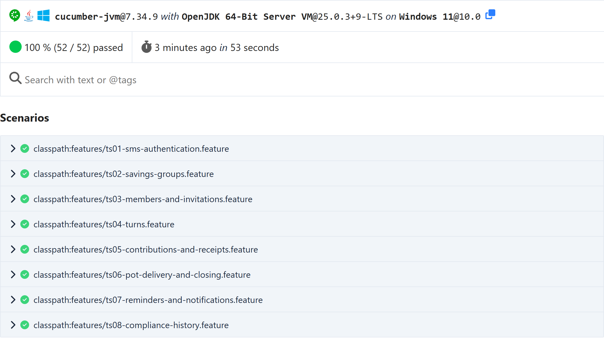{width=80%}

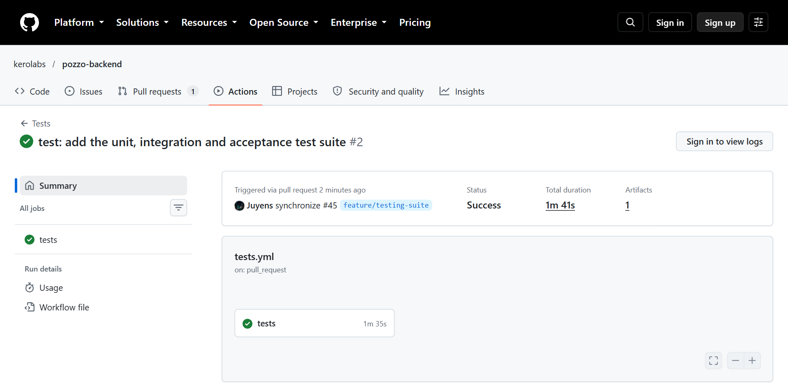{width=90%}

La Tabla 149 relaciona los commits de los avances en Testing de este Sprint.

<table>
  <caption>Commits de las pruebas de los servicios RESTful</caption>
  <colgroup><col width="13%"><col width="13%"><col width="11%"><col width="24%"><col width="24%"><col width="15%"></colgroup>
  <thead>
    <tr>
      <th>Repository</th>
      <th>Branch</th>
      <th>Commit Id</th>
      <th>Commit Message</th>
      <th>Commit Message Body</th>
      <th>Committed on (Date)</th>
    </tr>
  </thead>
  <tbody>
    <tr>
      <td>kerolabs/pozzo-backend</td>
      <td>feature/testing-suite</td>
      <td><a href="https://github.com/kerolabs/pozzo-backend/commit/9c4aa4a">9c4aa4a</a></td>
      <td>test: add the test infrastructure with Testcontainers and Cucumber</td>
      <td>The integration and acceptance tests start the whole application against PostgreSQL 16 in a container, call the API through MockMvc and read the SMS codes from a recording sender, with a clock the tests can move forward. Surefire also runs the Cucumber suite.</td>
      <td>08/10/2026</td>
    </tr>
    <tr>
      <td>kerolabs/pozzo-backend</td>
      <td>feature/testing-suite</td>
      <td><a href="https://github.com/kerolabs/pozzo-backend/commit/1b0c52e">1b0c52e</a></td>
      <td>test: add unit tests for the domain of the five bounded contexts</td>
      <td>Cover the aggregates, value objects and domain services without Spring or a database: receipt validation and review, the pot of a period, the setup of a savings group, the turn draw, the SMS code, the compliance level and the reminder plan.</td>
      <td>08/10/2026</td>
    </tr>
    <tr>
      <td>kerolabs/pozzo-backend</td>
      <td>feature/testing-suite</td>
      <td><a href="https://github.com/kerolabs/pozzo-backend/commit/1d65858">1d65858</a></td>
      <td>test: add integration tests of the REST API against PostgreSQL</td>
      <td>Check security, the standard error body, persistence and the events that carry a contribution to Compliance History and Notifications.</td>
      <td>08/10/2026</td>
    </tr>
    <tr>
      <td>kerolabs/pozzo-backend</td>
      <td>feature/testing-suite</td>
      <td><a href="https://github.com/kerolabs/pozzo-backend/commit/884bf11">884bf11</a></td>
      <td>test: add the acceptance tests of the technical stories in Gherkin</td>
      <td>One .feature file per Technical Story, TS01 to TS08, with the request and response scenarios of its acceptance criteria and their steps in Java.</td>
      <td>08/10/2026</td>
    </tr>
    <tr>
      <td>kerolabs/pozzo-backend</td>
      <td>feature/testing-suite</td>
      <td><a href="https://github.com/kerolabs/pozzo-backend/commit/de8a9d4">de8a9d4</a></td>
      <td>ci: run the test suite on every pull request</td>
      <td>The deploy builds without tests, so this workflow runs them on every pull request and on every push to develop and main, and keeps the Cucumber and Surefire reports.</td>
      <td>08/10/2026</td>
    </tr>
    <tr>
      <td>kerolabs/pozzo-backend</td>
      <td>feature/testing-suite</td>
      <td><a href="https://github.com/kerolabs/pozzo-backend/commit/6d18d17">6d18d17</a></td>
      <td>docs: describe the test suite in the README and fix its code blocks</td>
      <td>Sin cuerpo</td>
      <td>08/10/2026</td>
    </tr>
    <tr>
      <td>kerolabs/pozzo-backend</td>
      <td>feature/testing-suite</td>
      <td><a href="https://github.com/kerolabs/pozzo-backend/commit/c520f48">c520f48</a></td>
      <td>ci: move the test workflow to the actions that run on Node 24</td>
      <td>checkout v4 and setup-java v4 run on Node 20, which GitHub deprecated.</td>
      <td>08/10/2026</td>
    </tr>
  </tbody>
</table>

#### 4.2.1.6. Execution Evidence for Sprint Review

En el Sprint 1 la aplicación móvil alcanzó el flujo completo de una junta: el ingreso con el número de celular y el código SMS, la creación de la junta con sus reglas y su destino, la invitación por código y enlace, la asignación de turnos, el inicio de la junta y el estado del pozo del período en curso, junto con el registro del aporte con el comprobante leído en el dispositivo, la revisión de los aportes que no coinciden, el historial, los avisos y el perfil. Las capturas se tomaron en un emulador Android con una junta de muestra de cuatro integrantes, conectado a una instancia local de los servicios RESTful.

La Figura 146 muestra la bienvenida, el ingreso con el número de celular, la lista de juntas del integrante con su rol y su turno, y el perfil.

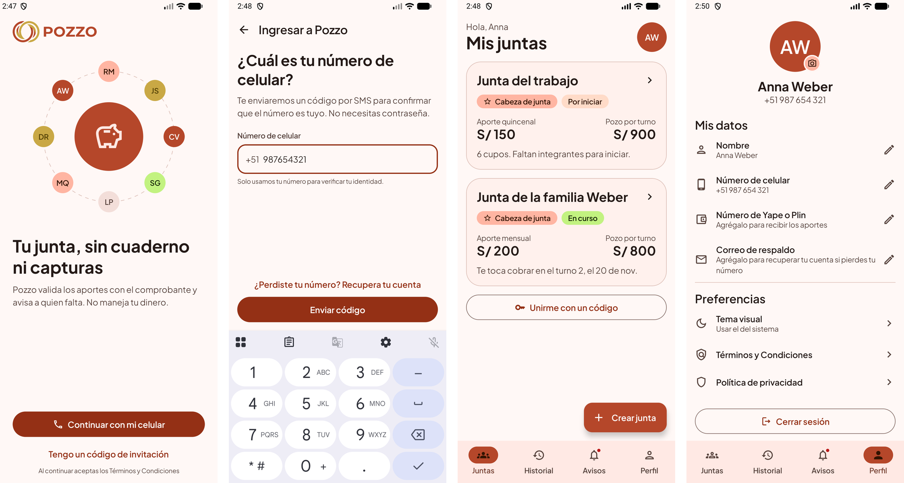{width=100%}

La Figura 147 muestra una junta por iniciar con lo que le falta para empezar, la invitación con su código y su enlace, y una junta en curso con el estado del pozo de su período y el calendario de turnos.

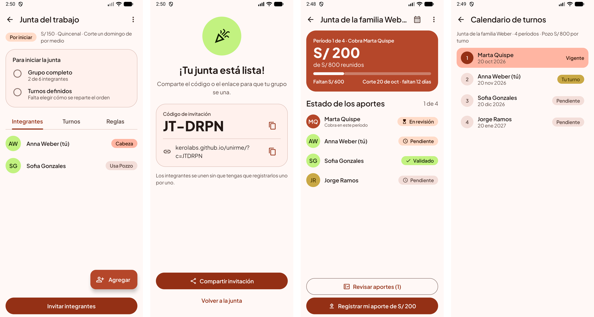{width=100%}

La Figura 148 muestra el registro del aporte, con el destino al que se transfiere; la revisión de un comprobante que no coincide, campo por campo; el historial de aportes de la junta; y los avisos que recibe la cabeza de junta.

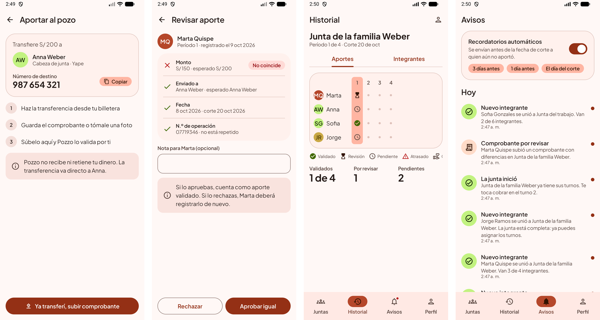{width=100%}

Para complementar la evidencia de ejecución del Sprint 1, se presenta el video explicativo del flujo de navegación y funcionamiento de la aplicación móvil desarrollado para la Sprint Review, disponible en YouTube: <https://youtu.be/rGwVmdaVSMA>. La Figura 149 muestra un cuadro del video.

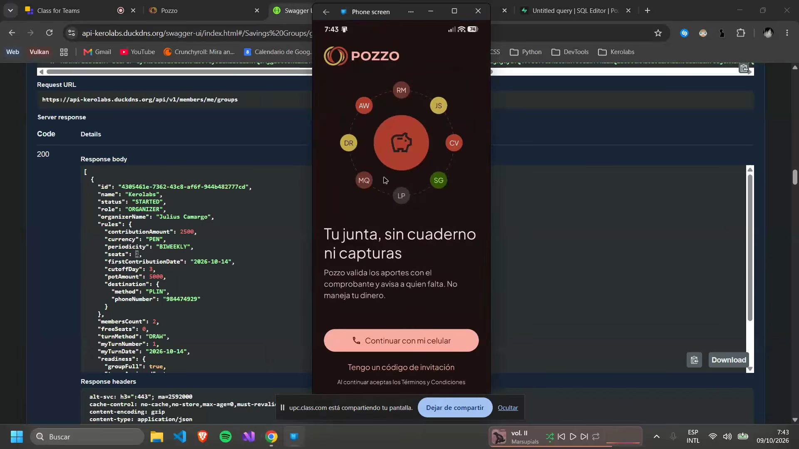{width=40%}

#### 4.2.1.7. Services Documentation Evidence for Sprint Review

En este Sprint se documentaron con OpenAPI los 54 endpoints de los servicios RESTful de Pozzo, agrupados en 11 recursos que corresponden a los cinco bounded contexts. La documentación se genera desde el código con springdoc-openapi: cada controller declara el resumen y la descripción de sus operaciones, los parámetros, el cuerpo esperado y los códigos de respuesta, incluidos los de error, que comparten el mismo cuerpo `Error` con un código y un mensaje. Los recursos describen cada campo y traen valores de ejemplo, y el documento declara el esquema de seguridad Bearer con el token JWT que emite Identity & Access.

La documentación está desplegada junto con los servicios: Swagger UI en <https://api-kerolabs.duckdns.org/swagger-ui/index.html> y el documento OpenAPI 3.1 en <https://api-kerolabs.duckdns.org/v3/api-docs>. El código está en el repositorio <https://github.com/kerolabs/pozzo-backend>. La Figura 150 muestra la documentación desplegada con sus 11 recursos.

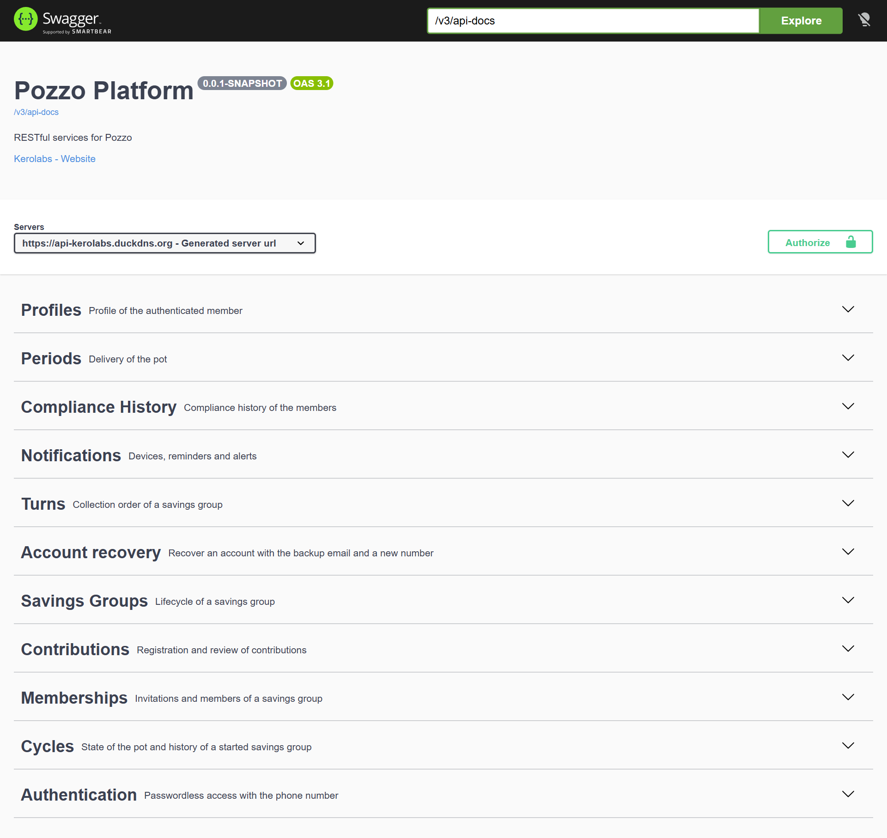{width=85%}

Las rutas parten de `https://api-kerolabs.duckdns.org/api/v1` y todas requieren el token Bearer, salvo las marcadas como públicas. Las Tablas 150 a 154 presentan los endpoints de cada bounded context: el verbo HTTP, la sintaxis de la llamada, la acción con su enlace a la documentación desplegada, los parámetros y la respuesta exitosa. Los errores de cada operación están en la documentación desplegada.

<table>
  <caption>Endpoints documentados de Identity &amp; Access</caption>
  <colgroup><col width="12%"><col width="24%"><col width="20%"><col width="18%"><col width="26%"></colgroup>
  <thead>
    <tr>
      <th>Verbo</th>
      <th>Sintaxis de llamada</th>
      <th>Acción</th>
      <th>Parámetros</th>
      <th>Respuesta</th>
    </tr>
  </thead>
  <tbody>
    <tr>
      <td>POST</td>
      <td>/auth/codes</td>
      <td><a href="https://api-kerolabs.duckdns.org/swagger-ui/index.html#/Authentication/requestCode_2">Solicitar el código de verificación por SMS</a> (pública)</td>
      <td>cuerpo: phoneNumber</td>
      <td><b>202 Accepted</b>: el número al que se envió el código, su vencimiento a los 10 minutos y desde cuándo se puede pedir otro.</td>
    </tr>
    <tr>
      <td>POST</td>
      <td>/auth/codes/verify</td>
      <td><a href="https://api-kerolabs.duckdns.org/swagger-ui/index.html#/Authentication/verifyCode_1">Verificar el código</a> (pública)</td>
      <td>cuerpo: code, phoneNumber</td>
      <td><b>200 OK</b>: la sesión si el número ya tiene cuenta; si no, un token de registro válido por 15 minutos.</td>
    </tr>
    <tr>
      <td>POST</td>
      <td>/auth/register</td>
      <td><a href="https://api-kerolabs.duckdns.org/swagger-ui/index.html#/Authentication/register">Completar el registro</a> (pública)</td>
      <td>cuerpo: displayName, registrationToken</td>
      <td><b>201 Created</b>: el token de sesión, su vencimiento y el perfil de la cuenta creada.</td>
    </tr>
    <tr>
      <td>POST</td>
      <td>/auth/sign-out</td>
      <td><a href="https://api-kerolabs.duckdns.org/swagger-ui/index.html#/Authentication/signOut">Cerrar la sesión</a></td>
      <td>Ninguno</td>
      <td><b>204 No Content</b>: sin cuerpo; la sesión con la que se hizo la solicitud queda revocada.</td>
    </tr>
    <tr>
      <td>POST</td>
      <td>/auth/recovery/codes</td>
      <td><a href="https://api-kerolabs.duckdns.org/swagger-ui/index.html#/Account%20recovery/requestCode_1">Solicitar un código de recuperación al correo de respaldo</a> (pública)</td>
      <td>cuerpo: email</td>
      <td><b>202 Accepted</b>: la misma respuesta exista o no una cuenta con ese correo, para no revelar cuáles están registrados.</td>
    </tr>
    <tr>
      <td>POST</td>
      <td>/auth/recovery/codes/verify</td>
      <td><a href="https://api-kerolabs.duckdns.org/swagger-ui/index.html#/Account%20recovery/verifyCode">Verificar el código de recuperación</a> (pública)</td>
      <td>cuerpo: code, email</td>
      <td><b>200 OK</b>: un token válido por 15 minutos para vincular un número nuevo.</td>
    </tr>
    <tr>
      <td>POST</td>
      <td>/auth/recovery/phone-number</td>
      <td><a href="https://api-kerolabs.duckdns.org/swagger-ui/index.html#/Account%20recovery/recover">Vincular el número nuevo e iniciar sesión</a> (pública)</td>
      <td>cuerpo: code, phoneNumber, recoveryToken</td>
      <td><b>200 OK</b>: la sesión nueva; las sesiones del celular perdido se cierran y las juntas y el historial se conservan.</td>
    </tr>
    <tr>
      <td>POST</td>
      <td>/auth/recovery/phone-number/codes</td>
      <td><a href="https://api-kerolabs.duckdns.org/swagger-ui/index.html#/Account%20recovery/requestPhoneCode">Solicitar el código SMS del número nuevo</a> (pública)</td>
      <td>cuerpo: phoneNumber, recoveryToken</td>
      <td><b>202 Accepted</b>: el número, el vencimiento del código y desde cuándo se puede pedir otro.</td>
    </tr>
    <tr>
      <td>PUT</td>
      <td>/members/me/phone-number</td>
      <td><a href="https://api-kerolabs.duckdns.org/swagger-ui/index.html#/Profiles/changePhoneNumber">Cambiar mi número de celular</a></td>
      <td>cuerpo: code, phoneNumber</td>
      <td><b>200 OK</b>: el perfil con el número nuevo; las juntas y el historial se conservan.</td>
    </tr>
    <tr>
      <td>POST</td>
      <td>/members/me/phone-number/codes</td>
      <td><a href="https://api-kerolabs.duckdns.org/swagger-ui/index.html#/Profiles/requestCode">Solicitar el código del número nuevo</a></td>
      <td>cuerpo: phoneNumber</td>
      <td><b>202 Accepted</b>: el número al que se envió el código y su vencimiento.</td>
    </tr>
    <tr>
      <td>GET</td>
      <td>/members/me/profile</td>
      <td><a href="https://api-kerolabs.duckdns.org/swagger-ui/index.html#/Profiles/getProfile">Consultar mi perfil</a></td>
      <td>Ninguno</td>
      <td><b>200 OK</b>: el perfil del integrante autenticado.</td>
    </tr>
    <tr>
      <td>PUT</td>
      <td>/members/me/profile</td>
      <td><a href="https://api-kerolabs.duckdns.org/swagger-ui/index.html#/Profiles/updateProfile">Actualizar mi perfil</a></td>
      <td>cuerpo: displayName, theme</td>
      <td><b>200 OK</b>: el perfil con el nombre, el tema visual, el número de Yape o Plin y el correo de respaldo nuevos.</td>
    </tr>
    <tr>
      <td>PUT</td>
      <td>/members/me/profile/photo</td>
      <td><a href="https://api-kerolabs.duckdns.org/swagger-ui/index.html#/Profiles/changePhoto">Cambiar mi foto</a></td>
      <td>archivo de imagen (multipart/form-data)</td>
      <td><b>200 OK</b>: el perfil con la URL de la foto nueva; la anterior se borra.</td>
    </tr>
    <tr>
      <td>DELETE</td>
      <td>/members/me/profile/photo</td>
      <td><a href="https://api-kerolabs.duckdns.org/swagger-ui/index.html#/Profiles/removePhoto">Quitar mi foto</a></td>
      <td>Ninguno</td>
      <td><b>200 OK</b>: el perfil sin foto; la aplicación muestra las iniciales.</td>
    </tr>
  </tbody>
</table>

<table>
  <caption>Endpoints documentados de Savings Groups</caption>
  <colgroup><col width="12%"><col width="24%"><col width="20%"><col width="18%"><col width="26%"></colgroup>
  <thead>
    <tr>
      <th>Verbo</th>
      <th>Sintaxis de llamada</th>
      <th>Acción</th>
      <th>Parámetros</th>
      <th>Respuesta</th>
    </tr>
  </thead>
  <tbody>
    <tr>
      <td>POST</td>
      <td>/groups</td>
      <td><a href="https://api-kerolabs.duckdns.org/swagger-ui/index.html#/Savings%20Groups/createGroup">Crear una junta</a></td>
      <td>cuerpo: contributionAmount, firstContributionDate, name, periodicity</td>
      <td><b>201 Created</b>: la junta en estado DRAFT, con quien la crea como cabeza.</td>
    </tr>
    <tr>
      <td>GET</td>
      <td>/groups/{groupId}</td>
      <td><a href="https://api-kerolabs.duckdns.org/swagger-ui/index.html#/Savings%20Groups/getGroup">Consultar una junta</a></td>
      <td>groupId (ruta)</td>
      <td><b>200 OK</b>: la junta con sus reglas, cupos libres y lo que le falta para iniciar.</td>
    </tr>
    <tr>
      <td>DELETE</td>
      <td>/groups/{groupId}</td>
      <td><a href="https://api-kerolabs.duckdns.org/swagger-ui/index.html#/Savings%20Groups/deleteGroup">Eliminar la junta</a></td>
      <td>groupId (ruta)</td>
      <td><b>204 No Content</b>: sin cuerpo; los integrantes con la aplicación reciben un aviso.</td>
    </tr>
    <tr>
      <td>PATCH</td>
      <td>/groups/{groupId}/destination</td>
      <td><a href="https://api-kerolabs.duckdns.org/swagger-ui/index.html#/Savings%20Groups/defineDestination">Definir a dónde se envían los aportes</a></td>
      <td>groupId (ruta), cuerpo: method, phoneNumber</td>
      <td><b>200 OK</b>: la junta con el método (Yape o Plin) y el número de destino.</td>
    </tr>
    <tr>
      <td>PUT</td>
      <td>/groups/{groupId}/rules</td>
      <td><a href="https://api-kerolabs.duckdns.org/swagger-ui/index.html#/Savings%20Groups/updateRules">Ajustar las reglas</a></td>
      <td>groupId (ruta), cuerpo: contributionAmount, firstContributionDate, name, periodicity</td>
      <td><b>200 OK</b>: la junta con las reglas nuevas; no acepta menos cupos que integrantes.</td>
    </tr>
    <tr>
      <td>POST</td>
      <td>/groups/{groupId}/start</td>
      <td><a href="https://api-kerolabs.duckdns.org/swagger-ui/index.html#/Savings%20Groups/startGroup">Iniciar la junta</a></td>
      <td>groupId (ruta)</td>
      <td><b>200 OK</b>: la junta en estado STARTED; las reglas ya no cambian y la invitación vence.</td>
    </tr>
    <tr>
      <td>GET</td>
      <td>/members/me/groups</td>
      <td><a href="https://api-kerolabs.duckdns.org/swagger-ui/index.html#/Savings%20Groups/getMyGroups">Listar mis juntas</a></td>
      <td>Ninguno</td>
      <td><b>200 OK</b>: las juntas en las que el integrante participa, con su rol y su turno.</td>
    </tr>
    <tr>
      <td>POST</td>
      <td>/groups/{groupId}/invitations</td>
      <td><a href="https://api-kerolabs.duckdns.org/swagger-ui/index.html#/Memberships/generateInvitation">Generar una invitación</a></td>
      <td>groupId (ruta)</td>
      <td><b>201 Created</b>: el código, el enlace para compartir y su vencimiento; la invitación anterior vence.</td>
    </tr>
    <tr>
      <td>GET</td>
      <td>/groups/{groupId}/invitations/active</td>
      <td><a href="https://api-kerolabs.duckdns.org/swagger-ui/index.html#/Memberships/getActiveInvitation">Consultar la invitación vigente</a></td>
      <td>groupId (ruta)</td>
      <td><b>200 OK</b>: el código y el enlace que siguen activos.</td>
    </tr>
    <tr>
      <td>GET</td>
      <td>/groups/{groupId}/members</td>
      <td><a href="https://api-kerolabs.duckdns.org/swagger-ui/index.html#/Memberships/getMembers">Listar los integrantes</a></td>
      <td>groupId (ruta)</td>
      <td><b>200 OK</b>: los integrantes con su tipo, su turno y su foto; la cabeza va primero.</td>
    </tr>
    <tr>
      <td>POST</td>
      <td>/groups/{groupId}/members/manual</td>
      <td><a href="https://api-kerolabs.duckdns.org/swagger-ui/index.html#/Memberships/addManualMember">Registrar un integrante sin la aplicación</a></td>
      <td>groupId (ruta), cuerpo: displayName</td>
      <td><b>201 Created</b>: la lista de integrantes actualizada.</td>
    </tr>
    <tr>
      <td>DELETE</td>
      <td>/groups/{groupId}/members/{membershipId}</td>
      <td><a href="https://api-kerolabs.duckdns.org/swagger-ui/index.html#/Memberships/removeMember">Retirar a un integrante</a></td>
      <td>groupId (ruta), membershipId (ruta)</td>
      <td><b>204 No Content</b>: sin cuerpo; el integrante puede volver a unirse con otra invitación.</td>
    </tr>
    <tr>
      <td>GET</td>
      <td>/invitations/{code}</td>
      <td><a href="https://api-kerolabs.duckdns.org/swagger-ui/index.html#/Memberships/previewGroup">Ver una junta antes de unirse</a></td>
      <td>code (ruta)</td>
      <td><b>200 OK</b>: el nombre, la cabeza, las reglas y los cupos libres, sin la lista de integrantes.</td>
    </tr>
    <tr>
      <td>POST</td>
      <td>/invitations/{code}/join</td>
      <td><a href="https://api-kerolabs.duckdns.org/swagger-ui/index.html#/Memberships/joinGroup">Unirse con un código de invitación</a></td>
      <td>code (ruta)</td>
      <td><b>200 OK</b>: la junta a la que el integrante se unió.</td>
    </tr>
    <tr>
      <td>GET</td>
      <td>/groups/{groupId}/turns</td>
      <td><a href="https://api-kerolabs.duckdns.org/swagger-ui/index.html#/Turns/getTurns">Consultar el calendario de turnos</a></td>
      <td>groupId (ruta)</td>
      <td><b>200 OK</b>: el turno, la fecha y el integrante que cobra en cada período.</td>
    </tr>
    <tr>
      <td>POST</td>
      <td>/groups/{groupId}/turns/agreed</td>
      <td><a href="https://api-kerolabs.duckdns.org/swagger-ui/index.html#/Turns/agreedTurns">Fijar el orden acordado</a></td>
      <td>groupId (ruta), cuerpo: order</td>
      <td><b>200 OK</b>: el calendario de turnos en el orden enviado.</td>
    </tr>
    <tr>
      <td>POST</td>
      <td>/groups/{groupId}/turns/draw</td>
      <td><a href="https://api-kerolabs.duckdns.org/swagger-ui/index.html#/Turns/drawTurns">Sortear los turnos</a></td>
      <td>groupId (ruta)</td>
      <td><b>200 OK</b>: el calendario de turnos y la semilla que permite reproducir el sorteo.</td>
    </tr>
  </tbody>
</table>

<table>
  <caption>Endpoints documentados de Contributions</caption>
  <colgroup><col width="12%"><col width="24%"><col width="20%"><col width="18%"><col width="26%"></colgroup>
  <thead>
    <tr>
      <th>Verbo</th>
      <th>Sintaxis de llamada</th>
      <th>Acción</th>
      <th>Parámetros</th>
      <th>Respuesta</th>
    </tr>
  </thead>
  <tbody>
    <tr>
      <td>GET</td>
      <td>/contributions/{contributionId}/receipt-image</td>
      <td><a href="https://api-kerolabs.duckdns.org/swagger-ui/index.html#/Contributions/getReceiptImage">Ver la imagen de un comprobante</a></td>
      <td>contributionId (ruta)</td>
      <td><b>200 OK</b>: un enlace firmado que funciona durante 15 minutos.</td>
    </tr>
    <tr>
      <td>PUT</td>
      <td>/contributions/{contributionId}/receipt-image</td>
      <td><a href="https://api-kerolabs.duckdns.org/swagger-ui/index.html#/Contributions/attachReceiptImage">Guardar la imagen de mi comprobante</a></td>
      <td>contributionId (ruta), archivo de imagen (multipart/form-data)</td>
      <td><b>200 OK</b>: el aporte, que indica que ya tiene imagen guardada.</td>
    </tr>
    <tr>
      <td>PATCH</td>
      <td>/contributions/{contributionId}/review</td>
      <td><a href="https://api-kerolabs.duckdns.org/swagger-ui/index.html#/Contributions/reviewContribution">Revisar un aporte</a></td>
      <td>contributionId (ruta), cuerpo: decision</td>
      <td><b>200 OK</b>: el aporte en APPROVED, que cuenta como pagado, o REJECTED, que el integrante puede registrar de nuevo.</td>
    </tr>
    <tr>
      <td>POST</td>
      <td>/periods/{periodId}/contributions</td>
      <td><a href="https://api-kerolabs.duckdns.org/swagger-ui/index.html#/Contributions/registerContribution">Registrar mi aporte con el comprobante</a></td>
      <td>periodId (ruta), cuerpo: amount, operationNumber, paidAt, payeeName, source</td>
      <td><b>201 Created</b>: el aporte en estado VALIDATED, o INCONSISTENT con los campos que no coinciden.</td>
    </tr>
    <tr>
      <td>POST</td>
      <td>/periods/{periodId}/contributions/cash</td>
      <td><a href="https://api-kerolabs.duckdns.org/swagger-ui/index.html#/Contributions/registerCash">Registrar un aporte en efectivo</a></td>
      <td>periodId (ruta), cuerpo: amount, membershipId, receivedOn</td>
      <td><b>201 Created</b>: el aporte validado, de método CASH.</td>
    </tr>
    <tr>
      <td>POST</td>
      <td>/periods/{periodId}/contributions/coverage</td>
      <td><a href="https://api-kerolabs.duckdns.org/swagger-ui/index.html#/Contributions/registerCoverage">Registrar una cobertura</a></td>
      <td>periodId (ruta), cuerpo: coveredByMembershipId, membershipId</td>
      <td><b>201 Created</b>: el aporte de método COVERAGE e indica quién puso el dinero.</td>
    </tr>
    <tr>
      <td>GET</td>
      <td>/periods/{periodId}/contributions/pending-review</td>
      <td><a href="https://api-kerolabs.duckdns.org/swagger-ui/index.html#/Contributions/getPendingReviews">Listar los aportes por revisar</a></td>
      <td>periodId (ruta)</td>
      <td><b>200 OK</b>: los aportes INCONSISTENT del período, con lo esperado y lo encontrado.</td>
    </tr>
    <tr>
      <td>GET</td>
      <td>/cycles/{cycleId}/members/me/contributions</td>
      <td><a href="https://api-kerolabs.duckdns.org/swagger-ui/index.html#/Cycles/getMyContributions">Listar mis aportes</a></td>
      <td>cycleId (ruta)</td>
      <td><b>200 OK</b>: lo aportado, lo pendiente y el estado de cada período.</td>
    </tr>
    <tr>
      <td>GET</td>
      <td>/cycles/{cycleId}/periods</td>
      <td><a href="https://api-kerolabs.duckdns.org/swagger-ui/index.html#/Cycles/getPeriods">Listar los períodos</a></td>
      <td>cycleId (ruta)</td>
      <td><b>200 OK</b>: los períodos abiertos hasta ahora, en orden de turno.</td>
    </tr>
    <tr>
      <td>GET</td>
      <td>/cycles/{cycleId}/periods/current</td>
      <td><a href="https://api-kerolabs.duckdns.org/swagger-ui/index.html#/Cycles/getCurrentPeriod">Consultar el estado del pozo</a></td>
      <td>cycleId (ruta)</td>
      <td><b>200 OK</b>: quién cobra, cuánto se reunió y cuánto falta, y el estado de cada integrante.</td>
    </tr>
    <tr>
      <td>GET</td>
      <td>/groups/{groupId}/cycle</td>
      <td><a href="https://api-kerolabs.duckdns.org/swagger-ui/index.html#/Cycles/getCycle">Consultar el ciclo de una junta</a></td>
      <td>groupId (ruta)</td>
      <td><b>200 OK</b>: el ciclo con el turno en curso, el pozo y el destino de los aportes.</td>
    </tr>
    <tr>
      <td>POST</td>
      <td>/periods/{periodId}/payout</td>
      <td><a href="https://api-kerolabs.duckdns.org/swagger-ui/index.html#/Periods/deliverPot">Confirmar la entrega del pozo</a></td>
      <td>periodId (ruta)</td>
      <td><b>200 OK</b>: el período entregado; se abre el siguiente o, si era el último, se cierra el ciclo.</td>
    </tr>
  </tbody>
</table>

<table>
  <caption>Endpoints documentados de Compliance History</caption>
  <colgroup><col width="12%"><col width="24%"><col width="20%"><col width="18%"><col width="26%"></colgroup>
  <thead>
    <tr>
      <th>Verbo</th>
      <th>Sintaxis de llamada</th>
      <th>Acción</th>
      <th>Parámetros</th>
      <th>Respuesta</th>
    </tr>
  </thead>
  <tbody>
    <tr>
      <td>GET</td>
      <td>/compliance/shared/{token}</td>
      <td><a href="https://api-kerolabs.duckdns.org/swagger-ui/index.html#/Compliance%20History/getSharedHistory">Abrir un historial compartido</a> (pública)</td>
      <td>token (ruta)</td>
      <td><b>200 OK</b>: el nombre y el resumen, sin montos ni nombres de juntas.</td>
    </tr>
    <tr>
      <td>DELETE</td>
      <td>/compliance/shares/{token}</td>
      <td><a href="https://api-kerolabs.duckdns.org/swagger-ui/index.html#/Compliance%20History/revokeShareLink">Revocar un enlace compartido</a></td>
      <td>token (ruta)</td>
      <td><b>204 No Content</b>: sin cuerpo; el enlace deja de funcionar.</td>
    </tr>
    <tr>
      <td>GET</td>
      <td>/groups/{groupId}/compliance</td>
      <td><a href="https://api-kerolabs.duckdns.org/swagger-ui/index.html#/Compliance%20History/getGroupCompliance">Consultar el cumplimiento de los integrantes de una junta</a></td>
      <td>groupId (ruta)</td>
      <td><b>200 OK</b>: el resumen de cada integrante de la junta.</td>
    </tr>
    <tr>
      <td>GET</td>
      <td>/members/me/compliance</td>
      <td><a href="https://api-kerolabs.duckdns.org/swagger-ui/index.html#/Compliance%20History/getMyHistory">Consultar mi historial</a></td>
      <td>Ninguno</td>
      <td><b>200 OK</b>: el resumen en todas las juntas y el detalle por junta.</td>
    </tr>
    <tr>
      <td>POST</td>
      <td>/members/me/compliance/share</td>
      <td><a href="https://api-kerolabs.duckdns.org/swagger-ui/index.html#/Compliance%20History/shareHistory">Compartir mi historial</a></td>
      <td>Ninguno</td>
      <td><b>201 Created</b>: el enlace público y su vencimiento a los 7 días.</td>
    </tr>
    <tr>
      <td>GET</td>
      <td>/members/{memberId}/compliance/summary</td>
      <td><a href="https://api-kerolabs.duckdns.org/swagger-ui/index.html#/Compliance%20History/getMemberSummary">Consultar el resumen de un integrante</a></td>
      <td>memberId (ruta)</td>
      <td><b>200 OK</b>: el nivel, la tasa de cumplimiento y los conteos de aportes.</td>
    </tr>
  </tbody>
</table>

<table>
  <caption>Endpoints documentados de Notifications</caption>
  <colgroup><col width="12%"><col width="24%"><col width="20%"><col width="18%"><col width="26%"></colgroup>
  <thead>
    <tr>
      <th>Verbo</th>
      <th>Sintaxis de llamada</th>
      <th>Acción</th>
      <th>Parámetros</th>
      <th>Respuesta</th>
    </tr>
  </thead>
  <tbody>
    <tr>
      <td>GET</td>
      <td>/groups/{groupId}/reminder-plan</td>
      <td><a href="https://api-kerolabs.duckdns.org/swagger-ui/index.html#/Notifications/getReminderPlan">Consultar los recordatorios de una junta</a></td>
      <td>groupId (ruta)</td>
      <td><b>200 OK</b>: los días de anticipación y la hora de envío.</td>
    </tr>
    <tr>
      <td>PUT</td>
      <td>/groups/{groupId}/reminder-plan</td>
      <td><a href="https://api-kerolabs.duckdns.org/swagger-ui/index.html#/Notifications/configureReminderPlan">Cambiar los recordatorios de una junta</a></td>
      <td>groupId (ruta), cuerpo: enabled, offsetsInDays, sendHour</td>
      <td><b>200 OK</b>: el plan nuevo, que se aplica desde el siguiente período.</td>
    </tr>
    <tr>
      <td>POST</td>
      <td>/members/me/devices</td>
      <td><a href="https://api-kerolabs.duckdns.org/swagger-ui/index.html#/Notifications/registerDevice">Registrar mi celular</a></td>
      <td>cuerpo: platform, pushToken</td>
      <td><b>201 Created</b>: el dispositivo con su token de Firebase Cloud Messaging.</td>
    </tr>
    <tr>
      <td>DELETE</td>
      <td>/members/me/devices/{deviceId}</td>
      <td><a href="https://api-kerolabs.duckdns.org/swagger-ui/index.html#/Notifications/deactivateDevice">Quitar mi celular</a></td>
      <td>deviceId (ruta)</td>
      <td><b>204 No Content</b>: sin cuerpo; el celular deja de recibir notificaciones.</td>
    </tr>
    <tr>
      <td>GET</td>
      <td>/members/me/notifications</td>
      <td><a href="https://api-kerolabs.duckdns.org/swagger-ui/index.html#/Notifications/getMyNotifications">Consultar mis notificaciones</a></td>
      <td>Ninguno</td>
      <td><b>200 OK</b>: las últimas 50, de la más reciente a la más antigua.</td>
    </tr>
  </tbody>
</table>

La Tabla 155 muestra un ejemplo de respuesta de los recursos principales, tomado de la junta de muestra con la que se probó la documentación y reducido a los campos que explican cada recurso. La documentación desplegada tiene el esquema completo de cada uno.

<table>
  <caption>Ejemplos de respuesta de los recursos principales</caption>
  <colgroup><col width="17%"><col width="60%"><col width="23%"></colgroup>
  <thead>
    <tr>
      <th>Recurso</th>
      <th>Ejemplo de respuesta</th>
      <th>Explicación</th>
    </tr>
  </thead>
  <tbody>
    <tr>
      <td>ProfileResponse</td>
      <td><code>{<br>&nbsp;"displayName":&nbsp;"Anna&nbsp;Weber",<br>&nbsp;"phoneNumber":&nbsp;"+51987654321",<br>&nbsp;"theme":&nbsp;"SYSTEM",<br>&nbsp;"walletNumber":&nbsp;null<br>}</code></td>
      <td>Perfil de un integrante. Lo devuelven las consultas y los cambios de perfil y de número.</td>
    </tr>
    <tr>
      <td>VerificationResponse</td>
      <td><code>{<br>&nbsp;"registrationRequired":&nbsp;null,<br>&nbsp;"session":&nbsp;null,<br>&nbsp;"registrationToken":&nbsp;null<br>}</code></td>
      <td>Resultado de verificar el código: la sesión, o el token para completar el registro.</td>
    </tr>
    <tr>
      <td>Group</td>
      <td><code>{<br>&nbsp;"name":&nbsp;"Junta&nbsp;de&nbsp;la&nbsp;familia&nbsp;Weber",<br>&nbsp;"status":&nbsp;"STARTED",<br>&nbsp;"role":&nbsp;"ORGANIZER",<br>&nbsp;"membersCount":&nbsp;4,<br>&nbsp;"freeSeats":&nbsp;0,<br>&nbsp;"readiness":&nbsp;{<br>&nbsp;&nbsp;"groupFull":&nbsp;true,<br>&nbsp;&nbsp;"turnsAssigned":&nbsp;true,<br>&nbsp;&nbsp;"destinationDefined":&nbsp;true<br>&nbsp;}<br>}</code></td>
      <td>Junta con sus reglas y lo que le falta para iniciar. Lo devuelven las operaciones sobre la junta.</td>
    </tr>
    <tr>
      <td>Membership</td>
      <td><code>{<br>&nbsp;"displayName":&nbsp;"Anna&nbsp;Weber",<br>&nbsp;"kind":&nbsp;"APP",<br>&nbsp;"organizer":&nbsp;true,<br>&nbsp;"turnNumber":&nbsp;4<br>}</code></td>
      <td>Integrante de una junta: con la aplicación (APP) o registrado por la cabeza (MANUAL).</td>
    </tr>
    <tr>
      <td>TurnCalendar</td>
      <td><code>{<br>&nbsp;"method":&nbsp;"DRAW",<br>&nbsp;"drawSeed":&nbsp;"5bd6904907be3299",<br>&nbsp;"potAmount":&nbsp;800.0,<br>&nbsp;"turns":&nbsp;[<br>&nbsp;&nbsp;{<br>&nbsp;&nbsp;&nbsp;"turnNumber":&nbsp;1,<br>&nbsp;&nbsp;&nbsp;"displayName":&nbsp;"Marta&nbsp;Quispe",<br>&nbsp;&nbsp;&nbsp;"cutoffDate":&nbsp;"2026-10-20"<br>&nbsp;&nbsp;},<br>&nbsp;&nbsp;...<br>&nbsp;]<br>}</code></td>
      <td>Calendario de turnos con el método de asignación y la semilla del sorteo.</td>
    </tr>
    <tr>
      <td>Cycle</td>
      <td><code>{<br>&nbsp;"groupName":&nbsp;"Junta&nbsp;de&nbsp;la&nbsp;familia&nbsp;Weber",<br>&nbsp;"status":&nbsp;"ACTIVE",<br>&nbsp;"currentTurn":&nbsp;1,<br>&nbsp;"totalTurns":&nbsp;4,<br>&nbsp;"potAmount":&nbsp;800.0,<br>&nbsp;"destinationMethod":&nbsp;"YAPE"<br>}</code></td>
      <td>Ciclo de una junta iniciada: el turno en curso, el pozo y a dónde se envían los aportes.</td>
    </tr>
    <tr>
      <td>PeriodStatus</td>
      <td><code>{<br>&nbsp;"turnNumber":&nbsp;1,<br>&nbsp;"status":&nbsp;"OPEN",<br>&nbsp;"cutoffDate":&nbsp;"2026-10-20",<br>&nbsp;"payoutMemberName":&nbsp;"Marta&nbsp;Quispe",<br>&nbsp;"potAmount":&nbsp;800.0,<br>&nbsp;"collectedAmount":&nbsp;600.0,<br>&nbsp;"missingAmount":&nbsp;200.0<br>}</code></td>
      <td>Estado del pozo de un período: quién cobra, cuánto se reunió y cuánto falta.</td>
    </tr>
    <tr>
      <td>Contribution</td>
      <td><code>{<br>&nbsp;"memberName":&nbsp;"Marta&nbsp;Quispe",<br>&nbsp;"amount":&nbsp;150.0,<br>&nbsp;"method":&nbsp;"TRANSFER",<br>&nbsp;"status":&nbsp;"INCONSISTENT",<br>&nbsp;"inconsistencies":&nbsp;[<br>&nbsp;&nbsp;{<br>&nbsp;&nbsp;&nbsp;"field":&nbsp;"AMOUNT",<br>&nbsp;&nbsp;&nbsp;"expected":&nbsp;"S/&nbsp;200.00",<br>&nbsp;&nbsp;&nbsp;"found":&nbsp;"S/&nbsp;150.00"<br>&nbsp;&nbsp;}<br>&nbsp;]<br>}</code></td>
      <td>Aporte con su comprobante, su validación y la revisión de la cabeza.</td>
    </tr>
    <tr>
      <td>MyContributions</td>
      <td><code>{<br>&nbsp;"groupName":&nbsp;"Junta&nbsp;de&nbsp;la&nbsp;familia&nbsp;Weber",<br>&nbsp;"contributedAmount":&nbsp;200.0,<br>&nbsp;"pendingAmount":&nbsp;0.0,<br>&nbsp;"periods":&nbsp;[<br>&nbsp;&nbsp;{<br>&nbsp;&nbsp;&nbsp;"turnNumber":&nbsp;1,<br>&nbsp;&nbsp;&nbsp;"cutoffDate":&nbsp;"2026-10-20",<br>&nbsp;&nbsp;&nbsp;"amount":&nbsp;200.0<br>&nbsp;&nbsp;}<br>&nbsp;]<br>}</code></td>
      <td>Aportes del integrante autenticado en un ciclo, período por período.</td>
    </tr>
    <tr>
      <td>ComplianceSummary</td>
      <td><code>{<br>&nbsp;"level":&nbsp;"GOOD",<br>&nbsp;"complianceRate":&nbsp;100,<br>&nbsp;"contributions":&nbsp;1,<br>&nbsp;"onTime":&nbsp;1,<br>&nbsp;"late":&nbsp;0<br>}</code></td>
      <td>Resumen de cumplimiento de un integrante en todas sus juntas.</td>
    </tr>
    <tr>
      <td>ShareLink</td>
      <td><code>{<br>&nbsp;"url":&nbsp;"kerolabs.github.io/historial/?t=...",<br>&nbsp;"expiresAt":&nbsp;"2026-10-15T23:21:58Z"<br>}</code></td>
      <td>Enlace público al historial, que vence a los 7 días.</td>
    </tr>
    <tr>
      <td>Notification</td>
      <td><code>{<br>&nbsp;"kind":&nbsp;"ALERT",<br>&nbsp;"title":&nbsp;"Comprobante&nbsp;por&nbsp;revisar",<br>&nbsp;"body":&nbsp;"Marta&nbsp;Quispe&nbsp;subió&nbsp;un&nbsp;compr...",<br>&nbsp;"sentAt":&nbsp;"2026-10-08T23:21:42Z"<br>}</code></td>
      <td>Notificación enviada al integrante, tal como la muestra la aplicación.</td>
    </tr>
    <tr>
      <td>ReminderPlan</td>
      <td><code>{<br>&nbsp;"offsetsInDays":&nbsp;[<br>&nbsp;&nbsp;3,<br>&nbsp;&nbsp;...<br>&nbsp;],<br>&nbsp;"sendHour":&nbsp;9,<br>&nbsp;"enabled":&nbsp;true<br>}</code></td>
      <td>Plan de recordatorios de una junta: los días de anticipación y la hora de envío.</td>
    </tr>
    <tr>
      <td>CodeRequestedResponse</td>
      <td><code>{<br>&nbsp;"phoneNumber":&nbsp;null,<br>&nbsp;"expiresAt":&nbsp;null,<br>&nbsp;"resendAvailableAt":&nbsp;null<br>}</code></td>
      <td>Confirmación del envío de un código por SMS.</td>
    </tr>
    <tr>
      <td>Error</td>
      <td><code>{<br>&nbsp;"code":&nbsp;"INVITATION_NOT_FOUND",<br>&nbsp;"message":&nbsp;"El&nbsp;código&nbsp;de&nbsp;invitación&nbsp;no..."<br>}</code></td>
      <td>Cuerpo común de todos los errores: un código estable para la aplicación y un mensaje en el idioma del integrante.</td>
    </tr>
  </tbody>
</table>

Para mostrar la interacción con la documentación se usó una junta de muestra de cuatro integrantes: Anna Weber como cabeza, y Sofia Gonzales, Marta Quispe y Jorge Ramos. Sofia registró un aporte que coincidía con lo esperado y Marta uno por un monto menor. Las Figuras 151 a 154 muestran cuatro llamadas hechas desde Swagger UI con el token de cada integrante, con la URL de la solicitud y la respuesta del servicio. Se hicieron sobre una instancia local de los servicios con una base de datos propia, para no mezclar los datos de muestra con los de producción.

Jorge Ramos registra su aporte de S/ 200 con los datos de un comprobante de Plin. El monto, el destinatario y la fecha coinciden con lo esperado, así que el servicio responde 201 Created con el aporte en estado VALIDATED y sin inconsistencias (ver Figura 151).

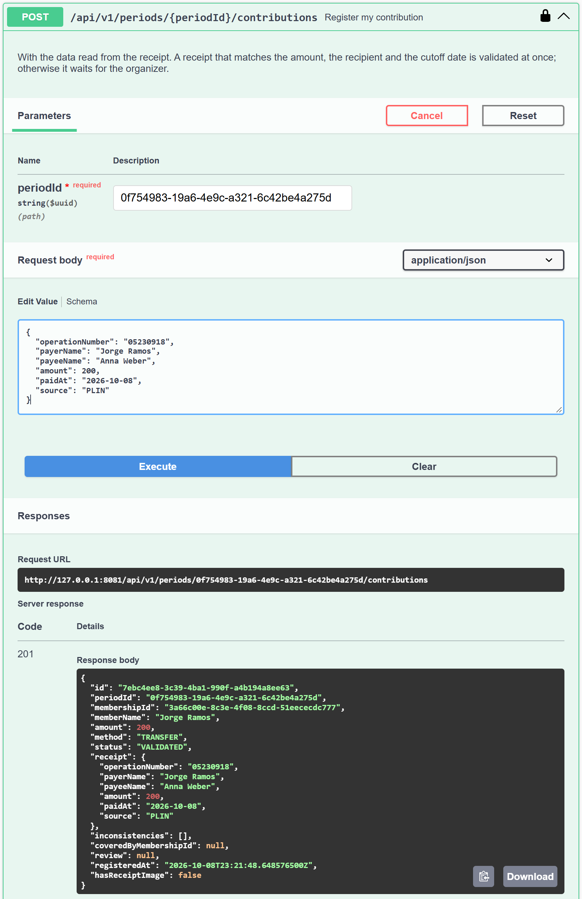{width=80%}

Anna Weber, la cabeza de la junta, consulta los aportes por revisar del período. Aparece el de Marta Quispe en estado INCONSISTENT: el comprobante dice S/ 150 y se esperaban S/ 200 (ver Figura 152).

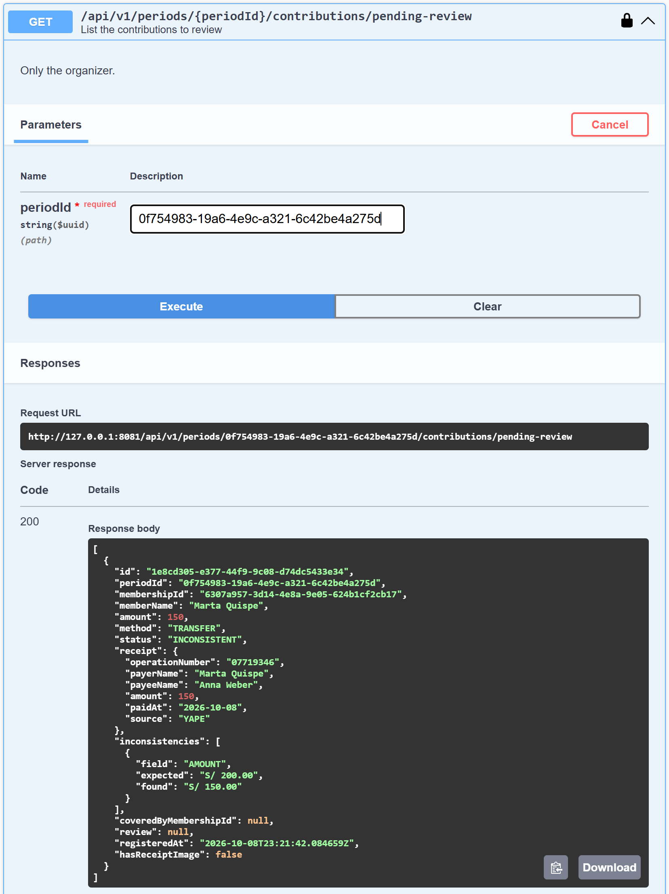{width=80%}

La cabeza aprueba ese aporte con una nota. El servicio responde 200 OK con el aporte en estado APPROVED y la decisión guardada en la revisión, y el aporte pasa a contar como pagado (ver Figura 153).

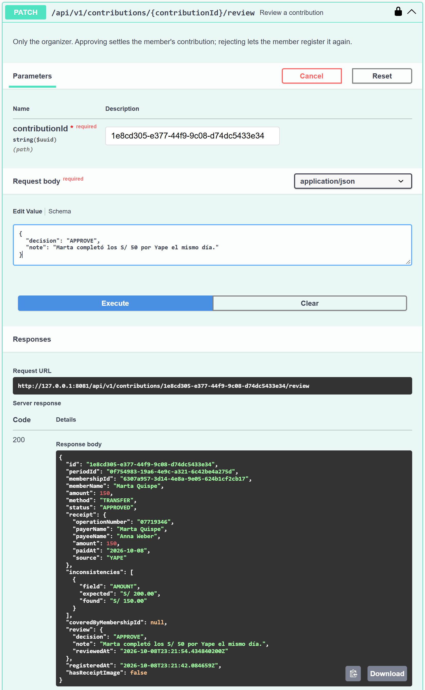{width=80%}

Con los tres aportes, el estado del pozo muestra S/ 600 reunidos de S/ 800, que en este turno cobra Marta Quispe, que solo falta el aporte de Anna Weber y el estado de cada integrante (ver Figura 154).

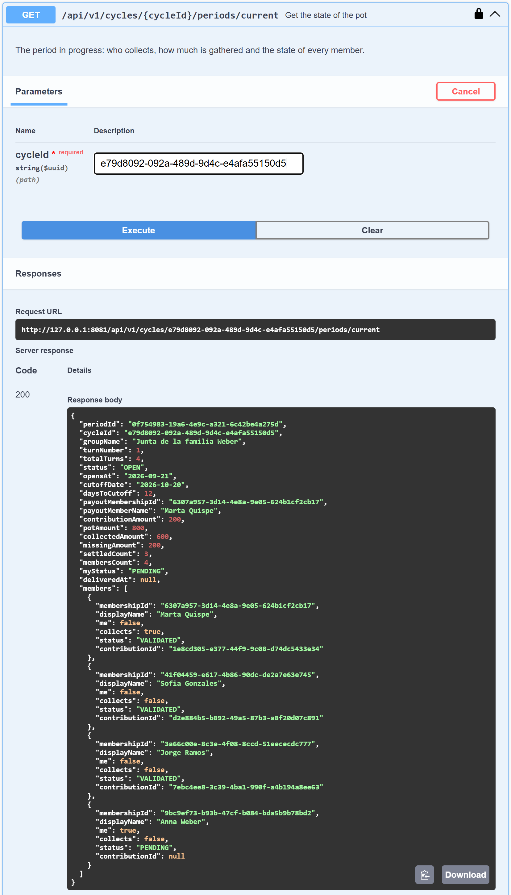{width=80%}

La documentación se escribió junto con cada controller, en el mismo commit que agrega sus endpoints, de modo que ningún endpoint quedó sin documentar en el historial. La Tabla 156 relaciona los commits de los servicios RESTful que agregaron o cambiaron la documentación OpenAPI en este Sprint.

<table>
  <caption>Commits de la documentación de los servicios RESTful</caption>
  <colgroup><col width="14%"><col width="18%"><col width="11%"><col width="33%"><col width="9%"><col width="15%"></colgroup>
  <thead>
    <tr>
      <th>Repository</th>
      <th>Branch</th>
      <th>Commit Id</th>
      <th>Commit Message</th>
      <th>Commit Message Body</th>
      <th>Committed on (Date)</th>
    </tr>
  </thead>
  <tbody>
    <tr>
      <td>kerolabs/pozzo-backend</td>
      <td>feature/shared-kernel</td>
      <td><a href="https://github.com/kerolabs/pozzo-backend/commit/af8a6e6">af8a6e6</a></td>
      <td>feat(shared): add the OpenAPI, locale and message bundle configuration</td>
      <td>Sin cuerpo</td>
      <td>06/10/2026</td>
    </tr>
    <tr>
      <td>kerolabs/pozzo-backend</td>
      <td>feature/shared-kernel</td>
      <td><a href="https://github.com/kerolabs/pozzo-backend/commit/b3fc64c">b3fc64c</a></td>
      <td>feat(shared): add the standard error response and global exception handler</td>
      <td>Sin cuerpo</td>
      <td>06/10/2026</td>
    </tr>
    <tr>
      <td>kerolabs/pozzo-backend</td>
      <td>feature/iam</td>
      <td><a href="https://github.com/kerolabs/pozzo-backend/commit/80cf2b0">80cf2b0</a></td>
      <td>feat(iam): add the authentication and profile endpoints</td>
      <td>Sin cuerpo</td>
      <td>06/10/2026</td>
    </tr>
    <tr>
      <td>kerolabs/pozzo-backend</td>
      <td>feature/savings-groups</td>
      <td><a href="https://github.com/kerolabs/pozzo-backend/commit/af8d172">af8d172</a></td>
      <td>feat(savings-groups): add the group, membership and turn endpoints</td>
      <td>Sin cuerpo</td>
      <td>06/10/2026</td>
    </tr>
    <tr>
      <td>kerolabs/pozzo-backend</td>
      <td>feature/contributions</td>
      <td><a href="https://github.com/kerolabs/pozzo-backend/commit/0fa3b5a">0fa3b5a</a></td>
      <td>feat(contributions): add the cycle, period and contribution endpoints</td>
      <td>Sin cuerpo</td>
      <td>07/10/2026</td>
    </tr>
    <tr>
      <td>kerolabs/pozzo-backend</td>
      <td>feature/notifications</td>
      <td><a href="https://github.com/kerolabs/pozzo-backend/commit/fe6fd9f">fe6fd9f</a></td>
      <td>feat(compliance-history): add the history, group compliance and share link endpoints</td>
      <td>Sin cuerpo</td>
      <td>07/10/2026</td>
    </tr>
    <tr>
      <td>kerolabs/pozzo-backend</td>
      <td>feature/notifications</td>
      <td><a href="https://github.com/kerolabs/pozzo-backend/commit/937d678">937d678</a></td>
      <td>feat(notifications): expose devices, reminder plans and the notification inbox</td>
      <td>Sin cuerpo</td>
      <td>07/10/2026</td>
    </tr>
    <tr>
      <td>kerolabs/pozzo-backend</td>
      <td>feature/profile-contact-data</td>
      <td><a href="https://github.com/kerolabs/pozzo-backend/commit/905057f">905057f</a></td>
      <td>feat(iam): add the Yape or Plin number and the backup email to the profile</td>
      <td>Sin cuerpo</td>
      <td>07/10/2026</td>
    </tr>
    <tr>
      <td>kerolabs/pozzo-backend</td>
      <td>feature/account-recovery</td>
      <td><a href="https://github.com/kerolabs/pozzo-backend/commit/d1ac94d">d1ac94d</a></td>
      <td>feat(iam): recover an account with the backup email and change the phone number</td>
      <td>Sin cuerpo</td>
      <td>07/10/2026</td>
    </tr>
    <tr>
      <td>kerolabs/pozzo-backend</td>
      <td>feature/profile-photo</td>
      <td><a href="https://github.com/kerolabs/pozzo-backend/commit/677812d">677812d</a></td>
      <td>feat(iam): store the profile photo in Supabase Storage</td>
      <td>Sin cuerpo</td>
      <td>07/10/2026</td>
    </tr>
    <tr>
      <td>kerolabs/pozzo-backend</td>
      <td>feature/member-photos</td>
      <td><a href="https://github.com/kerolabs/pozzo-backend/commit/76c3eff">76c3eff</a></td>
      <td>feat(savings-groups): include the profile photo of each member and turn</td>
      <td>Sin cuerpo</td>
      <td>07/10/2026</td>
    </tr>
    <tr>
      <td>kerolabs/pozzo-backend</td>
      <td>feature/group-management</td>
      <td><a href="https://github.com/kerolabs/pozzo-backend/commit/2946512">2946512</a></td>
      <td>feat: let removed members rejoin, delete groups before they start and tell the organizer who joins</td>
      <td>Sin cuerpo</td>
      <td>07/10/2026</td>
    </tr>
    <tr>
      <td>kerolabs/pozzo-backend</td>
      <td>feature/receipts-and-group-notices</td>
      <td><a href="https://github.com/kerolabs/pozzo-backend/commit/5716e4f">5716e4f</a></td>
      <td>feat: keep receipt images in a private bucket and show them through signed links</td>
      <td>Sin cuerpo</td>
      <td>07/10/2026</td>
    </tr>
    <tr>
      <td>kerolabs/pozzo-backend</td>
      <td>feature/receipts-and-group-notices</td>
      <td><a href="https://github.com/kerolabs/pozzo-backend/commit/3404b33">3404b33</a></td>
      <td>feat: tell the members when the rules change or the group fills up, and expose each member's account</td>
      <td>Sin cuerpo</td>
      <td>07/10/2026</td>
    </tr>
  </tbody>
</table>

#### 4.2.1.8. Software Deployment Evidence for Sprint Review

En el Sprint 1 se desplegaron los cuatro productos digitales. Cada uno se publica desde la rama `main` de su repositorio, de modo que lo desplegado es siempre lo que pasó por un pull request revisado.

**Landing Page.** Se publica con GitHub Pages desde la rama `main` de `kerolabs/pozzo-landing-page`, sin paso de compilación, en <https://kerolabs.github.io/pozzo-landing-page/>. Durante el Sprint se configuró el repositorio con su rama `develop`, la protección de ramas que solo acepta cambios por pull request y el workflow `commit-policy`, y se publicó la versión con el logo actual (ver Figura 155).

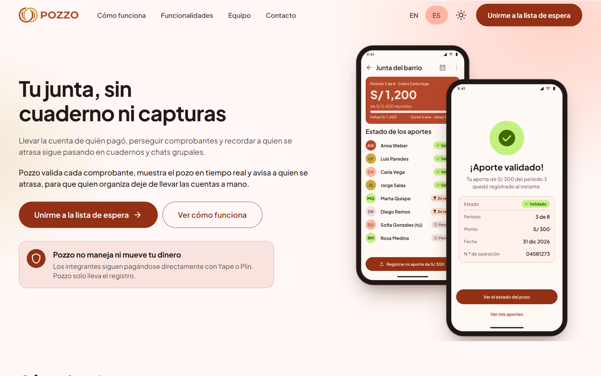{width=85%}

**Páginas públicas de los enlaces.** El repositorio `kerolabs/kerolabs.github.io` publica, también con GitHub Pages, las páginas que abren los enlaces de invitación (`/unirme`) y de historial compartido (`/historial`). Reemplazan al dominio que se había previsto para estos enlaces, que no se compró.

**Servicios RESTful.** Se desplegaron en una instancia Always Free de Oracle Cloud con Ubuntu 24.04. Los pasos fueron: crear la instancia y abrir los puertos 80 y 443 en su lista de seguridad; registrar el dominio `api-kerolabs.duckdns.org` en DuckDNS apuntando a la IP pública; preparar el servidor con `deploy/oracle-setup.sh`, que instala Java 21 y Caddy, crea los usuarios sin privilegios `pozzo` y `deploy` y registra el servicio de systemd; y configurar en GitHub los secretos del workflow `Deploy` con una llave SSH que solo puede ejecutar el script de despliegue. Desde entonces, cada push a `main` compila el jar en GitHub Actions, lo envía al servidor, reinicia el servicio y espera a que `/actuator/health` responda; si la versión nueva no arranca, el servidor vuelve a la anterior. Caddy obtiene el certificado HTTPS automáticamente. La Figura 156 muestra los despliegues del Sprint, todos exitosos. La base de datos PostgreSQL y el almacenamiento de las fotos y los comprobantes están en Supabase.

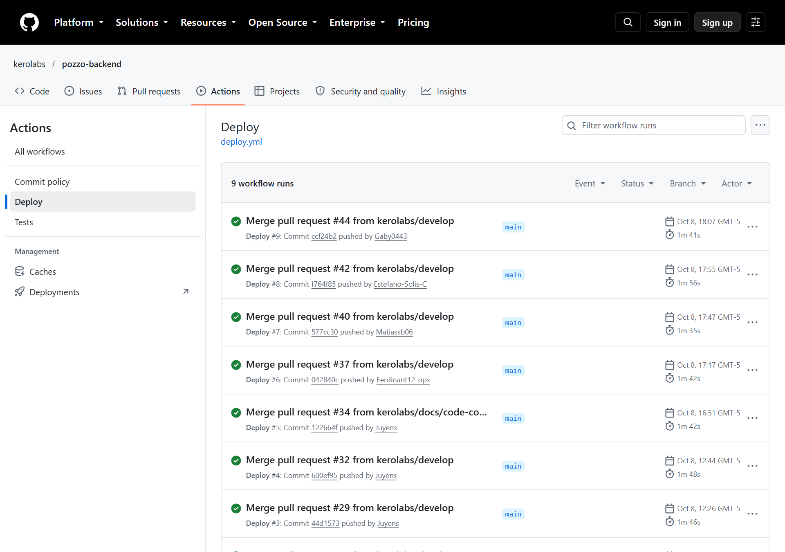{width=90%}

**Aplicación móvil.** El APK se genera en Android Studio con la variante `cloudRelease`, que apunta a los servicios desplegados, firmado con la llave de la aplicación que se guarda fuera del repositorio. El proyecto de Firebase `kerolabs-pozzo` provee las notificaciones push; la distribución con Firebase App Distribution queda para la entrega final.

#### 4.2.1.9. Team Collaboration Insights during Sprint

La implementación se organizó con GitFlow en cada repositorio: cada cambio se trabajó en una rama `feature/*`, `fix/*`, `docs/*` o `ci/*`, entró a `develop` por pull request con el check `commit-policy` y llegó a `main` en un pull request de integración. La Tabla 157 muestra los commits de cada integrante por repositorio durante el Sprint, y las Figuras 157 a 159 la pestaña Insights de los tres repositorios de código.

<table>
  <caption>Commits de cada integrante por repositorio en el Sprint 1</caption>
  <colgroup><col width="30%"><col width="13%"><col width="13%"><col width="13%"><col width="13%"><col width="18%"></colgroup>
  <thead>
    <tr>
      <th>Integrante</th>
      <th>Landing page</th>
      <th>Páginas de enlaces</th>
      <th>Servicios RESTful</th>
      <th>Aplicación móvil</th>
      <th>Informe</th>
    </tr>
  </thead>
  <tbody>
    <tr>
      <td>Camargo Briceño, Joseph Julius</td>
      <td>4</td>
      <td>9</td>
      <td>90</td>
      <td>33</td>
      <td>22</td>
    </tr>
    <tr>
      <td>Flores Pinchi, Jose Fernando</td>
      <td>2</td>
      <td>0</td>
      <td>4</td>
      <td>1</td>
      <td>31</td>
    </tr>
    <tr>
      <td>Sanchez Benavente, Leonardo Matias</td>
      <td>2</td>
      <td>0</td>
      <td>1</td>
      <td>1</td>
      <td>2</td>
    </tr>
    <tr>
      <td>Solis Campos, Estefano Sebastian</td>
      <td>5</td>
      <td>0</td>
      <td>5</td>
      <td>5</td>
      <td>1</td>
    </tr>
    <tr>
      <td>Tirado Carrera, Gabriela Luciana</td>
      <td>1</td>
      <td>0</td>
      <td>2</td>
      <td>2</td>
      <td>7</td>
    </tr>
  </tbody>
</table>

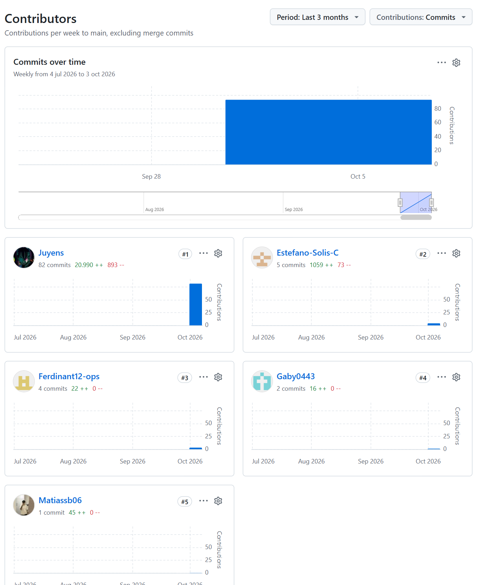{width=85%}

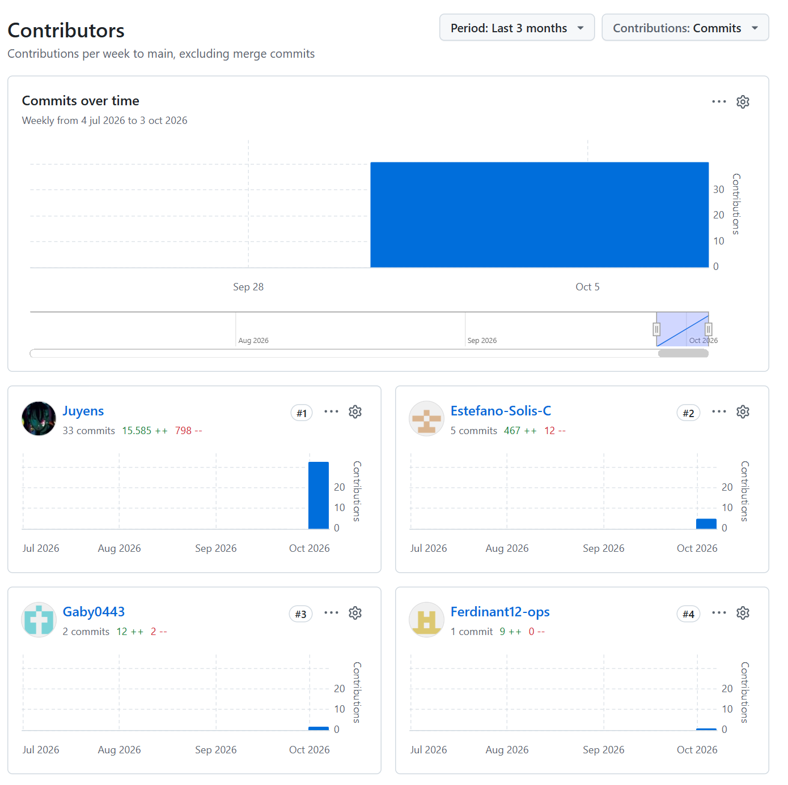{width=85%}

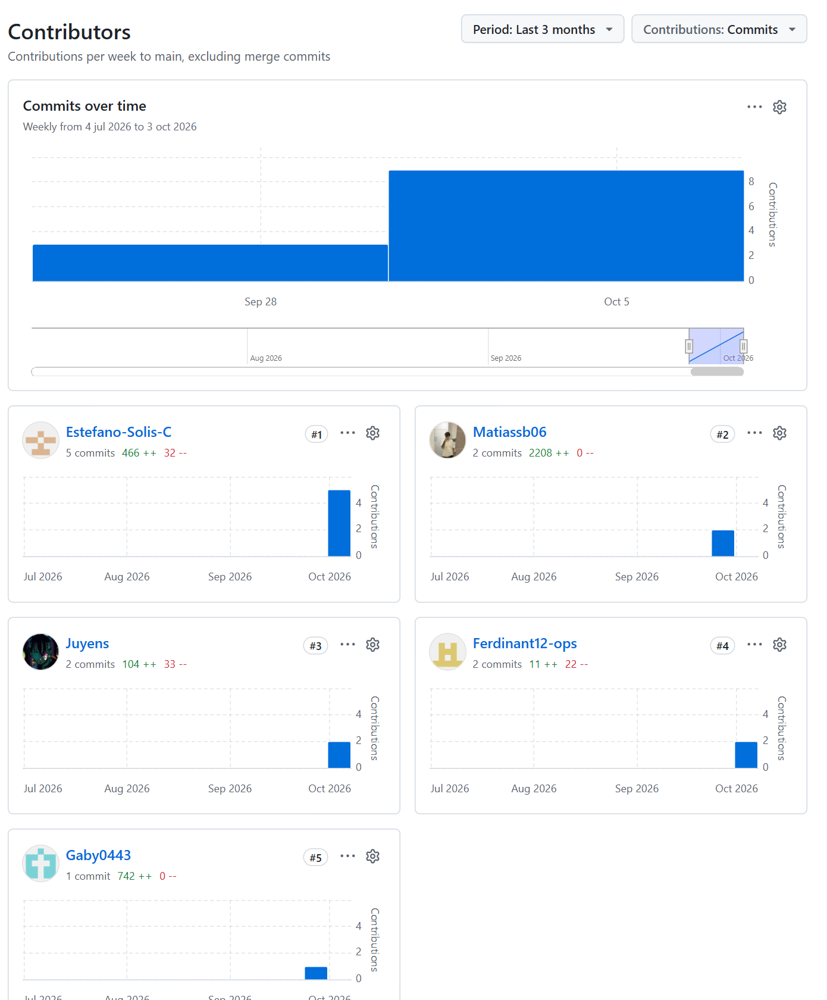{width=85%}

Los analíticos muestran una participación desigual en el código. Camargo concentró la implementación de los servicios RESTful y de la aplicación móvil, que se construyeron en pocos días sobre el diseño táctico del Capítulo II. El landing page tuvo la participación de los cinco integrantes: Tirado escribió su contenido y Sanchez sus estilos, su comportamiento y sus traducciones. En los repositorios de la aplicación y de los servicios, el aporte del resto del equipo se concentró en la documentación del código (README, guías de contribución y comentarios) y en la accesibilidad de la aplicación. En el informe ocurrió lo contrario: Flores fue el integrante con más commits, con la numeración APA de tablas y figuras y los canvases del Capítulo II, y Tirado y Sanchez redactaron el Capítulo III.

El enunciado pide que todos participen en la implementación de cada producto, y en la aplicación y los servicios eso no se cumplió en este Sprint. Para el Sprint 2 se propone que cada integrante lidere las historias de un bounded context en la aplicación y en los servicios, con sus pruebas de aceptación, para repartir la implementación.

<!-- pdf:desde av2 -->

### 4.2.2. Sprint 2

#### 4.2.2.1. Sprint Planning 2

El Sprint 2 cubre la entrega AV2. Reúne las historias que permiten que una junta complete su ciclo aunque cambie en el camino: la subasta de turnos, la deserción de un integrante y su reemplazo, el integrante sin la aplicación que luego se registra, la entrega del pozo con su comprobante, el cierre del ciclo y la apertura de uno nuevo, el aporte en efectivo, la consulta de aportes y de períodos anteriores, y los recordatorios por atraso. El enunciado pide para esta entrega los servicios RESTful desplegados al 100 % con su documentación, de modo que el Sprint termina el backend y lleva sus funcionalidades a la aplicación. La reunión de Sprint Planning se realizó el 3 de noviembre de 2026 por Discord con los cinco integrantes. La Tabla 158 resume la planificación.

<table>
  <caption>Resumen del Sprint Planning 2</caption>
  <colgroup><col width="32%"><col width="68%"></colgroup>
  <thead>
    <tr>
      <th>Sprint #</th>
      <th>Sprint 2</th>
    </tr>
  </thead>
  <tbody>
    <tr>
      <td><b>Sprint Planning Background</b></td>
      <td></td>
    </tr>
    <tr>
      <td>Date</td>
      <td>2026-11-03</td>
    </tr>
    <tr>
      <td>Time</td>
      <td>10:00 AM</td>
    </tr>
    <tr>
      <td>Location</td>
      <td>Reunión virtual por Discord. El alcance se tomó de la lista "Sprint 2 (AV2) - 58 SP" del tablero "Pozzo - Product Backlog" en Trello: <a href="https://trello.com/b/fRocSVZA/pozzo-product-backlog">https://trello.com/b/fRocSVZA/pozzo-product-backlog</a></td>
    </tr>
    <tr>
      <td>Prepared By</td>
      <td>Camargo Briceño, Joseph Julius</td>
    </tr>
    <tr>
      <td>Attendees (to planning meeting)</td>
      <td>Camargo Briceño, Joseph Julius / Flores Pinchi, Jose Fernando / Sanchez Benavente, Leonardo Matias / Solis Campos, Estefano Sebastian / Tirado Carrera, Gabriela Luciana</td>
    </tr>
    <tr>
      <td>Sprint 1 Review Summary</td>
      <td>La TB1 entregó el landing page publicado, los servicios RESTful de los cinco bounded contexts desplegados en Oracle Cloud con su documentación OpenAPI, y la aplicación móvil con el flujo completo de una junta: ingreso con código SMS, creación, invitación, turnos, inicio, registro y revisión de aportes, estado del pozo, avisos e historial. Se completaron 141 Story Points. Quedaron sin endpoint la subasta de turnos y la deserción de un integrante, y por eso sin escenario de aceptación en TS04 y TS06.</td>
    </tr>
    <tr>
      <td>Sprint 1 Retrospective Summary</td>
      <td>La implementación de la aplicación y de los servicios se concentró en un integrante, mientras el resto aportó sobre todo documentación, accesibilidad e informe (ver la sección Team Collaboration Insights during Sprint del Sprint 1). Para el Sprint 2 el equipo acordó repartir la implementación: los servicios RESTful quedan a cargo de Camargo, y la aplicación móvil la implementa el resto del equipo con Camargo como líder.</td>
    </tr>
    <tr>
      <td><b>Sprint Goal &amp; User Stories</b></td>
      <td></td>
    </tr>
    <tr>
      <td>Sprint 2 Goal</td>
      <td><b>Our focus is on</b> que una junta complete su ciclo entero en Pozzo aunque cambie en el camino: que sus turnos puedan subastarse, que un integrante que deserta pueda reemplazarse, que quien no tenía la aplicación pueda registrarse sin perder su historial, y que la cabeza entregue el pozo con su comprobante y abra un nuevo ciclo al terminar. <b>We believe it delivers</b> un registro que acompaña a la junta tal como se practica, con subastas, cambios y reemplazos, <b>to</b> las cabezas de junta y los participantes. <b>This will be confirmed when</b> una junta de prueba complete su ciclo desde la aplicación con al menos un turno subastado y una deserción reemplazada, y cada integrante vea en su historial lo que ocurrió.</td>
    </tr>
    <tr>
      <td>Sprint 2 Velocity</td>
      <td>58 Story Points planificados, los de las historias de la lista del Sprint 2.</td>
    </tr>
    <tr>
      <td>Sum of Story Points</td>
      <td>58 Story Points: 12 User Stories, las Technical Stories TS04 y TS06 y la Spike Story SP03.</td>
    </tr>
  </tbody>
</table>

#### 4.2.2.2. Aspect Leaders and Collaborators

Los aspectos del Sprint 2 son los productos que entrega la AV2 y el informe que los documenta: los servicios RESTful con su despliegue y su documentación, la aplicación móvil, el landing page y las páginas públicas de los enlaces, los videos de la entrega y el informe con su formato APA. La matriz se acordó en la reunión de Sprint Planning: Camargo lidera los servicios y la aplicación, cuya implementación reparte entre los demás integrantes, y Flores lidera los videos y el informe (ver Tabla 159).

<table>
  <caption>Leadership-and-Collaboration Matrix del Sprint 2</caption>
  <colgroup><col width="24%"><col width="16%"><col width="12%"><col width="12%"><col width="12%"><col width="12%"><col width="12%"></colgroup>
  <thead>
    <tr>
      <th>Team Member (Last Name, First Name)</th>
      <th>GitHub Username</th>
      <th>Servicios RESTful y despliegue Leader (L) / Collaborator (C)</th>
      <th>Aplicación móvil Leader (L) / Collaborator (C)</th>
      <th>Landing Page y páginas públicas Leader (L) / Collaborator (C)</th>
      <th>Videos Leader (L) / Collaborator (C)</th>
      <th>Informe y formato APA Leader (L) / Collaborator (C)</th>
    </tr>
  </thead>
  <tbody>
    <tr>
      <td>Camargo Briceño, Joseph Julius</td>
      <td>Juyens</td>
      <td><b>L</b></td>
      <td><b>L</b></td>
      <td><b>L</b></td>
      <td>C</td>
      <td>C</td>
    </tr>
    <tr>
      <td>Flores Pinchi, Jose Fernando</td>
      <td>Ferdinant12-ops</td>
      <td></td>
      <td>C</td>
      <td></td>
      <td><b>L</b></td>
      <td><b>L</b></td>
    </tr>
    <tr>
      <td>Sanchez Benavente, Leonardo Matias</td>
      <td>Matiassb06</td>
      <td></td>
      <td>C</td>
      <td></td>
      <td>C</td>
      <td>C</td>
    </tr>
    <tr>
      <td>Solis Campos, Estefano Sebastian</td>
      <td>Estefano-Solis-C</td>
      <td></td>
      <td>C</td>
      <td></td>
      <td>C</td>
      <td>C</td>
    </tr>
    <tr>
      <td>Tirado Carrera, Gabriela Luciana</td>
      <td>Gaby0443</td>
      <td></td>
      <td>C</td>
      <td></td>
      <td>C</td>
      <td>C</td>
    </tr>
  </tbody>
</table>

#### 4.2.2.3. Sprint Backlog 2

El objetivo del Sprint 2 es que una junta complete su ciclo en Pozzo aunque cambie en el camino, con subastas, deserciones, reemplazos e integrantes que se registran después. El Sprint se organiza en la lista "Sprint 2 (AV2) - 58 SP" del tablero de Trello: <https://trello.com/b/fRocSVZA/pozzo-product-backlog>.

La Tabla 160 relaciona cada historia con sus tareas, su responsable y su estado. Como en el Sprint 1, las tareas de los servicios se obtuvieron de sus pull requests y no se estimaron en horas. Dos tareas completan escenarios de historias del Sprint 1 que necesitaban un endpoint nuevo: el intercambio de turnos de US18 y la desactivación de los recordatorios ya programados de US34.

Las tareas de la aplicación se repartieron entre los cinco integrantes, y cada uno llevó la suya a `develop` en un pull request propio de `kerolabs/pozzo-mobile`; el intercambio de turnos en el calendario entró junto con el cierre de la subasta. Al cierre del Sprint quedan dos tareas abiertas. En el registro en efectivo (T61) falta pedir confirmación cuando el monto difiere del esperado: la aplicación propone lo que debe el integrante y los servicios rechazan un monto distinto. La investigación de Android App Links (T78) no se inició.

<table>
  <caption>Sprint Backlog del Sprint 2</caption>
  <colgroup><col width="7%"><col width="12%"><col width="6%"><col width="13%"><col width="27%"><col width="10%"><col width="16%"><col width="9%"></colgroup>
  <thead>
    <tr>
      <th>User Story Id</th>
      <th>User Story Title</th>
      <th>Task Id</th>
      <th>Task Title</th>
      <th>Description</th>
      <th>Estimation (Hours)</th>
      <th>Assigned To</th>
      <th>Status</th>
    </tr>
  </thead>
  <tbody>
    <tr>
      <td>US14</td>
      <td>Agregar un integrante sin la aplicación</td>
      <td>T51</td>
      <td>Vínculo de la cuenta</td>
      <td>Servicios: al registrarse con el celular que la cabeza anotó, la cuenta nueva toma la membresía, el turno y los aportes del integrante sin la aplicación (pozzo-backend#50).</td>
      <td>Sin estimar</td>
      <td>Camargo Briceño, Joseph Julius</td>
      <td>Done</td>
    </tr>
    <tr>
      <td></td>
      <td></td>
      <td>T52</td>
      <td>Pantalla del integrante sin la aplicación</td>
      <td>Aplicación: agregarlo con nombre y celular opcional, y mostrarlo como tal en la lista de integrantes.</td>
      <td>Sin estimar</td>
      <td>Camargo Briceño, Joseph Julius</td>
      <td>Done</td>
    </tr>
    <tr>
      <td>US15</td>
      <td>Retirar un integrante antes de iniciar</td>
      <td>T53</td>
      <td>Retiro con opción de deshacer</td>
      <td>Aplicación: retirar a un integrante antes de iniciar, con cinco segundos para deshacer, y remitir a la deserción si la junta ya inició (pozzo-mobile#26).</td>
      <td>Sin estimar</td>
      <td>Tirado Carrera, Gabriela Luciana</td>
      <td>Done</td>
    </tr>
    <tr>
      <td>US18</td>
      <td>Asignar turnos por orden acordado</td>
      <td>T54</td>
      <td>Intercambio de turnos</td>
      <td>Servicios: la cabeza intercambia dos turnos cuyos períodos no empezaron; el calendario de la junta sigue el cambio y los dos integrantes reciben un aviso (pozzo-backend#52).</td>
      <td>Sin estimar</td>
      <td>Camargo Briceño, Joseph Julius</td>
      <td>Done</td>
    </tr>
    <tr>
      <td>US19</td>
      <td>Configurar la junta por subasta</td>
      <td>T55</td>
      <td>Reglas de la subasta</td>
      <td>Servicios: asignar los turnos por subasta con los días de anticipación al corte, la oferta mínima y el respaldo, y abrir la subasta de cada período (pozzo-backend#56).</td>
      <td>Sin estimar</td>
      <td>Camargo Briceño, Joseph Julius</td>
      <td>Done</td>
    </tr>
    <tr>
      <td></td>
      <td></td>
      <td>T56</td>
      <td>Configuración de la subasta</td>
      <td>Aplicación: elegir la subasta como método de turnos y definir sus reglas (pozzo-mobile#27).</td>
      <td>Sin estimar</td>
      <td>Sanchez Benavente, Leonardo Matias</td>
      <td>Done</td>
    </tr>
    <tr>
      <td>US20</td>
      <td>Ofertar en la subasta del turno</td>
      <td>T57</td>
      <td>Ofertas</td>
      <td>Servicios: ofertar desde la oferta mínima y por debajo del pozo, solo quienes no han cobrado, contando la última oferta de cada uno, y consultar las ofertas ordenadas (pozzo-backend#56).</td>
      <td>Sin estimar</td>
      <td>Camargo Briceño, Joseph Julius</td>
      <td>Done</td>
    </tr>
    <tr>
      <td></td>
      <td></td>
      <td>T58</td>
      <td>Pantalla de la subasta</td>
      <td>Aplicación: ver la subasta del período, ofertar y saber si la oferta propia es la mayor (pozzo-mobile#27).</td>
      <td>Sin estimar</td>
      <td>Sanchez Benavente, Leonardo Matias</td>
      <td>Done</td>
    </tr>
    <tr>
      <td>US21</td>
      <td>Cerrar la subasta y asignar el turno</td>
      <td>T59</td>
      <td>Cierre y reparto del descuento</td>
      <td>Servicios: cerrar la subasta por la cabeza o al pasar su día de cierre, dar el turno a la mayor oferta o por el respaldo, y repartir el descuento como crédito del siguiente aporte (pozzo-backend#56 y #63).</td>
      <td>Sin estimar</td>
      <td>Camargo Briceño, Joseph Julius</td>
      <td>Done</td>
    </tr>
    <tr>
      <td></td>
      <td></td>
      <td>T60</td>
      <td>Cierre de la subasta</td>
      <td>Aplicación: cerrar la subasta, elegir al ganador cuando el respaldo es la cabeza y mostrar el resultado (pozzo-mobile#28).</td>
      <td>Sin estimar</td>
      <td>Solis Campos, Estefano Sebastian</td>
      <td>Done</td>
    </tr>
    <tr>
      <td>US27</td>
      <td>Registrar un aporte en efectivo</td>
      <td>T61</td>
      <td>Registro en efectivo</td>
      <td>Aplicación: registrar el aporte en efectivo con el monto y la fecha, y confirmar un monto distinto al esperado (pozzo-mobile#27).</td>
      <td>Sin estimar</td>
      <td>Sanchez Benavente, Leonardo Matias</td>
      <td>In Progress</td>
    </tr>
    <tr>
      <td>US28</td>
      <td>Consultar mis aportes y sus comprobantes</td>
      <td>T62</td>
      <td>Enlace verificable de un aporte</td>
      <td>Servicios: el integrante del aporte o la cabeza obtienen un enlace público que cualquiera abre sin iniciar sesión (pozzo-backend#54).</td>
      <td>Sin estimar</td>
      <td>Camargo Briceño, Joseph Julius</td>
      <td>Done</td>
    </tr>
    <tr>
      <td></td>
      <td></td>
      <td>T63</td>
      <td>Página pública del aporte</td>
      <td>Página <code>aporte/</code> del sitio de Kerolabs que lee el aporte compartido desde el endpoint público (kerolabs.github.io#7).</td>
      <td>Sin estimar</td>
      <td>Camargo Briceño, Joseph Julius</td>
      <td>Done</td>
    </tr>
    <tr>
      <td></td>
      <td></td>
      <td>T64</td>
      <td>Mis aportes y compartir</td>
      <td>Aplicación: lista de aportes por período con su estado, detalle del comprobante y botón para compartir el enlace verificable (pozzo-mobile#24).</td>
      <td>Sin estimar</td>
      <td>Camargo Briceño, Joseph Julius</td>
      <td>Done</td>
    </tr>
    <tr>
      <td>US32</td>
      <td>Consultar períodos anteriores</td>
      <td>T65</td>
      <td>Períodos anteriores</td>
      <td>Aplicación: consultar un período cerrado con quién cobró, el monto entregado, la fecha y el estado de cada aporte (pozzo-mobile#25).</td>
      <td>Sin estimar</td>
      <td>Flores Pinchi, Jose Fernando</td>
      <td>Done</td>
    </tr>
    <tr>
      <td>US33</td>
      <td>Recibir recordatorios escalonados de mi aporte</td>
      <td>T66</td>
      <td>Recordatorio diario por atraso</td>
      <td>Servicios: cada período programa un recordatorio diario durante los 30 días posteriores al corte, que se cancela al liquidarse el aporte (pozzo-backend#48).</td>
      <td>Sin estimar</td>
      <td>Camargo Briceño, Joseph Julius</td>
      <td>Done</td>
    </tr>
    <tr>
      <td>US34</td>
      <td>Configurar los recordatorios de la junta</td>
      <td>T67</td>
      <td>Cancelar los recordatorios programados</td>
      <td>Servicios: desactivar el plan cancela también los recordatorios ya programados del período abierto (pozzo-backend#49).</td>
      <td>Sin estimar</td>
      <td>Camargo Briceño, Joseph Julius</td>
      <td>Done</td>
    </tr>
    <tr>
      <td>US36</td>
      <td>Entregar el pozo y abrir el siguiente turno</td>
      <td>T68</td>
      <td>Comprobante de la entrega</td>
      <td>Servicios: tras entregar el pozo, la cabeza adjunta la imagen de la transferencia y los integrantes la ven con un enlace firmado; el monto entregado descuenta la subasta (pozzo-backend#51, #56 y #62).</td>
      <td>Sin estimar</td>
      <td>Camargo Briceño, Joseph Julius</td>
      <td>Done</td>
    </tr>
    <tr>
      <td></td>
      <td></td>
      <td>T69</td>
      <td>Entrega del pozo</td>
      <td>Aplicación: marcar el pozo como entregado, adjuntar la imagen de la transferencia y mostrar el monto con el descuento de la subasta (pozzo-mobile#25).</td>
      <td>Sin estimar</td>
      <td>Flores Pinchi, Jose Fernando</td>
      <td>Done</td>
    </tr>
    <tr>
      <td>US38</td>
      <td>Registrar una deserción y su reemplazo</td>
      <td>T70</td>
      <td>Deserción y reemplazo</td>
      <td>Servicios: registrar la deserción de un integrante de una junta iniciada y asignar su lugar a un reemplazo, con la aplicación o sin ella (pozzo-backend#55 y #65).</td>
      <td>Sin estimar</td>
      <td>Camargo Briceño, Joseph Julius</td>
      <td>Done</td>
    </tr>
    <tr>
      <td></td>
      <td></td>
      <td>T71</td>
      <td>Pantalla de deserción y reemplazo</td>
      <td>Aplicación: registrar la deserción y asignar el reemplazo por nombre o por celular (pozzo-mobile#26).</td>
      <td>Sin estimar</td>
      <td>Tirado Carrera, Gabriela Luciana</td>
      <td>Done</td>
    </tr>
    <tr>
      <td>US39</td>
      <td>Cerrar la junta al completar el ciclo</td>
      <td>T72</td>
      <td>Nuevo ciclo con el mismo grupo</td>
      <td>Servicios: la cabeza de una junta cerrada abre otra con las mismas reglas, destino e integrantes, por iniciar (pozzo-backend#53).</td>
      <td>Sin estimar</td>
      <td>Camargo Briceño, Joseph Julius</td>
      <td>Done</td>
    </tr>
    <tr>
      <td></td>
      <td></td>
      <td>T73</td>
      <td>Resumen del ciclo y nuevo ciclo</td>
      <td>Aplicación: mostrar el resumen al cerrar el ciclo y abrir uno nuevo (pozzo-mobile#25).</td>
      <td>Sin estimar</td>
      <td>Flores Pinchi, Jose Fernando</td>
      <td>Done</td>
    </tr>
    <tr>
      <td>TS04</td>
      <td>Servicio de turnos y subastas</td>
      <td>T74</td>
      <td>Escenarios de turnos y subastas</td>
      <td>Escenarios de intercambio y de subasta en <code>ts04-turns.feature</code>, y corrección del paso que inicia la junta para que guarde el ciclo (pozzo-backend#52, #56, #60 y #63).</td>
      <td>Sin estimar</td>
      <td>Camargo Briceño, Joseph Julius</td>
      <td>Done</td>
    </tr>
    <tr>
      <td>TS06</td>
      <td>Servicio de entrega del pozo y cierre</td>
      <td>T75</td>
      <td>Escenarios de entrega, deserción y nuevo ciclo</td>
      <td>Escenarios del comprobante de la entrega, del nuevo ciclo y de la deserción con su reemplazo en <code>ts06-pot-delivery-and-closing.feature</code> (pozzo-backend#51, #53 y #55).</td>
      <td>Sin estimar</td>
      <td>Camargo Briceño, Joseph Julius</td>
      <td>Done</td>
    </tr>
    <tr>
      <td></td>
      <td></td>
      <td>T76</td>
      <td>Pruebas que no se ejecutaban</td>
      <td>Devolver la anotación <code>@Test</code> a cinco pruebas de dominio y quitar imports repetidos que dejó la integración de las ramas (pozzo-backend#57 y #58).</td>
      <td>Sin estimar</td>
      <td>Camargo Briceño, Joseph Julius</td>
      <td>Done</td>
    </tr>
    <tr>
      <td></td>
      <td></td>
      <td>T77</td>
      <td>Release y despliegue</td>
      <td>Llevar <code>develop</code> a <code>main</code>, desplegar en Oracle Cloud y marcar las versiones <code>v0.2.0</code> a <code>v0.2.2</code> (pozzo-backend#59, #61, #64 y #66), y llevar la aplicación a <code>main</code> como <code>v0.2.0</code> (pozzo-mobile#29).</td>
      <td>Sin estimar</td>
      <td>Camargo Briceño, Joseph Julius</td>
      <td>Done</td>
    </tr>
    <tr>
      <td>SP03</td>
      <td>Investigar los enlaces de invitación que abren la aplicación</td>
      <td>T78</td>
      <td>Enlaces que abren la aplicación</td>
      <td>Aplicación: investigar Android App Links para que el enlace de invitación abra la aplicación instalada.</td>
      <td>Sin estimar</td>
      <td></td>
      <td>To-do</td>
    </tr>
  </tbody>
</table>

#### 4.2.2.4. Development Evidence for Sprint Review

En el Sprint 2 se completaron los servicios RESTful: cada historia que necesitaba un endpoint nuevo se implementó en su propia rama, entró a `develop` por pull request con las pruebas en verde y llegó a `main` en dos pull requests de integración, desplegados en Oracle Cloud como la versión `v0.2.0`. Al probar la aplicación contra esos servicios aparecieron tres fallas, que se corrigieron con su prueba y se desplegaron como `v0.2.1` y `v0.2.2`: los enlaces firmados de las imágenes de comprobantes y transferencias no abrían, el estado del período no decía cuánto debía cada integrante después del descuento de una subasta, y los períodos de un ciclo fallaban después de un reemplazo. Se sumaron además la página pública que abre el enlace de un aporte compartido y, en la aplicación móvil, las pantallas de las historias del Sprint.

**Servicios RESTful.** La Tabla 161 lista los 17 commits de `kerolabs/pozzo-backend` del Sprint, con la rama en la que se hicieron.

<table>
  <caption>Commits de implementación de pozzo-backend en el Sprint 2</caption>
  <colgroup><col width="13%"><col width="17%"><col width="11%"><col width="23%"><col width="21%"><col width="15%"></colgroup>
  <thead>
    <tr>
      <th>Repository</th>
      <th>Branch</th>
      <th>Commit Id</th>
      <th>Commit Message</th>
      <th>Commit Message Body</th>
      <th>Committed on (Date)</th>
    </tr>
  </thead>
  <tbody>
    <tr>
      <td>kerolabs/pozzo-backend</td>
      <td>feature/overdue-reminders</td>
      <td><a href="https://github.com/kerolabs/pozzo-backend/commit/3a95999">3a95999</a></td>
      <td>feat(notifications): remind late members every day until they pay</td>
      <td>The reminder plan only queued reminders before the cutoff, so a member who missed it heard nothing more. Each period now also queues one reminder a day for the 30 days after the cutoff, at the hour of the plan. They are cancelled with the other reminders once the contribution is settled, and none are queued while the plan is disabled. The reminder plan resource says how many days they last.</td>
      <td>10/11/2026</td>
    </tr>
    <tr>
      <td>kerolabs/pozzo-backend</td>
      <td>fix/disabled-reminder-plan</td>
      <td><a href="https://github.com/kerolabs/pozzo-backend/commit/7f15325">7f15325</a></td>
      <td>fix(notifications): stop the queued reminders when the plan is turned off</td>
      <td>Turning the reminders of a group off only applied to the periods opened afterwards; the reminders of the period already open had been queued when it opened and still went out. Turning the plan off now cancels every reminder the group still has queued.</td>
      <td>10/11/2026</td>
    </tr>
    <tr>
      <td>kerolabs/pozzo-backend</td>
      <td>feature/link-manual-members</td>
      <td><a href="https://github.com/kerolabs/pozzo-backend/commit/913f241">913f241</a></td>
      <td>feat: link a member registered without the app when they sign up with the same number</td>
      <td>The organizer can register a member who does not use Pozzo, with an optional number, but signing up later with that number created an account that did not see the group. Identity & Access now announces each new account, Savings Groups links it to the members registered with that number, Contributions gives the account their turn and Compliance History records the contributions settled so far. Cash contributions keep the day the organizer received them, so whether they arrived on time can still be told after linking.</td>
      <td>10/11/2026</td>
    </tr>
    <tr>
      <td>kerolabs/pozzo-backend</td>
      <td>feature/payout-proof</td>
      <td><a href="https://github.com/kerolabs/pozzo-backend/commit/c62005d">c62005d</a></td>
      <td>feat(contributions): attach the transfer with which the pot was delivered</td>
      <td>Confirming the delivery of the pot only recorded the date, and the organizer had no way to show the members the transfer. Once the pot is delivered, the organizer can now attach an image of the transfer, kept in the same private storage as the receipts, and every member of the cycle can open it with a signed link. The image rules of the receipts move to one place so both uploads follow them, and the tests store images in memory.</td>
      <td>10/11/2026</td>
    </tr>
    <tr>
      <td>kerolabs/pozzo-backend</td>
      <td>feature/swap-turns</td>
      <td><a href="https://github.com/kerolabs/pozzo-backend/commit/8f388ea">8f388ea</a></td>
      <td>feat: swap two turns whose periods have not started</td>
      <td>Once a group started, its turns could not change, so two members who agreed to collect in each other's turn had no way to record it. The organizer can now swap two turns whose periods have not started: Contributions changes the cycle, Savings Groups keeps the calendar of the group in step within the same transaction, and both members get a notice with their new turn.</td>
      <td>10/11/2026</td>
    </tr>
    <tr>
      <td>kerolabs/pozzo-backend</td>
      <td>feature/swap-turns</td>
      <td><a href="https://github.com/kerolabs/pozzo-backend/commit/f71dc35">f71dc35</a></td>
      <td>test: check the calendar of the group after swapping two turns</td>
      <td>The scenario read the turns from the last response, which after the swap is the cycle and has no turns. It now reads the calendar of the group.</td>
      <td>10/11/2026</td>
    </tr>
    <tr>
      <td>kerolabs/pozzo-backend</td>
      <td>feature/new-cycle</td>
      <td><a href="https://github.com/kerolabs/pozzo-backend/commit/d5145ef">d5145ef</a></td>
      <td>feat(savings-groups): open a new cycle with the same group</td>
      <td>When a cycle ended, a group that wanted to go again had to be created from scratch and every member invited again. The organizer of a group whose cycle is over can now open the next cycle: a new group, still to start, with the same name, rules, destination and active members, which the organizer adjusts, gives turns and starts as usual. The members with the app get a notice.</td>
      <td>10/11/2026</td>
    </tr>
    <tr>
      <td>kerolabs/pozzo-backend</td>
      <td>feature/share-contribution</td>
      <td><a href="https://github.com/kerolabs/pozzo-backend/commit/b7de27f">b7de27f</a></td>
      <td>feat(contributions): share a contribution with a link anyone can verify</td>
      <td>A member who was told they had not paid could only forward a screenshot, which proves nothing. The member a settled contribution counts for, or the organizer, can now get a public link to it: anyone who opens it sees the group, the member, the period, the amount and the end of the operation number, without signing in and without the receipt image. The link is the same every time and keeps working.</td>
      <td>10/11/2026</td>
    </tr>
    <tr>
      <td>kerolabs/pozzo-backend</td>
      <td>feature/dropouts</td>
      <td><a href="https://github.com/kerolabs/pozzo-backend/commit/2db2a55">2db2a55</a></td>
      <td>feat: register a dropout and give the turn to a replacement</td>
      <td>A member who left a started group could not be recorded: removing members is only allowed before the start, so the cycle kept waiting for their contributions. The organizer can now register a dropout, which goes to the member's compliance history, tells the group and stops their reminders, and then give the seat to a replacement. The replacement takes the turn of the member who left, while it was not collected, and owes the contributions still pending from the current period; with the number of a Pozzo account they join with it, otherwise without the app.</td>
      <td>10/11/2026</td>
    </tr>
    <tr>
      <td>kerolabs/pozzo-backend</td>
      <td>feature/auctions</td>
      <td><a href="https://github.com/kerolabs/pozzo-backend/commit/e1b273a">e1b273a</a></td>
      <td>feat: auction the turns of a group</td>
      <td>Groups that decide who collects by auction could not use Pozzo, because the turns had to be drawn or agreed before the start. The organizer can now auction the turns: each period opens an auction among the members who have not collected, the highest discount on the pot wins the turn in progress, and the discount is shared as a credit on the next contribution of the members still to collect. Without bids the turn goes by draw or to the member the organizer chooses, and auctions close by themselves the day after their closing day.</td>
      <td>10/11/2026</td>
    </tr>
    <tr>
      <td>kerolabs/pozzo-backend</td>
      <td>fix/cycle-test-imports</td>
      <td><a href="https://github.com/kerolabs/pozzo-backend/commit/29986f5">29986f5</a></td>
      <td>style: drop the repeated imports of CycleTest</td>
      <td>Resolving the conflicts of the turn swap left the imports of CycleTest written twice. Java accepts it, but the block now lists each import once, as in the rest of the tests.</td>
      <td>10/11/2026</td>
    </tr>
    <tr>
      <td>kerolabs/pozzo-backend</td>
      <td>fix/missing-test-annotations</td>
      <td><a href="https://github.com/kerolabs/pozzo-backend/commit/2b16ab1">2b16ab1</a></td>
      <td>test: run the domain tests that lost their annotation</td>
      <td>Resolving the conflicts between the Sprint 2 branches kept the shared @Test line outside the conflict and attached it to only one of the two new methods, so five tests compiled but never ran. All five pass.</td>
      <td>10/11/2026</td>
    </tr>
    <tr>
      <td>kerolabs/pozzo-backend</td>
      <td>fix/missing-test-annotations</td>
      <td><a href="https://github.com/kerolabs/pozzo-backend/commit/8ba29b7">8ba29b7</a></td>
      <td>refactor: drop a comment left without its constant</td>
      <td>The validity of a receipt link moved to ReceiptImageRules.LINK_VALIDITY, which keeps its own comment; the one left in the query service described nothing.</td>
      <td>10/11/2026</td>
    </tr>
    <tr>
      <td>kerolabs/pozzo-backend</td>
      <td>fix/auction-scenarios-cycle</td>
      <td><a href="https://github.com/kerolabs/pozzo-backend/commit/227fbfe">227fbfe</a></td>
      <td>test: keep the cycle when a scenario starts the group</td>
      <td>The auction scenarios start the group with the step that only keeps the response, so reading the current period found no cycle and the three scenarios stopped before bidding. The step now keeps the cycle whenever the start succeeds.</td>
      <td>10/11/2026</td>
    </tr>
    <tr>
      <td>kerolabs/pozzo-backend</td>
      <td>fix/signed-image-links</td>
      <td><a href="https://github.com/kerolabs/pozzo-backend/commit/95f86b6">95f86b6</a></td>
      <td>fix(contributions): sign the image links with the path Supabase stored</td>
      <td>The image of a receipt or of the transfer of a pot was uploaded and its link signed with the path encoded as a single segment, so Supabase signed a key that does not exist and every link answered InvalidSignature. The path now goes to Supabase as it is stored, in the upload and in the signature.</td>
      <td>10/11/2026</td>
    </tr>
    <tr>
      <td>kerolabs/pozzo-backend</td>
      <td>feature/member-expected-amount</td>
      <td><a href="https://github.com/kerolabs/pozzo-backend/commit/8841e0f">8841e0f</a></td>
      <td>feat(contributions): show what each member owes in the period</td>
      <td>After an auction the members still to collect owe less in the next period, but the state of the period only gave the contribution of the group, so the application proposed the full amount in cash and the backend rejected it. Each member of the period now carries what they owe.</td>
      <td>11/11/2026</td>
    </tr>
    <tr>
      <td>kerolabs/pozzo-backend</td>
      <td>fix/periods-after-replacement</td>
      <td><a href="https://github.com/kerolabs/pozzo-backend/commit/a78a0c8">a78a0c8</a></td>
      <td>fix: list the periods a replacement joined after without failing</td>
      <td>A member who replaces a dropout holds a turn of the cycle but owes nothing in the periods opened before they joined. The period status and the contributions of the member looked up that expected contribution and threw, so GET /cycles/{id}/periods and the history of the replacement answered 500. Both now keep only the members and periods that expected a contribution.</td>
      <td>11/11/2026</td>
    </tr>
  </tbody>
</table>

**Páginas públicas de los enlaces.** La Tabla 162 muestra el commit de `kerolabs/kerolabs.github.io` que agrega la página del aporte compartido.

<table>
  <caption>Commits de implementación de kerolabs.github.io en el Sprint 2</caption>
  <colgroup><col width="13%"><col width="17%"><col width="11%"><col width="23%"><col width="21%"><col width="15%"></colgroup>
  <thead>
    <tr>
      <th>Repository</th>
      <th>Branch</th>
      <th>Commit Id</th>
      <th>Commit Message</th>
      <th>Commit Message Body</th>
      <th>Committed on (Date)</th>
    </tr>
  </thead>
  <tbody>
    <tr>
      <td>kerolabs/kerolabs.github.io</td>
      <td>feature/shared-contribution-page</td>
      <td><a href="https://github.com/kerolabs/kerolabs.github.io/commit/a4a8bfa">a4a8bfa</a></td>
      <td>feat: add the page of a contribution shared with a link</td>
      <td>The backend now gives a public link to a settled contribution, pointing to kerolabs.github.io/aporte/?t={token}. The page reads the contribution from the public endpoint and shows the member, the amount, the turn and group, how it was paid and the end of the operation number, with the same states as the shared history page.</td>
      <td>10/11/2026</td>
    </tr>
  </tbody>
</table>

**Aplicación móvil.** La Tabla 163 lista los 16 commits de `kerolabs/pozzo-mobile` del Sprint, con la rama en la que se hicieron. Cada integrante llevó su parte a `develop` en un pull request propio (pozzo-mobile#24 a #28) y la aplicación llegó a `main` en pozzo-mobile#29. La tabla no incluye los dos merges de `develop` con los que se resolvieron los conflictos entre las ramas de la subasta y de la entrega del pozo.

<table>
  <caption>Commits de implementación de pozzo-mobile en el Sprint 2</caption>
  <colgroup><col width="13%"><col width="17%"><col width="11%"><col width="23%"><col width="21%"><col width="15%"></colgroup>
  <thead>
    <tr>
      <th>Repository</th>
      <th>Branch</th>
      <th>Commit Id</th>
      <th>Commit Message</th>
      <th>Commit Message Body</th>
      <th>Committed on (Date)</th>
    </tr>
  </thead>
  <tbody>
    <tr>
      <td>kerolabs/pozzo-mobile</td>
      <td>feature/share-contribution</td>
      <td><a href="https://github.com/kerolabs/pozzo-mobile/commit/974a8ed">974a8ed</a></td>
      <td>feat(contributions): share a contribution with a link anyone can verify</td>
      <td>A member who was told they had not paid could only forward a screenshot. A settled contribution now has a button in its receipt to share a public link to it through the share sheet; whoever opens it sees the group, the period, the amount and the end of the operation number, without the receipt image.</td>
      <td>10/11/2026</td>
    </tr>
    <tr>
      <td>kerolabs/pozzo-mobile</td>
      <td>feature/turn-auction</td>
      <td><a href="https://github.com/kerolabs/pozzo-mobile/commit/2a1c606">2a1c606</a></td>
      <td>feat(contributions): add turn auction with bidding and member payment proposal</td>
      <td>Sin cuerpo</td>
      <td>11/11/2026</td>
    </tr>
    <tr>
      <td>kerolabs/pozzo-mobile</td>
      <td>feat/turn-auctions</td>
      <td><a href="https://github.com/kerolabs/pozzo-mobile/commit/076ef4c">076ef4c</a></td>
      <td>feat(savings-groups): auction the turns of a group</td>
      <td>The auction option was shown but disabled. The organizer can now choose it and set how many days before each cutoff the auction closes, the smallest discount accepted and whether a draw or the organizer decides when nobody bids. Nothing is assigned in advance: each period opens its own auction.</td>
      <td>11/11/2026</td>
    </tr>
    <tr>
      <td>kerolabs/pozzo-mobile</td>
      <td>feat/turn-auctions</td>
      <td><a href="https://github.com/kerolabs/pozzo-mobile/commit/927a564">927a564</a></td>
      <td>feat(contributions): bid in the auction of the turn</td>
      <td>Groups whose turns are auctioned now show the auction of the period under the pot. Every member sees the bids from the highest to the lowest with what each bidder would receive, and a member who has not collected places or improves a bid.</td>
      <td>11/11/2026</td>
    </tr>
    <tr>
      <td>kerolabs/pozzo-mobile</td>
      <td>feat/turn-auctions</td>
      <td><a href="https://github.com/kerolabs/pozzo-mobile/commit/bc9e4cc">bc9e4cc</a></td>
      <td>fix(contributions): leave who collects to the auction and propose what each member owes</td>
      <td>Testing on the emulator, the pot and the start of a group named the provisional holder of a turn whose auction was still open, and the cash screen proposed the full contribution although an auction had lowered what the members still to collect owe, so the backend rejected it. While the auction is open the pot now says the turn goes to its winner, the start says the turn is auctioned, and the cash screen and the button to contribute use what each member owes.</td>
      <td>11/11/2026</td>
    </tr>
    <tr>
      <td>kerolabs/pozzo-mobile</td>
      <td>feat/turn-auctions</td>
      <td><a href="https://github.com/kerolabs/pozzo-mobile/commit/64c28eb">64c28eb</a></td>
      <td>feat(contributions): close the auction of the turn</td>
      <td>The organizer can close an open auction before its closing day. With bids the highest one collects; without bids the turn goes by draw, or to the member the organizer picks among those who have not collected when the group chose that.</td>
      <td>11/11/2026</td>
    </tr>
    <tr>
      <td>kerolabs/pozzo-mobile</td>
      <td>feat/turn-auctions</td>
      <td><a href="https://github.com/kerolabs/pozzo-mobile/commit/e8c50d6">e8c50d6</a></td>
      <td>feat(contributions): swap turns and show the turns still to auction</td>
      <td>Once a group started its turns could not change. The organizer can now swap two turns whose periods have not started from the calendar, and both members get a notice. In groups whose turns are auctioned, the calendar shows the periods to come as pending auction instead of the provisional order.</td>
      <td>11/11/2026</td>
    </tr>
    <tr>
      <td>kerolabs/pozzo-mobile</td>
      <td>feat/turn-auctions</td>
      <td><a href="https://github.com/kerolabs/pozzo-mobile/commit/f0b6caa">f0b6caa</a></td>
      <td>fix(contributions): show the closed auction and the real winners in the calendar</td>
      <td>Testing on the emulator, closing an auction left the screen showing it open until it was opened again, and in a group whose turns are auctioned the calendar named the provisional holder of each turn instead of who won it. The organizer's action now hands back the closed auction, and the calendar takes who collected each decided turn from the periods of the cycle, showing the turn in progress as being auctioned while its auction is open.</td>
      <td>11/11/2026</td>
    </tr>
    <tr>
      <td>kerolabs/pozzo-mobile</td>
      <td>feat/saving-group</td>
      <td><a href="https://github.com/kerolabs/pozzo-mobile/commit/16dee9e">16dee9e</a></td>
      <td>feat(savingsgroups): add member dropout and replacement contracts to domain</td>
      <td>Sin cuerpo</td>
      <td>11/11/2026</td>
    </tr>
    <tr>
      <td>kerolabs/pozzo-mobile</td>
      <td>feat/saving-group</td>
      <td><a href="https://github.com/kerolabs/pozzo-mobile/commit/a36dbc1">a36dbc1</a></td>
      <td>feat(savingsgroups): add member dropout and replacement use cases</td>
      <td>Sin cuerpo</td>
      <td>11/11/2026</td>
    </tr>
    <tr>
      <td>kerolabs/pozzo-mobile</td>
      <td>feat/saving-group</td>
      <td><a href="https://github.com/kerolabs/pozzo-mobile/commit/f8f0172">f8f0172</a></td>
      <td>feat(savingsgroups): implement member dropout and replacement endpoints in repository</td>
      <td>Sin cuerpo</td>
      <td>11/11/2026</td>
    </tr>
    <tr>
      <td>kerolabs/pozzo-mobile</td>
      <td>feat/saving-group</td>
      <td><a href="https://github.com/kerolabs/pozzo-mobile/commit/2cd17c9">2cd17c9</a></td>
      <td>feat(savingsgroups): add undoable member removal and dropout replacement flow in group detail</td>
      <td>Sin cuerpo</td>
      <td>11/11/2026</td>
    </tr>
    <tr>
      <td>kerolabs/pozzo-mobile</td>
      <td>feature/cycle-close-and-reopen</td>
      <td><a href="https://github.com/kerolabs/pozzo-mobile/commit/29190fb">29190fb</a></td>
      <td>feat(savings-groups): open a new cycle with the same group</td>
      <td>When a cycle ended, a group that wanted to go again had to be created from scratch. The organizer of a closed group can now open the next cycle from its detail, choosing the date of the first contribution: a new group with the same rules, destination and members, still to start.</td>
      <td>11/11/2026</td>
    </tr>
    <tr>
      <td>kerolabs/pozzo-mobile</td>
      <td>feature/cycle-close-and-reopen</td>
      <td><a href="https://github.com/kerolabs/pozzo-mobile/commit/ceb274e">ceb274e</a></td>
      <td>feat(contributions): attach the transfer of the pot and see past periods</td>
      <td>Delivering the pot only recorded it. The organizer can now attach the screenshot of the transfer right after delivering, also for the last turn, and the amount to deliver shows the discount of an auction. Every member can see the periods already closed, with who collected, how much and when, the final state of each contribution and the transfer of the pot.</td>
      <td>11/11/2026</td>
    </tr>
    <tr>
      <td>kerolabs/pozzo-mobile</td>
      <td>feature/cycle-close-and-reopen</td>
      <td><a href="https://github.com/kerolabs/pozzo-mobile/commit/3bf7f21">3bf7f21</a></td>
      <td>fix(contributions): word the closed cycle for groups that auctioned their turns</td>
      <td>The closed cycle said every member received the full pot, which is not true when a winner of an auction received the pot less their discount. It now says every member collected their turn.</td>
      <td>11/11/2026</td>
    </tr>
    <tr>
      <td>kerolabs/pozzo-mobile</td>
      <td>feature/cycle-close-and-reopen</td>
      <td><a href="https://github.com/kerolabs/pozzo-mobile/commit/f4556e6">f4556e6</a></td>
      <td>feat(savings-groups): see the periods of a closed group</td>
      <td>A closed group opens its detail, which has no pot, so its periods could no longer be read although they stay readable after the cycle ends. The detail of a closed group now offers its periods to every member, and the organizer still opens a new cycle from there.</td>
      <td>11/11/2026</td>
    </tr>
  </tbody>
</table>

#### 4.2.2.5. Testing Suite Evidence for Sprint Review

En este Sprint la suite de los servicios creció con cada historia: cada pull request agregó las pruebas unitarias de las reglas nuevas del dominio y los escenarios de aceptación de su Technical Story. Se sumaron dos clases y 28 métodos de pruebas unitarias y 23 escenarios de aceptación, con lo que la suite llega a 16 clases de pruebas unitarias con 100 métodos, 3 clases de integración con 15 métodos y 75 escenarios de aceptación. Quedan cubiertos los dos criterios que el Sprint 1 había dejado sin escenario: la subasta de turnos de TS04 y la deserción de TS06. Las herramientas y la forma de ejecución no cambiaron: JUnit 6, AssertJ y Cucumber, con PostgreSQL 16 en Testcontainers, y el workflow `Tests` de GitHub Actions las corre en cada pull request y en cada push a `develop` y `main`. En `main`, tras la versión `v0.2.2`, corrió las 221 pruebas sin fallas: <https://github.com/kerolabs/pozzo-backend/actions/runs/42982329670>.

**Unit Tests.** La Tabla 164 indica las clases de prueba que cambiaron en el Sprint y los comportamientos que agregaron.

<table>
  <caption>Pruebas unitarias agregadas en el Sprint 2</caption>
  <colgroup><col width="24%"><col width="22%"><col width="54%"></colgroup>
  <thead>
    <tr>
      <th>Clase de prueba</th>
      <th>Clase probada</th>
      <th>Comportamientos verificados</th>
    </tr>
  </thead>
  <tbody>
    <tr>
      <td>AuctionTest (nueva)</td>
      <td>Auction</td>
      <td>La subasta cierra los días configurados antes del corte sobre el pozo del período; gana la mayor oferta y, en un empate, la que se registró primero; una oferta nueva reemplaza a la anterior del mismo integrante; se rechazan las ofertas bajo el mínimo, iguales o mayores al pozo, de quien ya cobró y posteriores al día de cierre; el descuento se reparte entre quienes aún no cobran; sin ofertas no hay descuento.</td>
    </tr>
    <tr>
      <td>ContributionTest</td>
      <td>Contribution</td>
      <td>El efectivo llega a tiempo según el día en que la cabeza lo recibió; un aporte liquidado da siempre el mismo enlace verificable; un aporte en revisión no se puede compartir.</td>
    </tr>
    <tr>
      <td>CycleTest</td>
      <td>Cycle</td>
      <td>El integrante sin la aplicación recibe su turno para la cuenta con la que se registró; la cabeza intercambia dos turnos que no empezaron, y no los que empezaron ni el de un integrante consigo mismo; el reemplazo toma un turno que no se cobró; el ganador de una subasta toma el turno en curso de quien lo tenía de forma provisional.</td>
    </tr>
    <tr>
      <td>PeriodStatusResourceFromViewAssemblerTest (nueva)</td>
      <td>PeriodStatusResourceFromViewAssembler, MyContributionsResourceFromViewAssembler</td>
      <td>Un período abierto antes de un reemplazo muestra solo a los integrantes que debían aportar en él; el reemplazo puede leer un período que no lo esperaba; los aportes del reemplazo empiezan en el período en que entró.</td>
    </tr>
    <tr>
      <td>PeriodTest</td>
      <td>Period</td>
      <td>La transferencia del pozo solo se guarda una vez entregado; el reemplazo debe lo que el desertor aún debía; un crédito reduce lo que debe un integrante y el ganador recibe el pozo menos el descuento.</td>
    </tr>
    <tr>
      <td>ReminderPlanTest</td>
      <td>ReminderPlan</td>
      <td>Después del corte se recuerda cada día a la misma hora; un plan desactivado no envía recordatorios diarios.</td>
    </tr>
    <tr>
      <td>SavingsGroupTest</td>
      <td>SavingsGroup</td>
      <td>El integrante sin la aplicación se vincula a la cuenta registrada con el mismo número, y no a otro número ni a una cuenta que ya está en la junta; una junta cerrada abre su siguiente ciclo con las mismas reglas e integrantes, y una cuyo ciclo no terminó no puede; un integrante distinto de la cabeza deserta de una junta iniciada y otra persona toma su turno.</td>
    </tr>
  </tbody>
</table>

**Acceptance Tests.** La Tabla 165 lista los escenarios que se agregaron a cada archivo `.feature`. Los archivos completos están en <https://github.com/kerolabs/pozzo-backend/tree/develop/src/test/resources/features>.

<table>
  <caption>Escenarios de aceptación agregados en el Sprint 2</caption>
  <colgroup><col width="30%"><col width="22%"><col width="48%"></colgroup>
  <thead>
    <tr>
      <th>Archivo .feature</th>
      <th>Escenarios (antes y después)</th>
      <th>Escenarios agregados</th>
    </tr>
  </thead>
  <tbody>
    <tr>
      <td>ts03-members-and-invitations.feature</td>
      <td>9 a 11</td>
      <td>A member registered without the application links the account when signing up; The linked member keeps the contributions recorded before signing up.</td>
    </tr>
    <tr>
      <td>ts04-turns.feature</td>
      <td>3 a 11</td>
      <td>Swap two turns whose periods have not started; A turn whose period started cannot be swapped; Only the organizer swaps turns; Auction the turns; The highest bid collects the turn; A bid below the minimum; Without bids the turn goes by draw without discount; The members still to collect owe less in the next period.</td>
    </tr>
    <tr>
      <td>ts05-contributions-and-receipts.feature</td>
      <td>7 a 9</td>
      <td>Share a contribution with a link anyone can verify; A contribution under review cannot be shared.</td>
    </tr>
    <tr>
      <td>ts06-pot-delivery-and-closing.feature</td>
      <td>4 a 12</td>
      <td>Open a new cycle with the same group; A new cycle needs the current one to be over; Attach the transfer of a delivered pot; Attach the transfer before delivering the pot; Only the organizer attaches the transfer of the pot; Register that a member dropped out; Replace a member who dropped out with someone without the application; Replace a member who dropped out with someone who uses Pozzo.</td>
    </tr>
    <tr>
      <td>ts07-reminders-and-notifications.feature</td>
      <td>5 a 8</td>
      <td>Daily reminder while a contribution is late; No daily reminder once the contribution is settled; Turning the reminders off stops the ones already queued.</td>
    </tr>
  </tbody>
</table>

La integración de las ramas dejó dos fallas en la suite que se corrigieron dentro del Sprint. Al resolver los conflictos, cinco métodos de prueba perdieron la anotación `@Test` y compilaban sin ejecutarse; se detectaron al revisar los métodos sin anotación y se corrigieron en un pull request propio. Además, los tres escenarios de subasta fallaron en GitHub Actions porque el paso que inicia la junta no guardaba el ciclo; el error estaba en el paso y no en los servicios, y se corrigió antes de cerrar la versión. La Tabla 166 relaciona los commits que solo tocan las pruebas.

<table>
  <caption>Commits de las pruebas de los servicios RESTful en el Sprint 2</caption>
  <colgroup><col width="13%"><col width="13%"><col width="11%"><col width="24%"><col width="24%"><col width="15%"></colgroup>
  <thead>
    <tr>
      <th>Repository</th>
      <th>Branch</th>
      <th>Commit Id</th>
      <th>Commit Message</th>
      <th>Commit Message Body</th>
      <th>Committed on (Date)</th>
    </tr>
  </thead>
  <tbody>
    <tr>
      <td>kerolabs/pozzo-backend</td>
      <td>feature/swap-turns</td>
      <td><a href="https://github.com/kerolabs/pozzo-backend/commit/f71dc35">f71dc35</a></td>
      <td>test: check the calendar of the group after swapping two turns</td>
      <td>The scenario read the turns from the last response, which after the swap is the cycle and has no turns. It now reads the calendar of the group.</td>
      <td>10/11/2026</td>
    </tr>
    <tr>
      <td>kerolabs/pozzo-backend</td>
      <td>fix/cycle-test-imports</td>
      <td><a href="https://github.com/kerolabs/pozzo-backend/commit/29986f5">29986f5</a></td>
      <td>style: drop the repeated imports of CycleTest</td>
      <td>Resolving the conflicts of the turn swap left the imports of CycleTest written twice. Java accepts it, but the block now lists each import once, as in the rest of the tests.</td>
      <td>10/11/2026</td>
    </tr>
    <tr>
      <td>kerolabs/pozzo-backend</td>
      <td>fix/missing-test-annotations</td>
      <td><a href="https://github.com/kerolabs/pozzo-backend/commit/2b16ab1">2b16ab1</a></td>
      <td>test: run the domain tests that lost their annotation</td>
      <td>Resolving the conflicts between the Sprint 2 branches kept the shared @Test line outside the conflict and attached it to only one of the two new methods, so five tests compiled but never ran. All five pass.</td>
      <td>10/11/2026</td>
    </tr>
    <tr>
      <td>kerolabs/pozzo-backend</td>
      <td>fix/auction-scenarios-cycle</td>
      <td><a href="https://github.com/kerolabs/pozzo-backend/commit/227fbfe">227fbfe</a></td>
      <td>test: keep the cycle when a scenario starts the group</td>
      <td>The auction scenarios start the group with the step that only keeps the response, so reading the current period found no cycle and the three scenarios stopped before bidding. The step now keeps the cycle whenever the start succeeds.</td>
      <td>10/11/2026</td>
    </tr>
  </tbody>
</table>

#### 4.2.2.6. Execution Evidence for Sprint Review

En el Sprint 2 la aplicación móvil incorporó la gestión dinámica del ciclo de vida de la junta y las modalidades avanzadas de asignación de turnos. Se implementó la configuración y ejecución de subastas de turnos con ofertas en vivo bajo el pozo, el recálculo dinámico de las cuotas tras el descuento de la oferta ganadora, el intercambio de turnos no iniciados desde el calendario y el registro directo de aportes en efectivo. Asimismo, la aplicación sumó el flujo de deserción de integrantes con asignación de reemplazos en marcha, la entrega del pozo con comprobante de transferencia bancaria, la consulta de períodos anteriores y la apertura de un nuevo ciclo conservando las reglas de la junta. Por último, se integró la generación de enlaces públicos para compartir constancias de aportes verificables en la web sin exponer el comprobante original.

La Figura 160 muestra la subasta de turnos: la cabeza elige la subasta y define cuántos días antes del corte cierra, la oferta mínima y qué pasa si nadie oferta; el integrante ve la subasta del período y mejora su oferta; sin ofertas, la cabeza elige quién cobra entre quienes aún no cobraron; y el calendario marca los turnos que quedan por subastar.

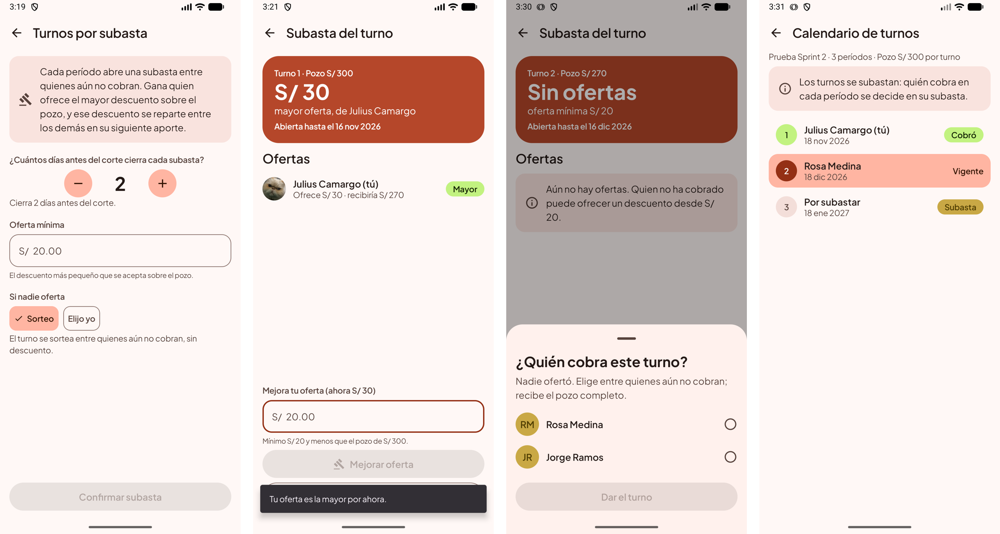{width=100%}

La Figura 161 muestra los cambios de integrantes: el retiro de un integrante antes de iniciar, con la opción de deshacerlo; la deserción de un integrante en una junta en curso; el turno libre ya ocupado por su reemplazo; y el calendario con el botón para intercambiar dos turnos que no empezaron.

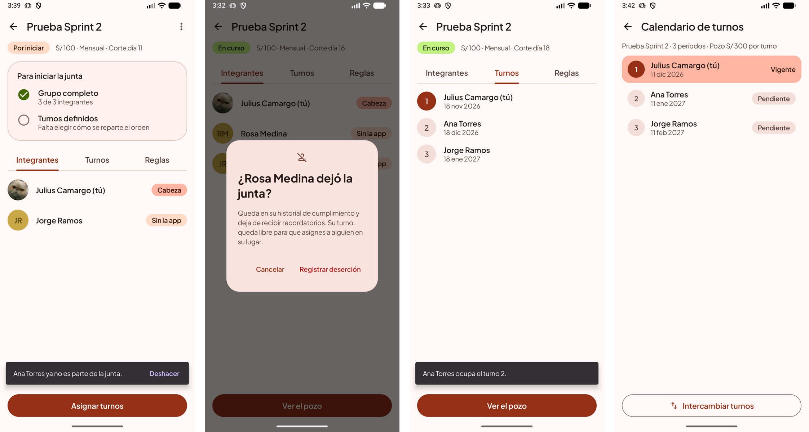{width=100%}

La Figura 162 muestra la entrega del pozo con el descuento de la subasta, la confirmación de la entrega con la transferencia ya adjunta, los períodos anteriores con quién cobró, cuánto y el estado de cada aporte, y la apertura de un nuevo ciclo en una junta cerrada.

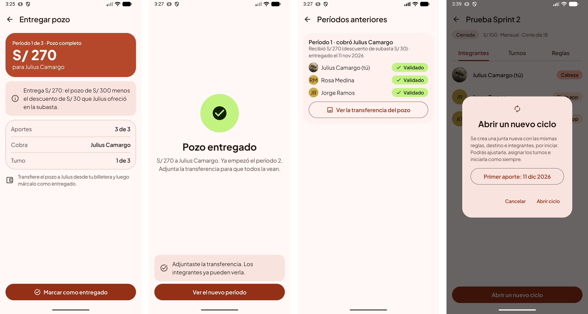{width=100%}

La Figura 163 muestra el registro de un integrante sin la aplicación, el comprobante de un aporte en Mis aportes con el botón para compartirlo y la hoja de compartir con el enlace verificable.

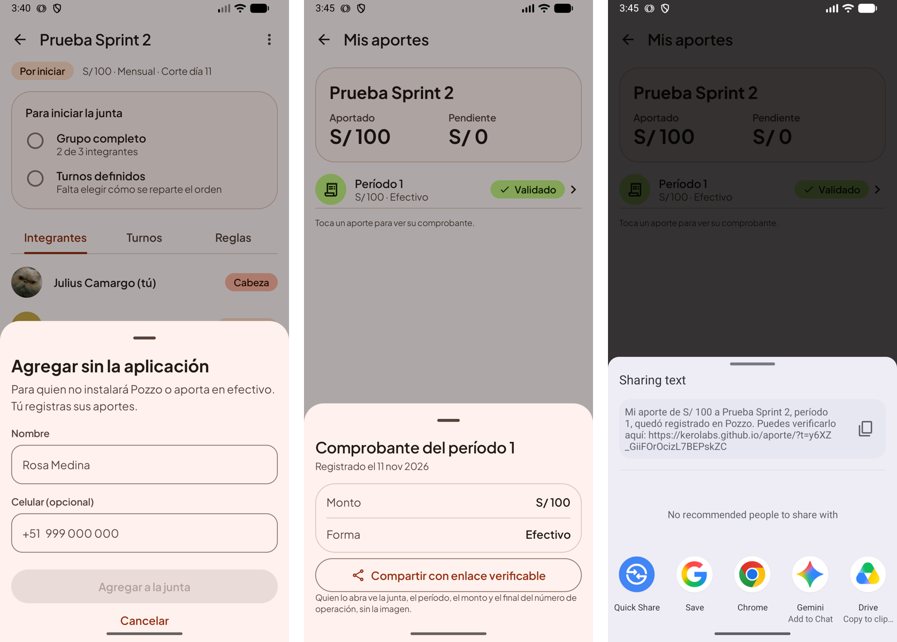{width=75%}

Para complementar la evidencia de ejecución del Sprint 2, se presenta el video explicativo del flujo de navegación y funcionamiento de la aplicación móvil desarrollado para la Sprint Review, disponible en YouTube: <https://youtu.be/YW2H3MOr3kE>.

#### 4.2.2.7. Services Documentation Evidence for Sprint Review

En este Sprint se documentaron con OpenAPI 12 endpoints nuevos, con lo que los servicios suman 66 endpoints en 12 recursos. El recurso nuevo es Auctions, con la subasta de cada período; los demás endpoints se agregaron a recursos que ya existían. La documentación sigue generándose desde el código con springdoc-openapi y está desplegada junto con los servicios: Swagger UI en <https://api-kerolabs.duckdns.org/swagger-ui/index.html> y el documento OpenAPI en <https://api-kerolabs.duckdns.org/v3/api-docs>.

Las rutas parten de `https://api-kerolabs.duckdns.org/api/v1` y requieren el token Bearer, salvo la marcada como pública. La Figura 164 muestra la documentación desplegada con el recurso nuevo Auctions y los endpoints que se sumaron a Periods y Turns.

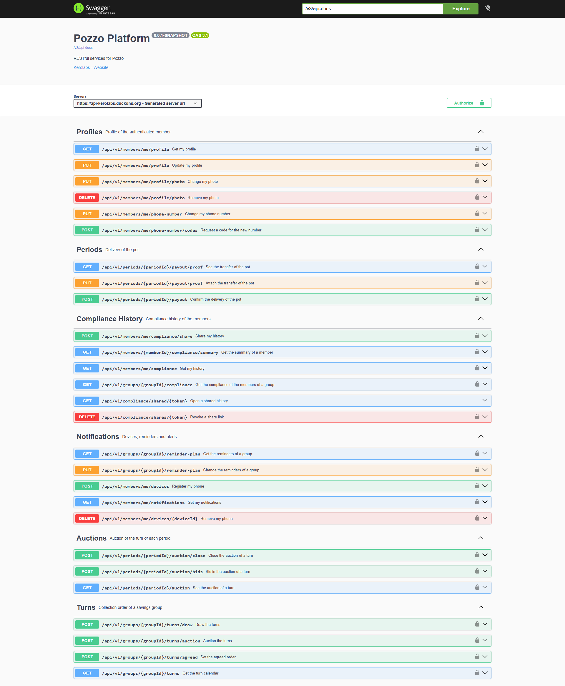{width=85%}

La Tabla 167 presenta los endpoints nuevos con el verbo HTTP, la sintaxis de la llamada, la acción con su enlace a la documentación desplegada, los parámetros y la respuesta exitosa.

<table>
  <caption>Endpoints documentados en el Sprint 2</caption>
  <colgroup><col width="12%"><col width="24%"><col width="20%"><col width="18%"><col width="26%"></colgroup>
  <thead>
    <tr>
      <th>Verbo</th>
      <th>Sintaxis de llamada</th>
      <th>Acción</th>
      <th>Parámetros</th>
      <th>Respuesta</th>
    </tr>
  </thead>
  <tbody>
    <tr>
      <td>POST</td>
      <td>/groups/{groupId}/turns/auction</td>
      <td><a href="https://api-kerolabs.duckdns.org/swagger-ui/index.html#/Turns/auctionTurns">Asignar los turnos por subasta</a></td>
      <td>groupId; cuerpo: closesDaysBeforeCutoff, minimumBid, fallback</td>
      <td><b>200 OK</b>: el calendario con el orden provisional que cada subasta corrige.</td>
    </tr>
    <tr>
      <td>GET</td>
      <td>/periods/{periodId}/auction</td>
      <td><a href="https://api-kerolabs.duckdns.org/swagger-ui/index.html#/Auctions/getAuction">Ver la subasta de un turno</a></td>
      <td>periodId</td>
      <td><b>200 OK</b>: la subasta con su cierre, la oferta mínima, las ofertas de mayor a menor, si quien consulta puede ofertar y, cerrada, el ganador y lo que recibe.</td>
    </tr>
    <tr>
      <td>POST</td>
      <td>/periods/{periodId}/auction/bids</td>
      <td><a href="https://api-kerolabs.duckdns.org/swagger-ui/index.html#/Auctions/placeBid">Ofertar en la subasta de un turno</a></td>
      <td>periodId; cuerpo: amount</td>
      <td><b>200 OK</b>: la subasta con la oferta registrada.</td>
    </tr>
    <tr>
      <td>POST</td>
      <td>/periods/{periodId}/auction/close</td>
      <td><a href="https://api-kerolabs.duckdns.org/swagger-ui/index.html#/Auctions/closeAuction">Cerrar la subasta de un turno</a></td>
      <td>periodId; cuerpo: winnerMembershipId (si nadie ofertó y decide la cabeza)</td>
      <td><b>200 OK</b>: la subasta cerrada con el ganador, el descuento y cómo se resolvió.</td>
    </tr>
    <tr>
      <td>POST</td>
      <td>/cycles/{cycleId}/turns/swap</td>
      <td><a href="https://api-kerolabs.duckdns.org/swagger-ui/index.html#/Cycles/swapTurns">Intercambiar dos turnos</a></td>
      <td>cycleId; cuerpo: firstMembershipId, secondMembershipId</td>
      <td><b>200 OK</b>: el ciclo con los turnos intercambiados.</td>
    </tr>
    <tr>
      <td>PUT</td>
      <td>/periods/{periodId}/payout/proof</td>
      <td><a href="https://api-kerolabs.duckdns.org/swagger-ui/index.html#/Periods/attachPayoutProof">Adjuntar la transferencia del pozo</a></td>
      <td>periodId; cuerpo multipart: image</td>
      <td><b>200 OK</b>: un enlace firmado y temporal a la imagen.</td>
    </tr>
    <tr>
      <td>GET</td>
      <td>/periods/{periodId}/payout/proof</td>
      <td><a href="https://api-kerolabs.duckdns.org/swagger-ui/index.html#/Periods/getPayoutProof">Ver la transferencia del pozo</a></td>
      <td>periodId</td>
      <td><b>200 OK</b>: un enlace firmado y temporal a la imagen.</td>
    </tr>
    <tr>
      <td>POST</td>
      <td>/contributions/{contributionId}/share</td>
      <td><a href="https://api-kerolabs.duckdns.org/swagger-ui/index.html#/Contributions/shareContribution">Compartir un aporte</a></td>
      <td>contributionId</td>
      <td><b>200 OK</b>: el enlace público y verificable del aporte.</td>
    </tr>
    <tr>
      <td>GET</td>
      <td>/contributions/shared/{token}</td>
      <td><a href="https://api-kerolabs.duckdns.org/swagger-ui/index.html#/Contributions/getSharedContribution">Verificar un aporte compartido</a> (pública)</td>
      <td>token</td>
      <td><b>200 OK</b>: la junta, el integrante, el período, el monto y el final del número de operación, sin la imagen del comprobante.</td>
    </tr>
    <tr>
      <td>POST</td>
      <td>/groups/{groupId}/members/{membershipId}/dropout</td>
      <td><a href="https://api-kerolabs.duckdns.org/swagger-ui/index.html#/Memberships/registerDropout">Registrar la deserción de un integrante</a></td>
      <td>groupId, membershipId</td>
      <td><b>200 OK</b>: la membresía marcada como desertora.</td>
    </tr>
    <tr>
      <td>POST</td>
      <td>/groups/{groupId}/members/{membershipId}/replacement</td>
      <td><a href="https://api-kerolabs.duckdns.org/swagger-ui/index.html#/Memberships/replaceMember">Reemplazar a quien desertó</a></td>
      <td>groupId, membershipId; cuerpo: displayName, phoneNumber</td>
      <td><b>201 Created</b>: la membresía del reemplazo, con la cuenta si el celular ya usa Pozzo.</td>
    </tr>
    <tr>
      <td>POST</td>
      <td>/groups/{groupId}/new-cycle</td>
      <td><a href="https://api-kerolabs.duckdns.org/swagger-ui/index.html#/Savings%20Groups/openNewCycle">Abrir un nuevo ciclo con la misma junta</a></td>
      <td>groupId; cuerpo: firstContributionDate</td>
      <td><b>201 Created</b>: la junta nueva, por iniciar, con las mismas reglas e integrantes.</td>
    </tr>
  </tbody>
</table>

#### 4.2.2.8. Software Deployment Evidence for Sprint Review

En el Sprint 2 se desplegaron de nuevo los servicios RESTful y las páginas públicas de los enlaces, y se generó un APK nuevo de la aplicación móvil. Como en el Sprint 1, cada producto se publica desde la rama `main` de su repositorio.

**Servicios RESTful.** El despliegue no cambió de infraestructura: la instancia de Oracle Cloud, el dominio `api-kerolabs.duckdns.org` y el workflow `Deploy`, que compila el jar, lo envía al servidor y espera a que responda antes de dar el despliegue por bueno. El Sprint llegó a `main` en cuatro pull requests de integración. El primero, pozzo-backend#59, llevó las historias del Sprint y se desplegó el 10 de noviembre (<https://github.com/kerolabs/pozzo-backend/actions/runs/42919507445>). El segundo, pozzo-backend#61, llevó la corrección de los escenarios de subasta y se desplegó el mismo día (<https://github.com/kerolabs/pozzo-backend/actions/runs/42938822170>); su commit quedó marcado como la versión `v0.2.0`. Los otros dos llevaron las correcciones que aparecieron al probar la aplicación contra los servicios desplegados y se desplegaron el 11 de noviembre: pozzo-backend#64 como `v0.2.1` (<https://github.com/kerolabs/pozzo-backend/actions/runs/42979252247>) y pozzo-backend#66 como `v0.2.2` (<https://github.com/kerolabs/pozzo-backend/actions/runs/42982329663>), la versión que queda desplegada: <https://github.com/kerolabs/pozzo-backend/tree/v0.2.2>. La Figura 165 muestra las ejecuciones del workflow `Deploy`, con las cuatro del Sprint 2 al inicio de la lista.

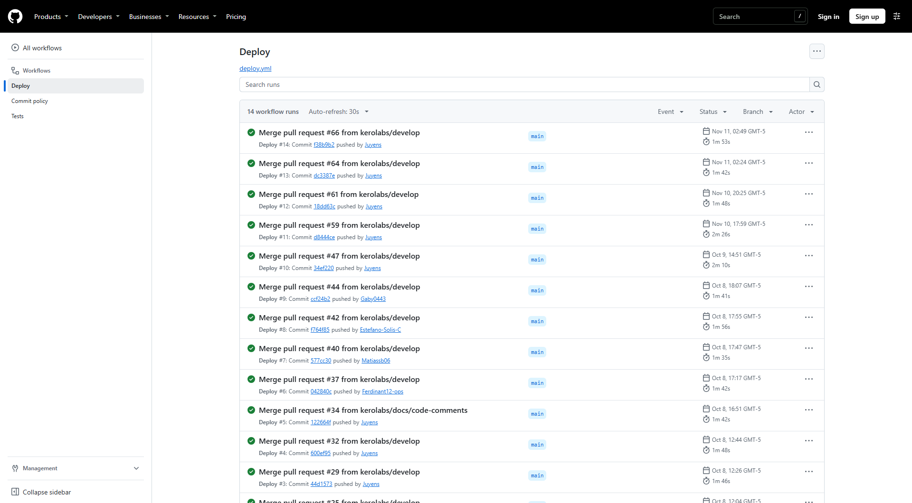{width=90%}

Las columnas y tablas nuevas las creó Hibernate al arrancar, sin variables de entorno nuevas, porque las propiedades agregadas tienen un valor por defecto.

**Páginas públicas de los enlaces.** La página del aporte compartido llegó a `main` de `kerolabs/kerolabs.github.io` en kerolabs.github.io#8 y quedó publicada en <https://kerolabs.github.io/aporte/>, junto a las de invitación e historial.

**Landing Page.** No cambió en este Sprint y sigue publicado en <https://kerolabs.github.io/pozzo-landing-page/>.

**Aplicación móvil.** La aplicación llegó a `main` de `kerolabs/pozzo-mobile` en pozzo-mobile#29 y quedó marcada como la versión `v0.2.0`: <https://github.com/kerolabs/pozzo-mobile/tree/v0.2.0>. No tiene despliegue automático: el APK se genera con la variante `cloudRelease`, que apunta a los servicios desplegados, y se firma con la llave de la aplicación, que se guarda fuera del repositorio. Para este Sprint se generó una llave nueva, por lo que en un celular con el APK del Sprint 1 hay que desinstalar la aplicación antes de instalar la nueva. Este APK es el que se usa en las entrevistas de validación; la distribución con Firebase App Distribution sigue prevista para la entrega final.

#### 4.2.2.9. Team Collaboration Insights during Sprint

Como en el Sprint 1, cada cambio se trabajó en su propia rama, entró a `develop` por pull request con el check `commit-policy` y llegó a `main` en pull requests de integración. La Tabla 168 muestra los commits de cada integrante por repositorio entre el 3 y el 12 de noviembre de 2026, sin contar los merges, y las Figuras 166 y 167 la pestaña Insights de los repositorios de los servicios y de la aplicación en ese período. El landing page no cambió en este Sprint.

<table>
  <caption>Commits de cada integrante por repositorio en el Sprint 2</caption>
  <colgroup><col width="30%"><col width="13%"><col width="13%"><col width="13%"><col width="13%"><col width="18%"></colgroup>
  <thead>
    <tr>
      <th>Integrante</th>
      <th>Landing page</th>
      <th>Páginas de enlaces</th>
      <th>Servicios RESTful</th>
      <th>Aplicación móvil</th>
      <th>Informe</th>
    </tr>
  </thead>
  <tbody>
    <tr>
      <td>Camargo Briceño, Joseph Julius</td>
      <td>0</td>
      <td>1</td>
      <td>17</td>
      <td>1</td>
      <td>9</td>
    </tr>
    <tr>
      <td>Flores Pinchi, Jose Fernando</td>
      <td>0</td>
      <td>0</td>
      <td>0</td>
      <td>4</td>
      <td>6</td>
    </tr>
    <tr>
      <td>Sanchez Benavente, Leonardo Matias</td>
      <td>0</td>
      <td>0</td>
      <td>0</td>
      <td>1</td>
      <td>0</td>
    </tr>
    <tr>
      <td>Solis Campos, Estefano Sebastian</td>
      <td>0</td>
      <td>0</td>
      <td>0</td>
      <td>6</td>
      <td>1</td>
    </tr>
    <tr>
      <td>Tirado Carrera, Gabriela Luciana</td>
      <td>0</td>
      <td>0</td>
      <td>0</td>
      <td>4</td>
      <td>0</td>
    </tr>
  </tbody>
</table>

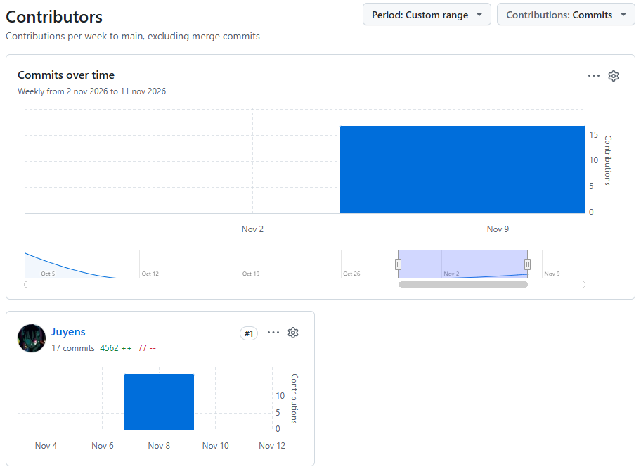{width=65%}

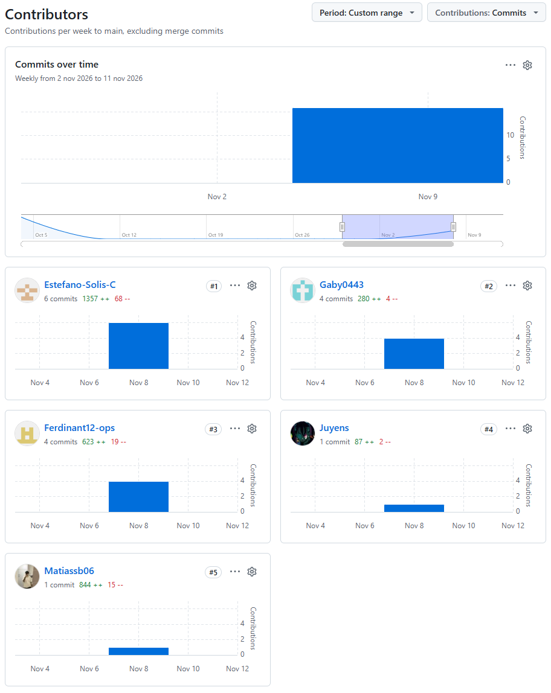{width=65%}

La aplicación móvil repartió su trabajo entre los cinco integrantes, como se propuso al cerrar el Sprint 1: Sanchez y Solis llevaron a `develop` la subasta de turnos, su cierre y el intercambio de turnos; Tirado, el retiro con deshacer, la deserción y el reemplazo; Flores, la entrega del pozo con su transferencia, los períodos anteriores y el nuevo ciclo; y Camargo, el enlace para compartir un aporte. Los servicios RESTful y las páginas de enlaces siguieron a cargo de Camargo, y en el informe participaron Camargo, Flores y Solis. La parte de la propuesta que no se cumplió es repartir también los servicios; para el Sprint 3 se propone que cada integrante implemente en los servicios las historias que lleve en la aplicación, con sus escenarios de aceptación.


## 4.3. Validation Interviews

Las entrevistas del Capítulo II sirvieron para descubrir el problema: cómo se administran hoy las juntas y dónde duele. Estas sirven para lo contrario, comprobar si lo construido en el Sprint 1 resuelve ese dolor. Se entrevista a los mismos dos segmentos, cabezas de junta y participantes, pero ahora con el producto delante: el landing page publicado y la aplicación móvil instalada en un celular Android. La diferencia de método es que el peso no está en lo que la persona dice, sino en lo que hace: cada entrevista incluye tareas que el entrevistado intenta completar sin ayuda mientras el entrevistador observa dónde duda, dónde se equivoca y qué entiende de lo que ve.

### 4.3.1. Diseño de Entrevistas

Antes de iniciar la entrevista se brinda un saludo cordial y una breve presentación del entrevistador, explicando que el propósito de la conversación es probar una aplicación que el equipo construyó para administrar juntas de ahorro. Se aclara que lo que se evalúa es la aplicación y no a la persona, que no hay respuestas correctas ni incorrectas y que, si algo no se entiende, el problema es del diseño. Se aclara también que la información recopilada será utilizada únicamente con fines académicos para el desarrollo del proyecto Pozzo y se mantendrá en estricta confidencialidad, y se solicita autorización para grabar la sesión.

La entrevista dura unos treinta minutos y se realiza de forma presencial o por videollamada compartiendo pantalla. La aplicación corre en un dispositivo Android con la variante `cloud` del APK, apuntando a los servicios desplegados, con datos de prueba cargados de antemano para que el entrevistado encuentre una junta en curso y no tenga que crearla desde cero cuando la tarea no lo pide. El landing page se abre desde el celular del entrevistado, en `kerolabs.github.io`, para reproducir la situación real de quien recibe el enlace por WhatsApp.

La sesión se estructura en cinco momentos: saludo y consentimiento; preguntas de contexto para situar a la persona y su junta actual; las tareas guiadas, que son el centro de la entrevista; las preguntas posteriores, que recogen lo que la persona entendió y lo que le faltó; y el cierre. Durante las tareas el entrevistador no guía ni corrige: solo enuncia la tarea y pide a la persona que piense en voz alta. Si la persona se bloquea más de un minuto, se anota el bloqueo y se da la pista mínima para continuar.

De cada tarea se registran cuatro datos: si la completó sin ayuda, con ayuda o no la completó; cuánto tardó; en qué pantalla dudó; y qué dijo mientras la hacía. La Tabla 169 reúne las tareas de cada segmento, la pantalla en la que ocurren, las historias de usuario que ejercitan, lo que cada una valida y el criterio con el que se considera superada. Entre las dieciséis cubren los nueve epics del Product Backlog.

<table>
  <caption>Tareas de validación por segmento</caption>
  <colgroup><col width="17%"><col width="20%"><col width="12%"><col width="10%"><col width="21%"><col width="20%"></colgroup>
  <thead>
    <tr>
      <th>Segmento</th>
      <th>Tarea</th>
      <th>Pantalla</th>
      <th>Historias</th>
      <th>Qué valida</th>
      <th>Criterio de éxito</th>
    </tr>
  </thead>
  <tbody>
    <tr>
      <td rowspan="8"><b>Cabeza de junta</b></td>
      <td>Crear una junta de S/200 mensuales, con cuatro cupos y corte el día 20</td>
      <td>Crear junta</td>
      <td>US07, US08</td>
      <td>EP02. Que las reglas de la junta se puedan expresar en la aplicación tal como se acuerdan en el grupo</td>
      <td>Completa el formulario sin preguntar qué significa ningún campo</td>
    </tr>
    <tr>
      <td>Conseguir que un integrante se una a esa junta</td>
      <td>Invitación</td>
      <td>US11</td>
      <td>EP03. Que la incorporación por código y enlace reemplace el registro manual</td>
      <td>Comparte el código o el enlace sin buscar una opción de registrar a mano</td>
    </tr>
    <tr>
      <td>Repartir los turnos e iniciar la junta</td>
      <td>Junta por iniciar y Turnos</td>
      <td>US10, US17, US18</td>
      <td>EP04. Que el reparto de turnos de la aplicación cubra el que la persona usa hoy</td>
      <td>Elige un método de reparto e inicia la junta sin ayuda</td>
    </tr>
    <tr>
      <td>Resolver un comprobante cuyo monto no coincide con lo esperado</td>
      <td>Revisar aporte</td>
      <td>US25, US26</td>
      <td>EP05. Que la validación automática reduzca la revisión manual sin quitarle la última palabra a la cabeza</td>
      <td>Identifica cuál es el campo que no coincide y decide aprobar o rechazar</td>
    </tr>
    <tr>
      <td>Decir cuánto falta para completar el pozo y quién no ha aportado</td>
      <td>Estado del pozo</td>
      <td>US29</td>
      <td>EP06. Que el estado del pozo se lea de un vistazo</td>
      <td>Responde ambas cosas en menos de quince segundos, sin abrir otra pantalla</td>
    </tr>
    <tr>
      <td>Averiguar cómo se avisa a quien no ha aportado y cuándo se envía</td>
      <td>Avisos</td>
      <td>US34</td>
      <td>EP07. Que los recordatorios automáticos sustituyan la cobranza por WhatsApp</td>
      <td>Encuentra los recordatorios y enuncia en qué momentos se envían</td>
    </tr>
    <tr>
      <td>Entregar el pozo al integrante del turno y adjuntar el comprobante de la transferencia</td>
      <td>Entregar el pozo</td>
      <td>US36</td>
      <td>EP08. Que la entrega del pozo quede registrada con su evidencia y abra el siguiente turno</td>
      <td>Registra la entrega y adjunta el comprobante sin ayuda</td>
    </tr>
    <tr>
      <td>Cerrar la junta cuando se entrega el último turno</td>
      <td>Cerrar la junta</td>
      <td>US39</td>
      <td>EP08. Que el cierre del ciclo sea una acción evidente y no un estado al que se llega sin querer</td>
      <td>Encuentra cómo cerrar la junta y explica qué pasa después de cerrarla</td>
    </tr>
    <tr>
      <td rowspan="8"><b>Participante</b></td>
      <td>Entrar a Pozzo con su número de celular</td>
      <td>Ingreso</td>
      <td>US01, US02</td>
      <td>EP01. Que el ingreso sin contraseña no genere desconfianza</td>
      <td>Entra sin ayuda y sin buscar dónde crear una contraseña</td>
    </tr>
    <tr>
      <td>Unirse a una junta con el código que le compartieron</td>
      <td>Unirme con un código</td>
      <td>US12, US13</td>
      <td>EP03. Que unirse a una junta no requiera explicación</td>
      <td>Encuentra la opción y entra a la junta al primer intento</td>
    </tr>
    <tr>
      <td>Registrar el aporte del período con su comprobante</td>
      <td>Aportar al pozo</td>
      <td>US23, US24</td>
      <td>EP05. Que el registro del aporte sea más corto que mandar la captura por WhatsApp</td>
      <td>Identifica a quién transferir y sube el comprobante sin ayuda</td>
    </tr>
    <tr>
      <td>Decir cuándo le toca cobrar y cuánto recibirá</td>
      <td>Calendario de turnos</td>
      <td>US22, US30</td>
      <td>EP04 y EP06. Que el turno propio sea evidente sin preguntarle a la cabeza</td>
      <td>Responde ambas cosas señalando la pantalla</td>
    </tr>
    <tr>
      <td>Comprobar si su aporte del período quedó validado</td>
      <td>Historial</td>
      <td>US28</td>
      <td>EP05. Que el participante pueda comprobar por sí mismo que su aporte quedó registrado</td>
      <td>Encuentra el estado de su aporte y distingue validado de pendiente</td>
    </tr>
    <tr>
      <td>Explicar, después de usar la aplicación, dónde queda su dinero</td>
      <td>Aportar al pozo y landing page</td>
      <td>US43</td>
      <td>Riesgo de confianza. Que quede claro que Pozzo no recibe ni retiene el dinero</td>
      <td>Responde que el dinero va directo a la cabeza de junta y no a Pozzo</td>
    </tr>
    <tr>
      <td>Consultar su historial de cumplimiento</td>
      <td>Historial de cumplimiento</td>
      <td>US40</td>
      <td>EP09. Que el historial sea legible sin explicación y describa el comportamiento de pago</td>
      <td>Encuentra su historial y dice qué mide cada cifra</td>
    </tr>
    <tr>
      <td>Demostrar a alguien de fuera de la junta que cumple con sus aportes</td>
      <td>Compartir historial</td>
      <td>US41</td>
      <td>EP09. Que el historial se pueda compartir de forma verificable sin exponer datos de otras juntas</td>
      <td>Genera el enlace y dice qué verá quien lo reciba</td>
    </tr>
  </tbody>
</table>

**Preguntas de contexto (ambos segmentos)**

-   ¿Cuál es su nombre completo?

1. ¿Qué edad tienes, en qué distrito vives y a qué te dedicas?

2. ¿En cuántas juntas estás ahora y qué rol tienes en cada una?

3. ¿Cómo llevan hoy la cuenta de esa junta?

4. ¿Qué celular usas y qué aplicaciones abres todos los días?

**Segmento 1: Cabezas de junta (organizadores)**

1. Cuando viste la primera pantalla, antes de tocar nada, ¿qué entendiste que hace Pozzo?

2. Las palabras aporte, pozo, turno, fecha de corte y cabeza de junta, ¿significan en la aplicación lo mismo que en tu junta?

3. Cuando el comprobante no coincidía, ¿qué miraste para decidir? ¿Qué te faltó para decidir con más seguridad?

4. ¿Aceptarías como bueno un aporte que la aplicación marcó validado, sin revisarlo tú?

5. En tu junta hay gente que no usaría una aplicación. ¿Qué harías con ellos?

6. Si usaras Pozzo en tu junta actual, ¿qué dejarías de hacer a mano y qué te falta para decidirte?

**Segmento 2: Participantes de junta**

1. Cuando viste la primera pantalla, antes de tocar nada, ¿qué entendiste que hace Pozzo?

2. Entrar con tu número y un código, sin contraseña, ¿te dio confianza o desconfianza?

3. Después de subir el comprobante, ¿qué creíste que pasaba con él?

4. Si la aplicación dijera que no pagaste y tú sí lo hiciste, ¿qué harías?

5. ¿Qué parte te pareció más difícil o más confusa?

6. ¿Le pedirías a la cabeza de tu junta que la usen? ¿Por qué sí o por qué no?

Al cerrar se agradece la participación, se pregunta si la persona quiere añadir algo que no se haya tocado y se le pide autorización para volver a contactarla cuando el producto avance.

### 4.3.2. Registro de Entrevistas

**Segmento 1: Cabezas de junta (organizadores)**

- **Primera entrevista**

La Tabla 170 presenta la ficha de la entrevista de validación a Lionel Chávez.

<table>
  <caption>Ficha de la entrevista de validación a Lionel Chávez</caption>
  <colgroup><col width="30%"><col width="70%"></colgroup>
  <thead>
    <tr>
      <th>Campo</th>
      <th>Detalle</th>
    </tr>
  </thead>
  <tbody>
    <tr>
      <td><b>Entrevistado(a)</b></td>
      <td>Lionel Chávez</td>
    </tr>
    <tr>
      <td><b>Género</b></td>
      <td>Masculino</td>
    </tr>
    <tr>
      <td><b>Edad</b></td>
      <td>20</td>
    </tr>
    <tr>
      <td><b>Lugar de residencia</b></td>
      <td>Los Olivos, Lima</td>
    </tr>
    <tr>
      <td><b>Entrevistador(a)</b></td>
      <td>Flores Pinchi, José Fernando</td>
    </tr>
    <tr>
      <td><b>Fecha</b></td>
      <td>12/11/2026</td>
    </tr>
    <tr>
      <td><b>Duración</b></td>
      <td>21:03</td>
    </tr>
    <tr>
      <td><b>Link de la entrevista</b></td>
      <td><a href="https://youtu.be/ZIZLua_E0Ns">https://youtu.be/ZIZLua_E0Ns</a></td>
    </tr>
    <tr>
      <td><b>Resultado de las tareas</b></td>
      <td>Las ocho completadas. Siete sin ayuda: crear la junta, invitar, repartir los turnos e iniciar, resolver el comprobante que no coincidía, leer el estado del pozo, averiguar qué hace la aplicación con quien no ha aportado y cerrar el ciclo. La entrega del pozo se completó al segundo intento: el primero devolvió un error.</td>
    </tr>
    <tr>
      <td><b>Observaciones</b></td>
      <td>Describió la interfaz como «súper intuitiva» y el aviso de que el comprobante no coincide como «muy informativo». Anotó dos fricciones: el inicio de la junta «tarda un poquito» sin indicar nada, y el número de Yape del perfil «podría estar conectado directamente con el número de celular».</td>
    </tr>
  </tbody>
</table>

La Figura 168 muestra la captura de la entrevista a Lionel Chávez.

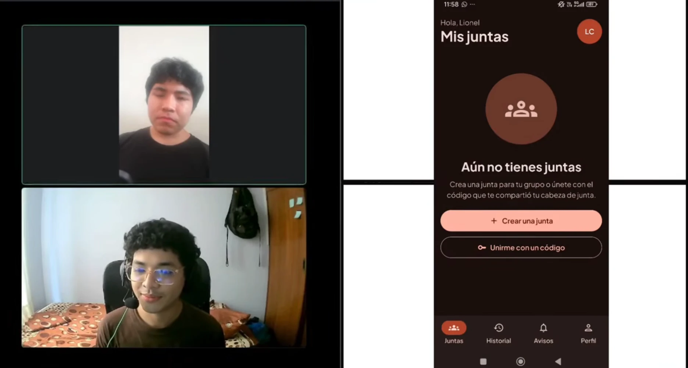{width=90%}

Lionel es el único entrevistado del segmento de cabezas de junta y el único que recorrió el ciclo entero, desde crear la junta hasta cerrarla. Administra la suya con una hoja a mano, que es el escenario que describió el Capítulo II, y completó las ocho tareas sin que el entrevistador interviniera. Dos observaciones suyas se recogen como problemas en la evaluación heurística: el error que devolvió el primer intento de registrar la entrega del pozo y la espera sin indicador al iniciar la junta.

**Segmento 2: Participantes de junta**

- **Primera entrevista**

La Tabla 171 presenta la ficha de la entrevista de validación a Elizabeth Díaz.

<table>
  <caption>Ficha de la entrevista de validación a Elizabeth Díaz</caption>
  <colgroup><col width="30%"><col width="70%"></colgroup>
  <thead>
    <tr>
      <th>Campo</th>
      <th>Detalle</th>
    </tr>
  </thead>
  <tbody>
    <tr>
      <td><b>Entrevistado(a)</b></td>
      <td>Elizabeth Díaz</td>
    </tr>
    <tr>
      <td><b>Género</b></td>
      <td>Femenino</td>
    </tr>
    <tr>
      <td><b>Edad</b></td>
      <td>22</td>
    </tr>
    <tr>
      <td><b>Lugar de residencia</b></td>
      <td>Callao</td>
    </tr>
    <tr>
      <td><b>Entrevistador(a)</b></td>
      <td>Flores Pinchi, José Fernando</td>
    </tr>
    <tr>
      <td><b>Fecha</b></td>
      <td>12/11/2026</td>
    </tr>
    <tr>
      <td><b>Duración</b></td>
      <td>20:15</td>
    </tr>
    <tr>
      <td><b>Link de la entrevista</b></td>
      <td><a href="https://youtu.be/T-7__YjW3yU">https://youtu.be/T-7__YjW3yU</a></td>
    </tr>
    <tr>
      <td><b>Resultado de las tareas</b></td>
      <td>Las ocho completadas sin ayuda: entrar con el código de invitación, unirse a la junta, registrar el aporte, leer el calendario de turnos, comprobar que su aporte quedó validado, explicar dónde queda su dinero, consultar su historial de cumplimiento y compartirlo.</td>
    </tr>
    <tr>
      <td><b>Observaciones</b></td>
      <td>Ya participó en las entrevistas del Capítulo II. Describió la aplicación como «todo muy sencillo y bastante intuitivo» y el ingreso sin contraseña como «un poco más seguro tal vez que una contraseña». Corrigió a mano los campos que la aplicación leyó del comprobante y preguntó por iniciativa propia cómo se comprueba «que sea el mismo monto que tú mandas y el mismo monto que estás escribiendo».</td>
    </tr>
  </tbody>
</table>

La Figura 169 muestra la captura de la entrevista a Elizabeth Díaz.

{width=90%}

Elizabeth completó las ocho tareas sin ayuda y sin preguntar una sola vez dónde tocar. Lo relevante de su sesión no está en lo que le costó, sino en lo que preguntó al final: si los campos que la aplicación lee del comprobante se pueden corregir a mano, qué impide que alguien escriba un monto que el comprobante no dice. La pregunta la planteó ella, sin que se le sugiriera, y es la que origina el problema de mayor severidad que añadió esta ronda de entrevistas.

- **Segunda entrevista**

La Tabla 172 presenta la ficha de la entrevista de validación a Mariana López.

<table>
  <caption>Ficha de la entrevista de validación a Mariana López</caption>
  <colgroup><col width="30%"><col width="70%"></colgroup>
  <thead>
    <tr>
      <th>Campo</th>
      <th>Detalle</th>
    </tr>
  </thead>
  <tbody>
    <tr>
      <td><b>Entrevistado(a)</b></td>
      <td>Mariana López</td>
    </tr>
    <tr>
      <td><b>Género</b></td>
      <td>Femenino</td>
    </tr>
    <tr>
      <td><b>Edad</b></td>
      <td>35</td>
    </tr>
    <tr>
      <td><b>Lugar de residencia</b></td>
      <td>San Juan de Lurigancho, Lima</td>
    </tr>
    <tr>
      <td><b>Entrevistador(a)</b></td>
      <td>Flores Pinchi, José Fernando</td>
    </tr>
    <tr>
      <td><b>Fecha</b></td>
      <td>12/11/2026</td>
    </tr>
    <tr>
      <td><b>Duración</b></td>
      <td>13:17</td>
    </tr>
    <tr>
      <td><b>Link de la entrevista</b></td>
      <td><a href="https://youtu.be/E_9QCZduGvk">https://youtu.be/E_9QCZduGvk</a></td>
    </tr>
    <tr>
      <td><b>Resultado de las tareas</b></td>
      <td>Las ocho completadas sin ayuda. Para el calendario de turnos abrió el menú de los tres puntos de la junta; el resto lo resolvió desde la pantalla en la que estaba.</td>
    </tr>
    <tr>
      <td><b>Observaciones</b></td>
      <td>Ya participó en las entrevistas del Capítulo II. Fue la única que echó en falta más seguridad en el ingreso: «sería mejor usar un PIN, o los dos pasos de verificación». No esperaba que la aplicación leyera el comprobante: «no pensaba que lo iba a leer; que lo lea me llena más de seguridad». Corrigió a mano los campos que no coincidían.</td>
    </tr>
  </tbody>
</table>

La Figura 170 muestra la captura de la entrevista a Mariana López.

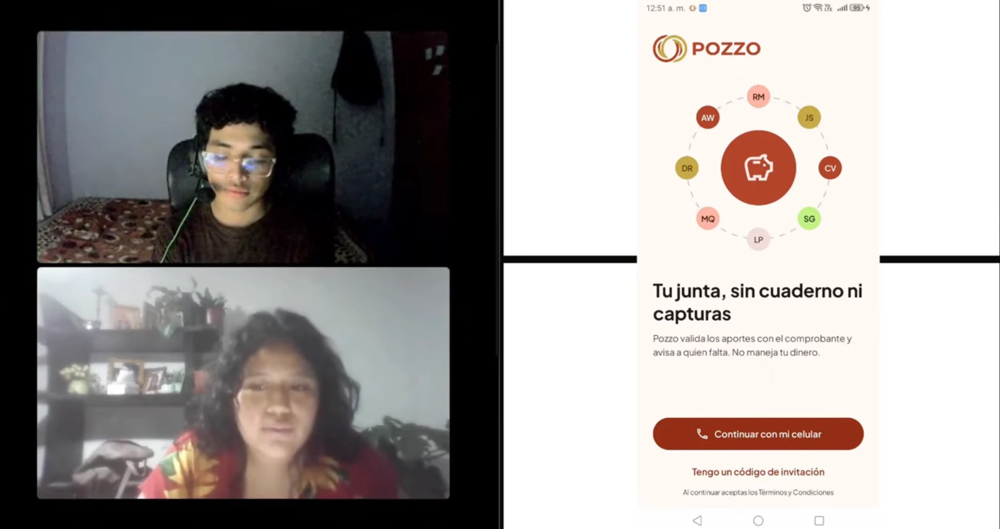{width=90%}

Mariana completó las ocho tareas sin ayuda. Su sesión aporta el contraste sobre el ingreso sin contraseña: donde Elizabeth lo vio más seguro que una contraseña, Mariana esperaba un PIN o una verificación en dos pasos. Las dos reacciones son legítimas, y la diferencia sugiere que la pantalla de ingreso no explica que el código SMS ya cumple esa función. También fue quien expresó con más claridad el valor de la lectura automática del comprobante, que no esperaba.

### 4.3.3. Evaluaciones según heurísticas

El equipo realizó una evaluación heurística del producto construido. Es una inspección hecha por el propio equipo, sin usuarios, en la que cada integrante recorre las tareas de la Tabla 169 buscando dónde la interfaz incumple un principio de usabilidad. No sustituye a las entrevistas, porque un equipo no puede sorprenderse con su propio producto, pero encuentra antes los problemas que no hace falta un usuario para detectar. Los hallazgos se contrastaron con las diez heurísticas de Nielsen [@nielsen1994heuristics], las mismas con las que se justificaron los principios de diseño del Capítulo III. La Tabla 173 presenta la cabecera de la evaluación.

<table>
  <caption>Cabecera de la evaluación heurística</caption>
  <colgroup><col width="28%"><col width="72%"></colgroup>
  <thead>
    <tr>
      <th>Campo</th>
      <th>Detalle</th>
    </tr>
  </thead>
  <tbody>
    <tr>
      <td><b>Universidad</b></td>
      <td>Universidad Peruana de Ciencias Aplicadas</td>
    </tr>
    <tr>
      <td><b>Carrera</b></td>
      <td>Ingeniería de Software</td>
    </tr>
    <tr>
      <td><b>Curso</b></td>
      <td>1ACC0238, Aplicaciones a Dispositivos Móviles. NRC 13980</td>
    </tr>
    <tr>
      <td><b>Docente</b></td>
      <td>Mayta Guillermo, Jorge Luis</td>
    </tr>
    <tr>
      <td><b>Equipo y producto</b></td>
      <td>Kerolabs. Pozzo</td>
    </tr>
    <tr>
      <td><b>Auditores</b></td>
      <td>Camargo Briceño, Joseph Julius; Flores Pinchi, José Fernando; Sanchez Benavente, Leonardo Matias; Solis Campos, Estefano Sebastian; Tirado Carrera, Gabriela Luciana</td>
    </tr>
    <tr>
      <td><b>Productos evaluados</b></td>
      <td>Aplicación móvil Android, variante <code>cloud</code> con lo construido en los Sprints 1 y 2, y landing page publicado en <code>kerolabs.github.io</code></td>
    </tr>
    <tr>
      <td><b>Alcance</b></td>
      <td>Las dieciséis tareas de la Tabla 169, que cubren el ingreso, la creación de la junta, la invitación, el reparto de turnos, el registro y la revisión del aporte, el estado del pozo, el calendario de turnos, el historial, los avisos, la entrega del pozo, el cierre del ciclo y el historial de cumplimiento. Quedan fuera la subasta del turno y la deserción de un integrante, que el Sprint 1 dejó para el siguiente por no tener endpoint en los servicios</td>
    </tr>
    <tr>
      <td><b>Fecha</b></td>
      <td>10 de noviembre de 2026</td>
    </tr>
  </tbody>
</table>

Cada problema se puntúa con la escala de severidad de Nielsen, que combina la frecuencia con la que ocurre, el impacto que tiene cuando ocurre y la persistencia con la que vuelve a aparecer. La Tabla 174 presenta la escala y lo que significa cada grado para este producto.

<table>
  <caption>Escala de severidad de los problemas de usabilidad</caption>
  <colgroup><col width="12%"><col width="28%"><col width="60%"></colgroup>
  <thead>
    <tr>
      <th>Grado</th>
      <th>Nombre</th>
      <th>Qué significa</th>
    </tr>
  </thead>
  <tbody>
    <tr>
      <td>0</td>
      <td>No es un problema</td>
      <td>El equipo discrepa sobre si es un problema; no se corrige</td>
    </tr>
    <tr>
      <td>1</td>
      <td>Cosmético</td>
      <td>Solo se corrige si sobra tiempo en el Sprint</td>
    </tr>
    <tr>
      <td>2</td>
      <td>Menor</td>
      <td>La persona completa la tarea, pero pierde tiempo o duda. Prioridad baja</td>
    </tr>
    <tr>
      <td>3</td>
      <td>Mayor</td>
      <td>La persona no completa la tarea o la completa mal. Prioridad alta en el Sprint 2</td>
    </tr>
    <tr>
      <td>4</td>
      <td>Catastrófico</td>
      <td>Impide usar el producto o pone en riesgo el dinero o la confianza del grupo. Se corrige antes de cualquier prueba con usuarios</td>
    </tr>
  </tbody>
</table>

La inspección del equipo encontró nueve problemas y las tres entrevistas de validación añadieron cuatro más, ninguno catastrófico. La Tabla 175 recoge los trece ordenados por severidad, con la heurística que incumplen, la pantalla donde aparecen, el origen del hallazgo y la corrección propuesta. Las pantallas referidas son las de las Figuras 146, 147 y 148 para la aplicación móvil y la Figura 155 para el landing page.

<table>
  <caption>Problemas encontrados en la evaluación heurística</caption>
  <colgroup><col width="4%"><col width="25%"><col width="11%"><col width="16%"><col width="7%"><col width="9%"><col width="28%"></colgroup>
  <thead>
    <tr>
      <th>N.º</th>
      <th>Problema</th>
      <th>Pantalla</th>
      <th>Heurística incumplida</th>
      <th>Severidad</th>
      <th>Origen</th>
      <th>Corrección propuesta</th>
    </tr>
  </thead>
  <tbody>
    <tr>
      <td>1</td>
      <td>En «Revisar aporte» la acción con más peso visual es «Aprobar igual», sobre un aporte que el propio sistema acaba de marcar como no coincidente. «Rechazar» queda como acción secundaria</td>
      <td>Revisar aporte</td>
      <td>Error prevention</td>
      <td>3</td>
      <td>Inspección</td>
      <td>Igualar el peso de ambas acciones y pedir una confirmación corta al aprobar un aporte con diferencias</td>
    </tr>
    <tr>
      <td>2</td>
      <td>La decisión de aprobar o rechazar un comprobante no ofrece una vía visible para deshacerse. Si la cabeza se equivoca, la pantalla no dice qué hacer</td>
      <td>Revisar aporte</td>
      <td>User control and freedom</td>
      <td>3</td>
      <td>Inspección</td>
      <td>Permitir revertir la decisión mientras el período siga abierto y dejar constancia del cambio en el historial</td>
    </tr>
    <tr>
      <td>3</td>
      <td>Los datos que la aplicación lee del comprobante se pueden reescribir a mano antes de registrar el aporte. Las dos participantes corrigieron el monto y el destinatario hasta que coincidieron, y una preguntó por iniciativa propia qué impide escribir un monto que el comprobante no dice</td>
      <td>Aportar al pozo</td>
      <td>Error prevention</td>
      <td>3</td>
      <td>Entrevista</td>
      <td>Dejar como solo lectura lo que la aplicación leyó y, si la persona necesita corregirlo, marcar el aporte como corregido a mano para que la cabeza lo revise</td>
    </tr>
    <tr>
      <td>4</td>
      <td>El primer intento de registrar la entrega del pozo devolvió un error sin explicar qué había fallado. El segundo intento, idéntico, funcionó</td>
      <td>Entregar el pozo</td>
      <td>Help users recognize, diagnose, and recover from errors</td>
      <td>3</td>
      <td>Entrevista</td>
      <td>Decir en el mensaje qué falló y si la entrega quedó registrada, y reintentar sin que la cabeza tenga que repetir la acción a ciegas</td>
    </tr>
    <tr>
      <td>5</td>
      <td>La lista «Para iniciar la junta» muestra dos requisitos, grupo completo y turnos definidos, pero el inicio valida además el destino de los aportes. Si falta el destino, la cabeza no se entera por la lista</td>
      <td>Junta por iniciar</td>
      <td>Visibility of system status</td>
      <td>2</td>
      <td>Inspección</td>
      <td>Mostrar el destino de los aportes como tercer requisito de la lista, con su estado, igual que los otros dos</td>
    </tr>
    <tr>
      <td>6</td>
      <td>La leyenda de estados del historial se corta en el borde derecho de la pantalla: el último estado no llega a leerse, de modo que un icono de la cuadrícula queda sin explicación</td>
      <td>Historial</td>
      <td>Recognition rather than recall</td>
      <td>2</td>
      <td>Inspección</td>
      <td>Repartir la leyenda en dos filas o permitir que se desplace, de modo que todos los estados se lean en pantallas de 360 px</td>
    </tr>
    <tr>
      <td>7</td>
      <td>El estado «En revisión» de un aporte no indica a quién le toca actuar ni desde cuándo está así. El participante no sabe si debe esperar o volver a registrar</td>
      <td>Estado del pozo</td>
      <td>Visibility of system status</td>
      <td>2</td>
      <td>Inspección</td>
      <td>Añadir al estado quién lo tiene que revisar y desde qué fecha, como ya se hace con la fecha de corte</td>
    </tr>
    <tr>
      <td>8</td>
      <td>En la lista de avisos, los que piden una acción («Comprobante por revisar») tienen el mismo peso visual que los informativos («Nuevo integrante»), y todos llevan el mismo punto de no leído</td>
      <td>Avisos</td>
      <td>Aesthetic and minimalist design</td>
      <td>2</td>
      <td>Inspección</td>
      <td>Separar los avisos que piden acción, con una llamada a la acción propia, de los que solo informan</td>
    </tr>
    <tr>
      <td>9</td>
      <td>Iniciar la junta tarda varios segundos sin que la pantalla muestre que está trabajando. La cabeza entrevistada esperó sin saber si la acción se había registrado</td>
      <td>Junta por iniciar</td>
      <td>Visibility of system status</td>
      <td>2</td>
      <td>Entrevista</td>
      <td>Mostrar el progreso mientras se inicia la junta y bloquear el botón hasta que termine</td>
    </tr>
    <tr>
      <td>10</td>
      <td>La tarjeta de la lista de juntas dice «Faltan integrantes para iniciar» sin decir cuántos, mientras que el detalle de la junta sí muestra «2 de 6 integrantes»</td>
      <td>Mis juntas</td>
      <td>Visibility of system status</td>
      <td>1</td>
      <td>Inspección</td>
      <td>Mostrar en la tarjeta el mismo conteo que el detalle</td>
    </tr>
    <tr>
      <td>11</td>
      <td>El campo del número de celular no indica el formato esperado ni cuántos dígitos tiene; el texto de ayuda explica para qué se usa el número, pero no cómo escribirlo</td>
      <td>Ingreso</td>
      <td>Help users recognize, diagnose, and recover from errors</td>
      <td>1</td>
      <td>Inspección</td>
      <td>Indicar los nueve dígitos esperados y validar la longitud antes de habilitar «Enviar código»</td>
    </tr>
    <tr>
      <td>12</td>
      <td>En el landing page, el conmutador de tema visual es un icono sin etiqueta ni texto alternativo visible, junto a un conmutador de idioma que sí está etiquetado</td>
      <td>Landing page</td>
      <td>Consistency and standards</td>
      <td>1</td>
      <td>Inspección</td>
      <td>Etiquetar el conmutador de tema igual que el de idioma, o añadirle una etiqueta accesible</td>
    </tr>
    <tr>
      <td>13</td>
      <td>El número de Yape o Plin del perfil se pide como un dato aparte del número de celular con el que se entra, y la cabeza entrevistada esperaba que fueran el mismo</td>
      <td>Perfil</td>
      <td>Match between system and the real world</td>
      <td>1</td>
      <td>Entrevista</td>
      <td>Proponer por defecto el número de celular de la cuenta como destino de los aportes, y dejar cambiarlo</td>
    </tr>
  </tbody>
</table>

Cuatro de los trece problemas son de severidad mayor y los cuatro están en el recorrido del dinero: las dos decisiones de la pantalla de revisión, que no se pueden deshacer y cuya acción de aprobar pesa más que la de rechazar; la posibilidad de reescribir a mano lo que la aplicación leyó del comprobante; y el error que devolvió el primer intento de registrar la entrega del pozo. Los cuatro entran al Sprint Backlog del Sprint 3, porque son los puntos donde una persona podría equivocarse con consecuencias sobre el dinero del grupo. Los nueve restantes, de severidad menor y cosmética, se atienden junto a las historias del bounded context al que pertenecen.

Las entrevistas confirmaron además tres decisiones del Capítulo III. El lenguaje de la interfaz usa los términos del Ubiquitous Language: preguntado por si aporte, pozo, turno y fecha de corte significan en la aplicación lo mismo que en su junta, el entrevistado del primer segmento respondió que son los términos que el grupo ya usa. El aviso de que Pozzo no recibe ni retiene el dinero se entendió: las tres personas respondieron sin dudar que el dinero va a la cuenta de quien cobra el turno. Y las veinticuatro tareas de las tres sesiones se completaron, veintitrés de ellas sin ayuda del entrevistador.

Un punto quedó dividido y no se recoge como problema porque las dos reacciones fueron legítimas: el ingreso sin contraseña. Una participante lo consideró más seguro que una contraseña, porque el código llega solo a su celular; otra esperaba un PIN o una verificación en dos pasos. La diferencia sugiere que la pantalla de ingreso no explica que el código SMS ya cumple la función de segundo factor.

<!-- pdf:desde-fin -->
